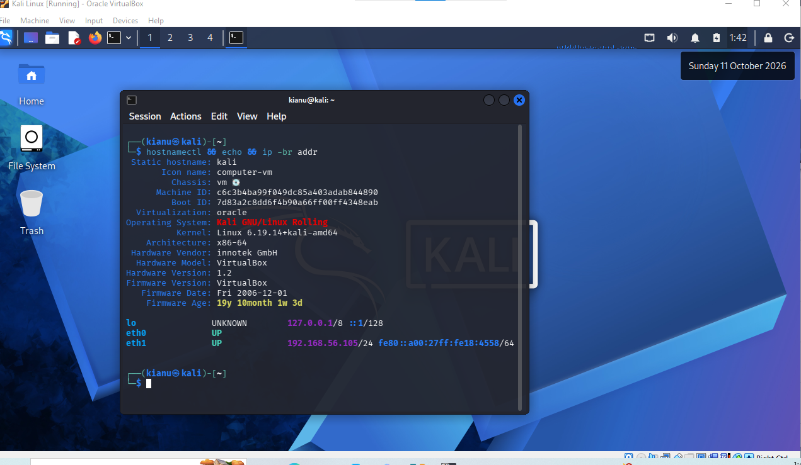
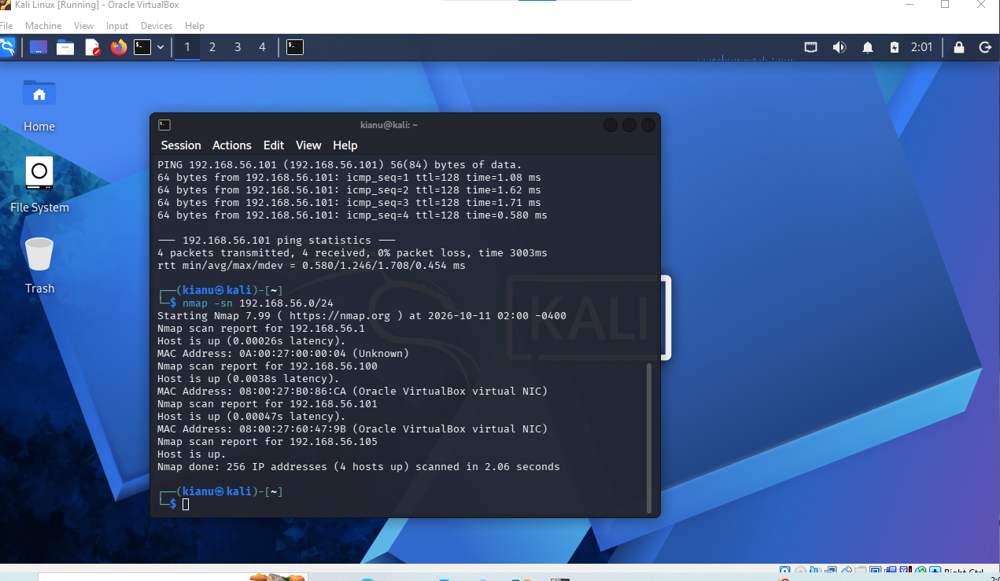
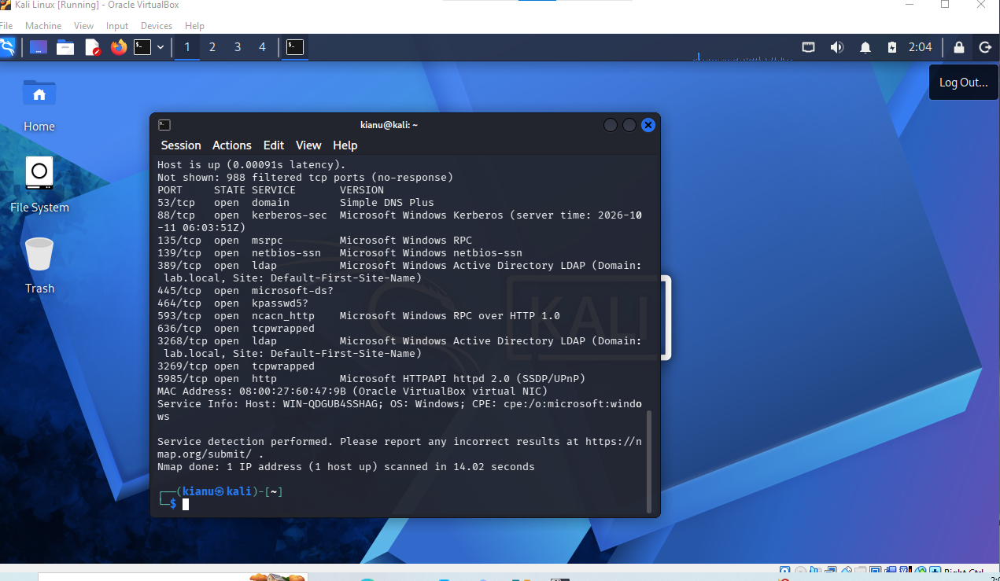
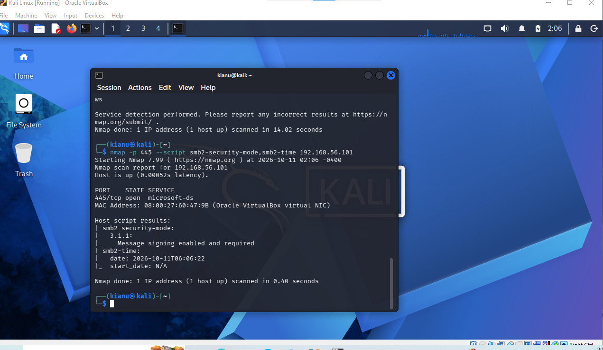
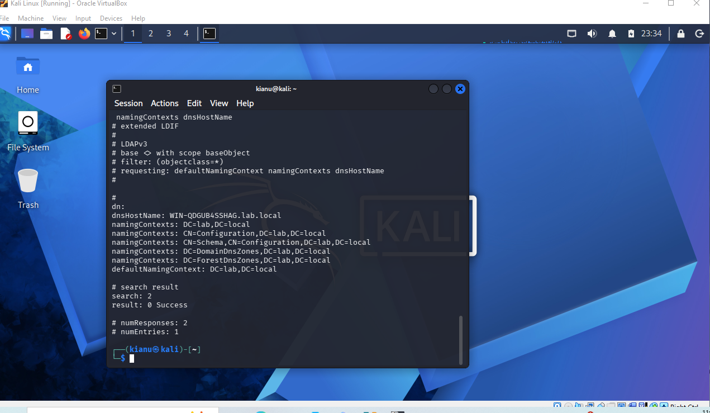
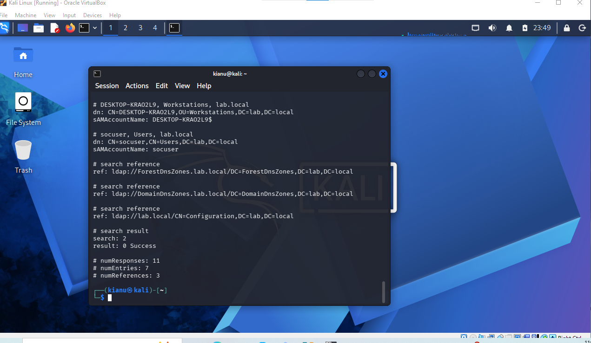
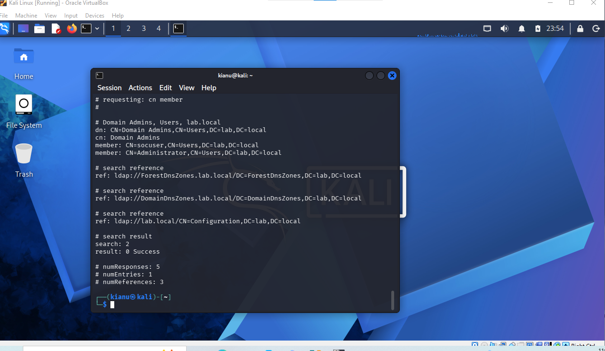
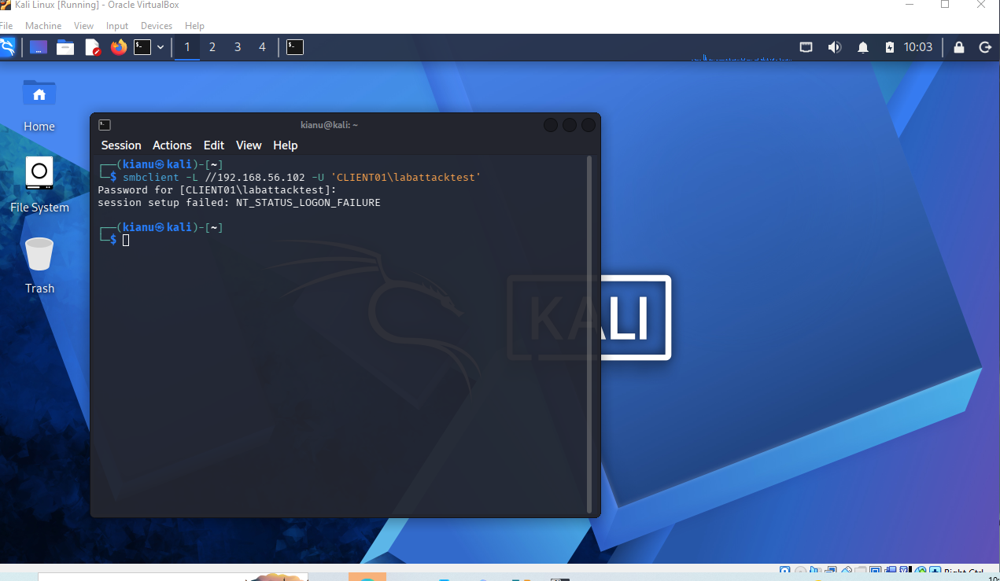
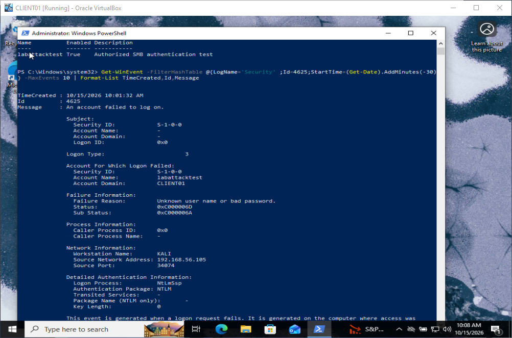
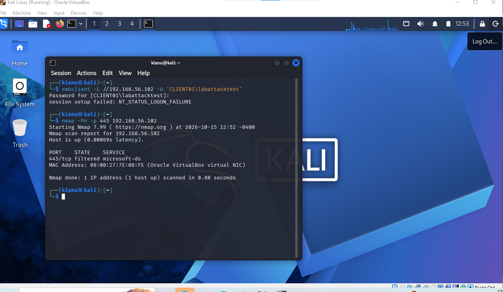

# Kali Linux Security Assessment & Defensive Investigation Lab

> **End-to-end, evidence-backed Active Directory assessment:** Kali Linux reconnaissance → service and identity enumeration → controlled authentication test → Windows event correlation → SMB exposure retest.


**Jump to:** [Key results](#key-results) · [Lab environment](#lab-environment) · [Investigation walkthrough](#investigation-walkthrough) · [Evidence index](#evidence-index) · [Reports](#reports-and-study-materials) · [Limitations](#evidence-standards-and-limitations)

## Executive Summary

I built a Kali Linux workstation inside a controlled VirtualBox Active Directory environment and performed a sequence of network and identity-security investigations. The assessment progressed from **host discovery and DC02 service fingerprinting** through **SMB signing validation and LDAP identity enumeration**, followed by a **single intentional SMB authentication failure**, correlation to **Windows Security Event 4625**, and a **post-hardening TCP/445 retest**.

The primary outcome is a reproducible analyst workflow connecting an assessment workstation to Windows-side telemetry and validation—not a claim of exploitation. Ten original screenshots document the observed results.

## Key Results

| Area | Verified observation | Analyst interpretation |
|---|---|---|
| Network discovery | `nmap -sn 192.168.56.0/24` reported **4 hosts up** | Established the visible host-only lab footprint |
| DC02 exposure | 12 open TCP services, including DNS, Kerberos, LDAP, SMB and WinRM | Expected AD service surface; access controls still warrant review |
| SMB security | SMB 3.1.1 **message signing enabled and required** | Positive hardening control on DC02 |
| LDAP directory | RootDSE naming contexts; authenticated account and group enumeration | Directory visibility; no demonstrated privilege escalation |
| Privileged membership | `Domain Admins` query returned `socuser` and `Administrator` | Review whether `socuser` needs that privilege; authorization not established |
| Controlled login | Kali `smbclient` returned `NT_STATUS_LOGON_FAILURE` | Expected unsuccessful test, not compromise |
| Defender-side telemetry | CLIENT01 Event **4625**, Type **3**, source `192.168.56.105` | Independent Windows log corroboration |
| Post-change retest | TCP/445 on CLIENT01 reported **filtered** | Consistent with traffic filtering; exact rule not independently verified |

## Lab Environment

```text
              Isolated VirtualBox host-only network
                         192.168.56.0/24

   Kali Linux                 DC02                    CLIENT01
   192.168.56.105             192.168.56.101          192.168.56.102
   Nmap / LDAP / SMB    --->  AD DS / DNS / SMB       Windows 10
         |                                              ^
         +------ Controlled SMB failure ----------------+
         +------ TCP/445 post-change probe ------------+
                           Windows Event 4625
```

Domain: `lab.local`. The DC02 service scan identifies hostname `WIN-QDGUB4SSHAG`. Kali's `eth1` was UP with `192.168.56.105/24`. See [topology, scope and evidence boundaries](docs/lab-topology-and-scope.md).

## Investigation Walkthrough

### 01 — Establish the assessment workstation


Confirmed Kali Rolling in VirtualBox and the host-only IP using `hostnamectl` and `ip -br addr`. This matters because an incorrect source interface or network segment can invalidate discovery conclusions.

### 02 — Discover hosts and validate reachability


Four ICMP replies from DC02 with **0% loss**; Nmap 7.99 reported **four responsive hosts** on the /24 subnet. Host discovery is not vulnerability scanning.

### 03 — Enumerate DC02's network service surface


Observed open TCP ports `53, 88, 135, 139, 389, 445, 464, 593, 636, 3268, 3269, 5985`; **988 filtered** in the displayed default scan. This is a domain-controller service baseline, not proof of exploitable weaknesses.

### 04 — Validate SMB signing posture


Ran `nmap -p 445 --script smb2-security-mode,smb2-time 192.168.56.101`. The result for SMB **3.1.1** stated **message signing enabled and required**. Signing reduces certain tampering and relay risks but does not eliminate all SMB threats.

### 05 — Inspect LDAP RootDSE and directory partitions


A base-object LDAP query returned `dnsHostName` and naming contexts, including `DC=lab,DC=local`, with `result: 0 Success`. RootDSE information should not be confused with unrestricted anonymous directory access.

### 06 — Review authenticated directory identities


LDAP output included `socuser` and a workstation account. This demonstrates that the captured authenticated query returned directory objects; it does not prove access to every identity.

### 07 — Review privileged group membership


A `Domain Admins` membership query returned `socuser` and `Administrator`. The security question is whether that membership is authorized and necessary—not whether enumeration itself constitutes compromise.

### 08 — Generate one controlled SMB authentication failure


A deliberately unsuccessful `smbclient` attempt from Kali to CLIENT01 (`192.168.56.102`) returned `NT_STATUS_LOGON_FAILURE`.

### 09 — Correlate with Windows Security Event 4625


CLIENT01 recorded a **network logon failure (Type 3)** for `labattacktest`, from workstation `KALI` / source `192.168.56.105`, using NTLM. The event shows `0xC000006D` with substatus `0xC000006A`. A single controlled failure is not a brute-force attack.

### 10 — Verify the post-hardening SMB exposure


The follow-up `nmap -Pn -p 445 192.168.56.102` returned **`445/tcp filtered`**. This confirms the observed scan state from Kali, but the underlying firewall rule and approved-source access still require independent verification.

## Reports and Study Materials

| Document | Purpose |
|---|---|
| [IR-001 — Failed SMB authentication and firewall retest](reports/IR-001-smb-authentication-and-hardening.md) | Investigation timeline, 4625 fields, correlation logic, retest, limitations |
| [ASSESSMENT-001 — DC02 exposure and identity review](reports/ASSESSMENT-001-ad-exposure-and-identity-review.md) | Port/service baseline, SMB signing, LDAP, privileged group review |
| [Command reference](commands/assessment-command-reference.md) | Reproducible commands, observed results, and commands reconstructed as examples |
| [Lab topology and scope](docs/lab-topology-and-scope.md) | Assets, network diagram, boundaries, and evidence handling |
| [Study notes and interview review](docs/study-notes-and-interview-review.md) | Concepts, quick-reference commands, self-test questions, future exercises |

## Evidence Index

| # | Original screenshot |
|---|---|
| 01 | [Kali workstation baseline](screenshots/01-Kali-Attacker-Workstation-Baseline.png) |
| 02 | [Nmap host discovery](screenshots/02-Nmap-Host-Discovery.png) |
| 03 | [DC02 service enumeration](screenshots/03-DC02-Service-Enumeration.png) |
| 04 | [SMB security mode](screenshots/04-DC02-SMB-Security-Mode.png) |
| 05 | [LDAP RootDSE enumeration](screenshots/05-Active-Directory-LDAP-Enumeration.png) |
| 06 | [Authenticated directory enumeration](screenshots/06-Authenticated-AD-User-Enumeration.png) |
| 07 | [Domain Admins membership](screenshots/07-Privileged-Group-Enumeration.png) |
| 08 | [Controlled SMB authentication failure](screenshots/08-Controlled-SMB-Authentication-Failure.png) |
| 09 | [Windows Event 4625 investigation](screenshots/09-Windows-Event-4625-Investigation.png) |
| 10 | [SMB firewall-hardening retest](screenshots/10-SMB-Firewall-Hardening-Retest.png) |

## Evidence Standards and Limitations

- **Observed** findings come from the ten original screenshots; raw Nmap XML, LDAP LDIF, EVTX exports, and a Kali PCAP have not been provided.
- **Authenticated LDAP enumeration is not privilege escalation.** `socuser` membership in `Domain Admins` requires an authorization review, not an assumption of compromise.
- **A filtered port does not prove a particular firewall rule.** Export the effective rules and test intended allow/deny paths for stronger verification.
- The service scan is **not** a comprehensive vulnerability assessment or a complete TCP/UDP scan.
- The screenshots span different lab sessions. Avoid inferring a single continuous timeline where timestamps do not establish one.
- All activity was performed in a controlled lab; no production incident or successful exploit is claimed.

**Analyst takeaway:** Strong security work connects source-side actions, target-side evidence, configuration posture, and a clearly bounded conclusion. This repository demonstrates that workflow and identifies exactly what evidence would strengthen the next iteration.
