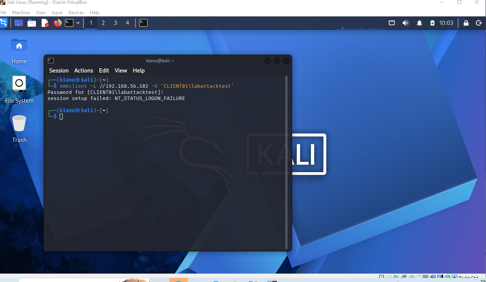
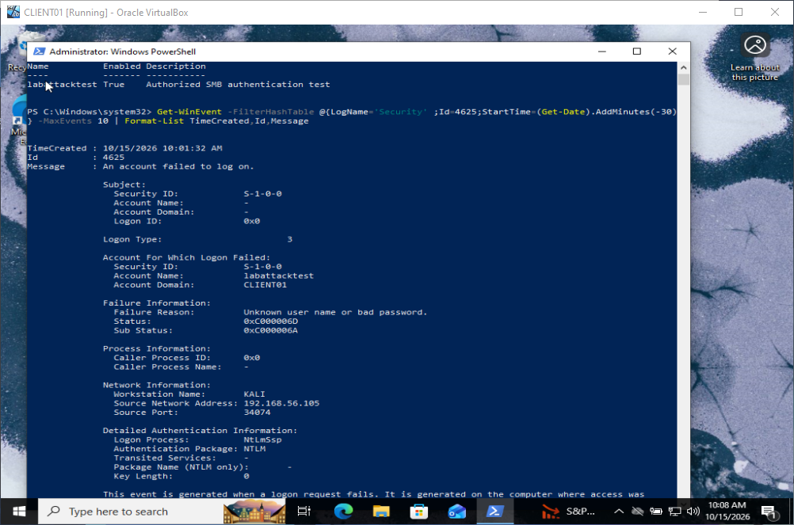
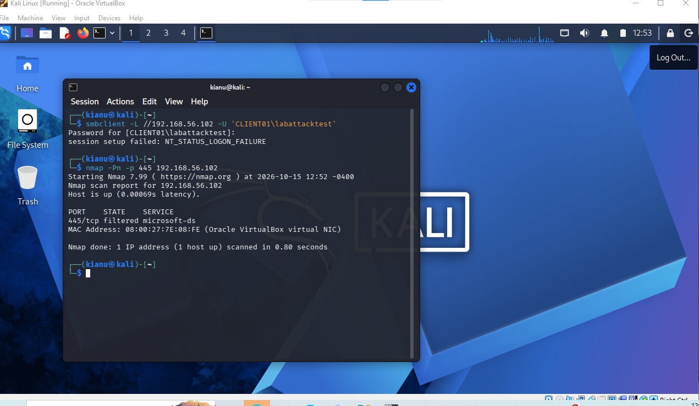

# IR-001 — Controlled SMB Authentication Failure & Firewall Retest

## Project at a Glance — Plain-English Summary

**What this project is:** A test computer deliberately attempted an incorrect Windows file-sharing login. The Windows machine recorded the failure, and a later network scan found the file-sharing port filtered.

**Why a security team cares:** The investigation practices distinguishing observed evidence from assumptions, documenting the technical outcome, and explaining the limits of the test.

**Skills demonstrated:** Windows authentication analysis, source-IP correlation, Security Event 4625, Server Message Block (SMB), network exposure retesting.

**How to review:** Read the original findings below, then open the linked evidence to check the observations. This is an authorized lab exercise; do not interpret simulated activity as a real-world compromise.

**Case type:** Authorized lab simulation / blue-team correlation  
**Systems:** Kali `192.168.56.105` → CLIENT01 `192.168.56.102`  
**Evidence:** [08 — Kali failed SMB login](../screenshots/08-Controlled-SMB-Authentication-Failure.png) · [09 — Windows 4625](../screenshots/09-Windows-Event-4625-Investigation.png) · [10 — TCP/445 retest](../screenshots/10-SMB-Firewall-Hardening-Retest.png)  
**Assessment:** Expected controlled failed login, followed by observed filtering of SMB TCP/445. No successful access or compromise established.

## Executive summary
An intentionally unsuccessful SMB authentication attempt was initiated from Kali against CLIENT01 using a lab test identity. Kali returned `NT_STATUS_LOGON_FAILURE`. A Windows Security event on CLIENT01 independently recorded a matching network logon failure from Kali's IP address. A subsequent Nmap check reported TCP/445 as filtered.

The evidence supports **cross-host event correlation and post-change exposure validation**. It does not prove the exact firewall rule configuration, and the failed login alone does not establish malicious intent.

## Timeline and evidence

| Sequence | Observation | Evidence |
|---|---|---|
| 1 | Kali ran `smbclient -L //192.168.56.102 -U 'CLIENT01\\labattacktest'` and received `NT_STATUS_LOGON_FAILURE` | [08](../screenshots/08-Controlled-SMB-Authentication-Failure.png) |
| 2 | CLIENT01 recorded Security Event 4625 at **2026-10-15 10:01:32 AM**, Logon Type 3, user `labattacktest`, source `192.168.56.105`, workstation `KALI` | [09](../screenshots/09-Windows-Event-4625-Investigation.png) |
| 3 | A later Nmap 7.99 probe at approximately **12:52 local time** showed `445/tcp filtered` on `192.168.56.102` | [10](../screenshots/10-SMB-Firewall-Hardening-Retest.png) |

Screenshot timestamps are displayed in the VM environments and have not been normalized to a single trusted clock source.

## Windows event interpretation

| Field | Value | Why it matters |
|---|---|---|
| Event ID | `4625` | Windows failed logon |
| Logon Type | `3` | Network logon |
| Target account | `labattacktest` | Test identity being attempted |
| Account domain | `CLIENT01` | Local account context in the screenshot |
| Source IP | `192.168.56.105` | Correlates to Kali's host-only IP |
| Workstation | `KALI` | Additional source context |
| Authentication package | `NTLM` | Authentication mechanism |
| Logon process | `NtLmSsp` | Windows NTLM SSP |
| Status / substatus | `0xC000006D` / `0xC000006A` | Generic logon failure / incorrect password indication |

**Correlation logic:** match the target, account, source IP, approximate event time, and failure status across client and endpoint telemetry. A single 4625 is low-confidence for brute force; investigate bursts, multiple accounts, abnormal source hosts, and subsequent successes before escalating.

## Defensive action and verification
The screenshot title identifies a firewall-hardening retest. The observable result is `445/tcp filtered` when probed from Kali. The screenshots do **not** include the underlying Windows Firewall rule export, so rule name, profile, remote scope, and enforcement persistence remain unverified.

**Recommended independent verification:** capture `Get-NetFirewallRule` / associated port and address filters on CLIENT01, confirm intended management access is preserved, test from authorized and unauthorized lab sources, and retain the before/after rule state.

## Detection engineering ideas (not claimed implemented)
- Correlate 4625 network logons by source IP, target host, and account over a bounded time window.
- Alert on unusually high failure counts or account diversity, not every isolated error.
- Enrich with 4624 successful logons, endpoint process telemetry, SMB server logs, and network-flow records where available.
- Suppress approved lab testing by scope and time window while retaining the raw evidence.

## Outcome / limitations
**Validated:** failed SMB authentication; corresponding Windows 4625; later TCP/445 filtered result.  
**Not established:** account compromise, brute force, lateral movement, precise firewall rule, or production impact.

## Original Screenshot Evidence — Click to Enlarge

These original repository images illustrate the observations described above. Click each screenshot to open the full-size file. Interpret the results using the report's findings and limitations, rather than treating an image alone as proof of compromise.

### Evidence 1 — Controlled SMB Authentication Failure

[Open full-size original screenshot](../screenshots/08-Controlled-SMB-Authentication-Failure.png)

### Evidence 2 — Windows Event 4625 Investigation

[Open full-size original screenshot](../screenshots/09-Windows-Event-4625-Investigation.png)

### Evidence 3 — SMB Firewall Hardening Retest

[Open full-size original screenshot](../screenshots/10-SMB-Firewall-Hardening-Retest.png)
