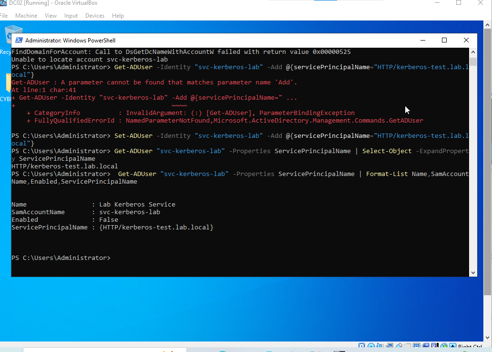
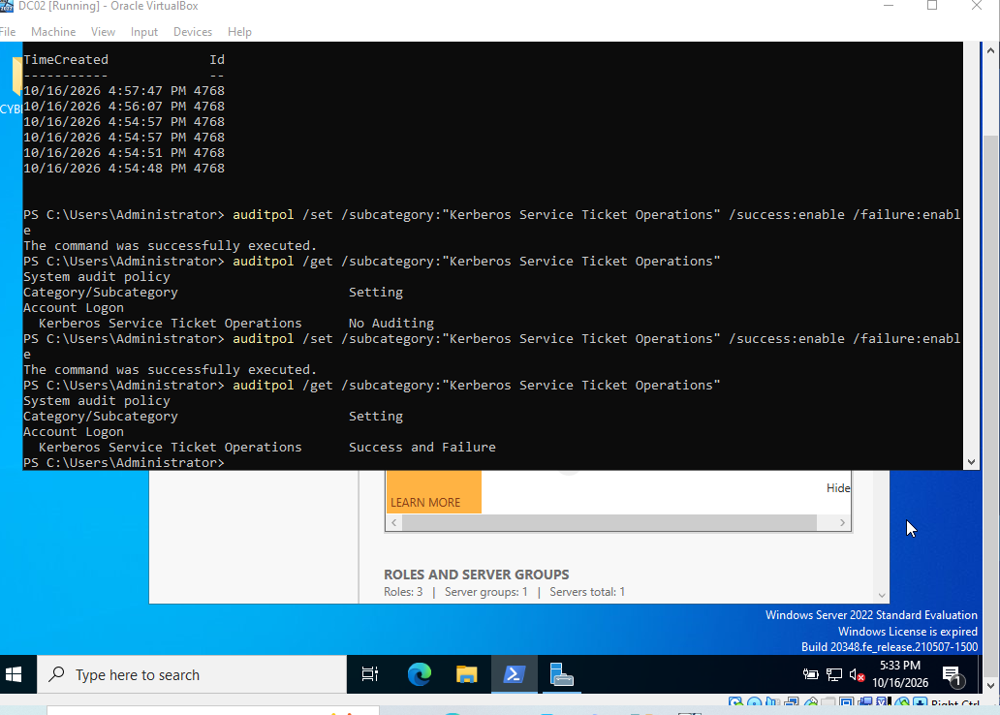
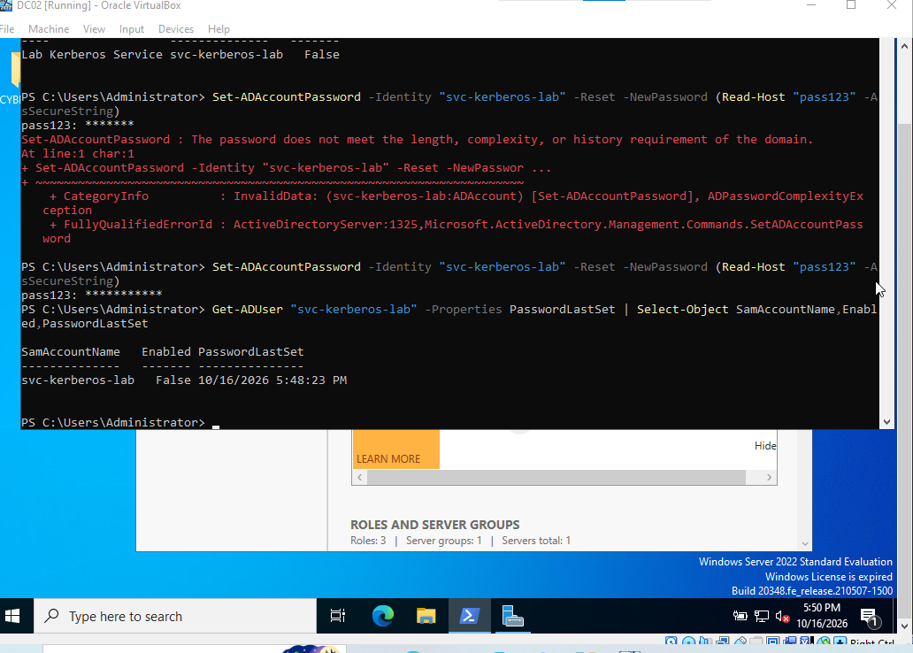
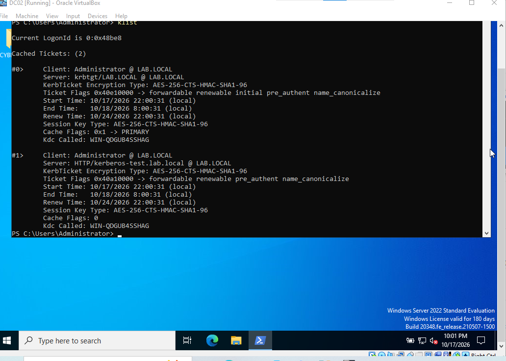
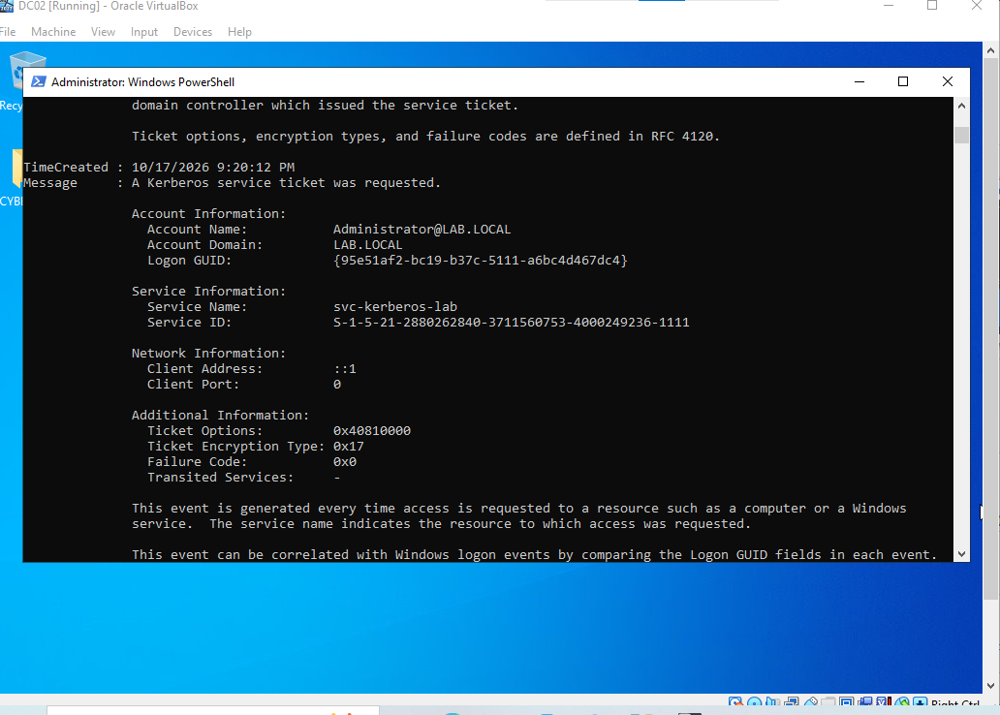
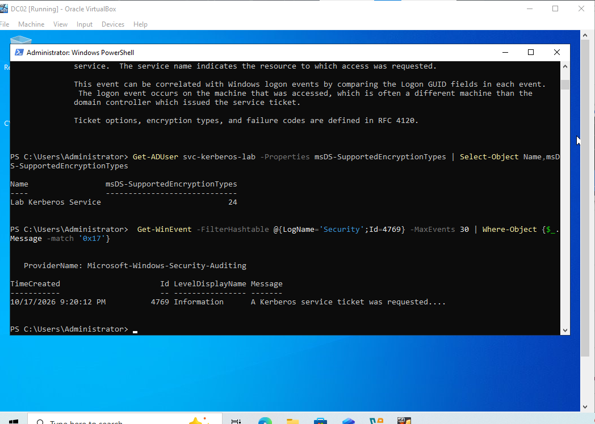
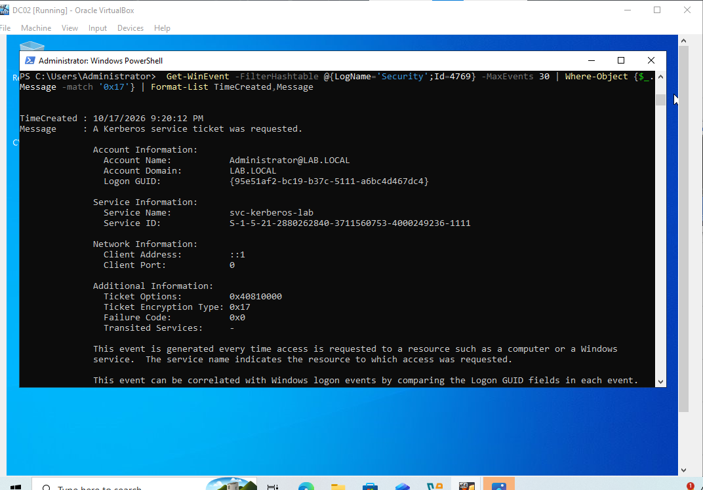
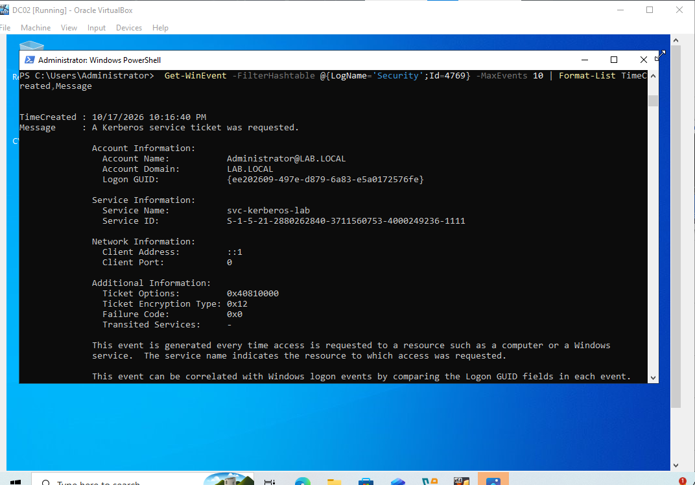

# IR-002 — Kerberos RC4 Service Ticket Investigation and AES-256 Hardening

## Project at a Glance — Plain-English Summary

**What this project is:** A Windows domain service initially received a Kerberos ticket using older RC4 encryption. After changing the test account's encryption settings and requesting a fresh ticket, the observed ticket used AES-256.

**Why a security team cares:** The investigation practices distinguishing observed evidence from assumptions, documenting the technical outcome, and explaining the limits of the test.

**Skills demonstrated:** Active Directory, Kerberos Event 4769, service-ticket encryption, PowerShell validation, security hardening.

**How to review:** Read the original findings below, then open the linked evidence to check the observations. This is an authorized lab exercise; do not interpret simulated activity as a real-world compromise.


**Classification:** Controlled lab security assessment / hardening validation  
**Environment:** Isolated VirtualBox domain `lab.local`; Windows Server 2022 domain controller DC02  
**Status:** Closed — tested service-ticket request verified with AES-256  
**Evidence:** [Screenshots 11–23](../screenshots/)

## Executive Summary

During an authorized Active Directory lab exercise, a Windows Security **Event ID 4769** showed a successful Kerberos service ticket issued with legacy **RC4-HMAC** encryption (`Ticket Encryption Type: 0x17`) for the test service account `svc-kerberos-lab`. The account was subsequently configured to support AES-128 and AES-256, the ticket cache was purged, and a new ticket was requested. A later Event 4769 showed **AES-256** (`0x12`) with success code `0x0`.

**Analyst disposition:** Legacy encryption observed and remediated for the tested service request. **No Kerberoasting, credential compromise, lateral movement, or malicious actor was demonstrated.** A successful RC4 ticket request by itself is not proof of an attack.

## Scope and Test Setup

- Domain: `lab.local`
- Domain controller: DC02 (Windows Server 2022), `192.168.56.101`
- Test principal: `Administrator@LAB.LOCAL`
- Test service account: `svc-kerberos-lab`
- SPN: `HTTP/kerberos-test.lab.local`
- Ticket requests originated locally on the domain controller (`Client Address: ::1`), not from a remote adversary.
- Windows Security audit subcategory: **Kerberos Service Ticket Operations** (success and failure enabled during exercise).
- Splunk was **not used** for this investigation; the prior Splunk Enterprise trial has expired. Evidence comes from Windows Security logs and PowerShell.

## Timeline (October 17, 2026 — DC02 local time)

| Time | Observation | Interpretation |
|---|---|---|
| 9:20:12 PM | Security Event **4769**; service `svc-kerberos-lab`; `Ticket Encryption Type: 0x17`; `Failure Code: 0x0` | Successful service ticket issued using RC4 |
| Between events | Account encryption setting verified as decimal **24** (`0x18`), AES-128 + AES-256; ticket cache purged and fresh ticket requested | Targeted encryption hardening and retest |
| 10:16:40 PM | Security Event **4769**; same service; `Ticket Encryption Type: 0x12`; `Failure Code: 0x0` | Successful service ticket issued using AES-256 |

These timestamps are from screenshots; the exact time of every configuration command is not independently established.

## Evidence and Reproduction

| Evidence | What it supports |
|---|---|
| [11 — SPN configuration](../screenshots/11-Kerberos-SPN-Configuration.png) | Test service principal configuration |
| [12 — Kerberos auditing](../screenshots/12_Kerberos_Auditing_Enabled.png) | Ticket-request auditing |
| [13 — Test account](../screenshots/13_Kerberos_Test_Account_Configured.png) | Service account setup |
| [16 — AES-256 ticket](../screenshots/16-Kerberos-AES256-Ticket-Verified.png) | Client-side ticket encryption verification |
| [18 — Original RC4 event](../screenshots/18-Kerberos-RC4-Event4769.png) | Earlier RC4 observation |
| [20 — RC4 detection](../screenshots/20-Kerberos-RC4-Detection.png) | Manual Windows event hunting |
| [22 — RC4 investigation](../screenshots/22-Kerberos-RC4-Investigation.png) | Full RC4 event fields and attribution |
| [23 — Final AES-256 verification](../screenshots/23-Kerberos-AES256-Final-Verification.png) | Newer AES-256 event and success |

### Commands used or relevant to validation

```powershell
# Confirm account configuration; 24 decimal = 0x18 = AES128 + AES256
Get-ADUser svc-kerberos-lab -Properties msDS-SupportedEncryptionTypes |
  Select-Object Name,msDS-SupportedEncryptionTypes

# Purge cached tickets and request a fresh service ticket
klist purge
klist get HTTP/kerberos-test.lab.local
klist

# Review Kerberos service-ticket requests
Get-WinEvent -FilterHashtable @{LogName='Security';Id=4769} -MaxEvents 30 |
  Format-List TimeCreated,Message
```

**Detection-engineering caution:** A broad search for the string `0x17` anywhere in Event 4769 message text is useful for quick triage but can match an unrelated field. Production-grade detection should parse the specific **TicketEncryptionType** field from event XML and filter it to `0x17`, then correlate account, SPN, source host, frequency, and environment baseline.

Example targeted local query:

```powershell
Get-WinEvent -FilterHashtable @{LogName='Security';Id=4769} |
  Where-Object {
    ([xml]$_.ToXml()).Event.EventData.Data |
      Where-Object { $_.Name -eq 'TicketEncryptionType' -and $_.'#text' -eq '0x17' }
  } | Select-Object TimeCreated,Id,MachineName
```

## Analysis and Risk

RC4 is a legacy Kerberos ticket encryption algorithm. RC4 service tickets can be relevant to **Kerberoasting** investigations because attackers may request tickets for service principal names and attempt offline password cracking. But Event 4769 with RC4 is not, by itself, a Kerberoasting finding: legitimate clients and legacy service configurations can also produce RC4 tickets.

**MITRE ATT&CK reference:** [T1558.003 — Steal or Forge Kerberos Tickets: Kerberoasting](https://attack.mitre.org/techniques/T1558/003/) is an *investigative hypothesis / relevant technique*, **not a confirmed technique executed in this case**.

## Hardening, Validation, and Limitations

- Configured `svc-kerberos-lab` with `msDS-SupportedEncryptionTypes = 24` (decimal), corresponding to AES-128 and AES-256 support.
- Requested a fresh service ticket and verified `0x12` (AES-256) in the newer 4769 event.
- This establishes successful AES-256 issuance **for the tested request**. It does **not** establish domain-wide removal of RC4, complete legacy-client compatibility, or enforcement of AES-only policy across every service account.
- No malware, exploitation, password cracking, or remote Kerberoasting traffic was part of this exercise.
- No live SIEM alert was deployed for this case because Splunk access had expired.

## SOC Analyst Disposition

**Finding:** Legacy RC4 Kerberos service-ticket issuance for a controlled test service account.  
**Action:** Review encryption configuration; enable auditing; retest with a fresh ticket.  
**Verification:** Newer Event 4769 uses AES-256 (`0x12`) and succeeds (`0x0`).  
**Case outcome:** Hardening validation complete for the scoped service-ticket request; no compromise evidenced.  
**Future detection work:** Build a parsed-field RC4 rule in a currently accessible SIEM, establish baseline and exclusions, and investigate high-volume or unusual ticket-request patterns using source, identity, and endpoint telemetry.

## Original Screenshot Evidence — Click to Enlarge

These original repository images illustrate the observations described above. Click each screenshot to open the full-size file. Interpret the results using the report's findings and limitations, rather than treating an image alone as proof of compromise.

### Evidence 1 — Kerberos SPN Configuration

[](../screenshots/11-Kerberos-SPN-Configuration.png)

[Open full-size original screenshot](../screenshots/11-Kerberos-SPN-Configuration.png)

### Evidence 2 — Kerberos Auditing Enabled

[](../screenshots/12_Kerberos_Auditing_Enabled.png)

[Open full-size original screenshot](../screenshots/12_Kerberos_Auditing_Enabled.png)

### Evidence 3 — Kerberos Test Account Configured

[](../screenshots/13_Kerberos_Test_Account_Configured.png)

[Open full-size original screenshot](../screenshots/13_Kerberos_Test_Account_Configured.png)

### Evidence 4 — Kerberos AES256 Ticket Verified

[](../screenshots/16-Kerberos-AES256-Ticket-Verified.png)

[Open full-size original screenshot](../screenshots/16-Kerberos-AES256-Ticket-Verified.png)

### Evidence 5 — Kerberos RC4 Event4769

[](../screenshots/18-Kerberos-RC4-Event4769.png)

[Open full-size original screenshot](../screenshots/18-Kerberos-RC4-Event4769.png)

### Evidence 6 — Kerberos RC4 Detection

[](../screenshots/20-Kerberos-RC4-Detection.png)

[Open full-size original screenshot](../screenshots/20-Kerberos-RC4-Detection.png)

### Evidence 7 — Kerberos RC4 Investigation

[](../screenshots/22-Kerberos-RC4-Investigation.png)

[Open full-size original screenshot](../screenshots/22-Kerberos-RC4-Investigation.png)

### Evidence 8 — Kerberos AES256 Final Verification

[](../screenshots/23-Kerberos-AES256-Final-Verification.png)

[Open full-size original screenshot](../screenshots/23-Kerberos-AES256-Final-Verification.png)
