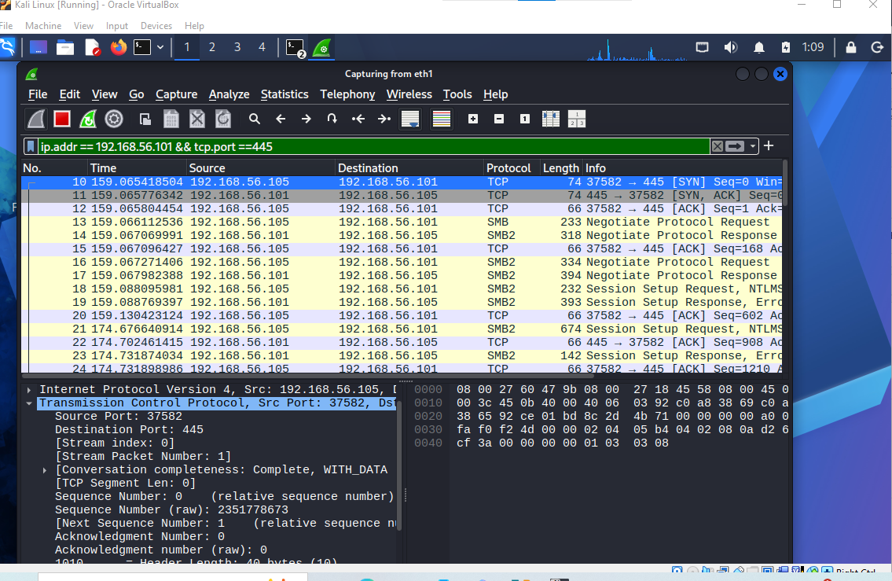
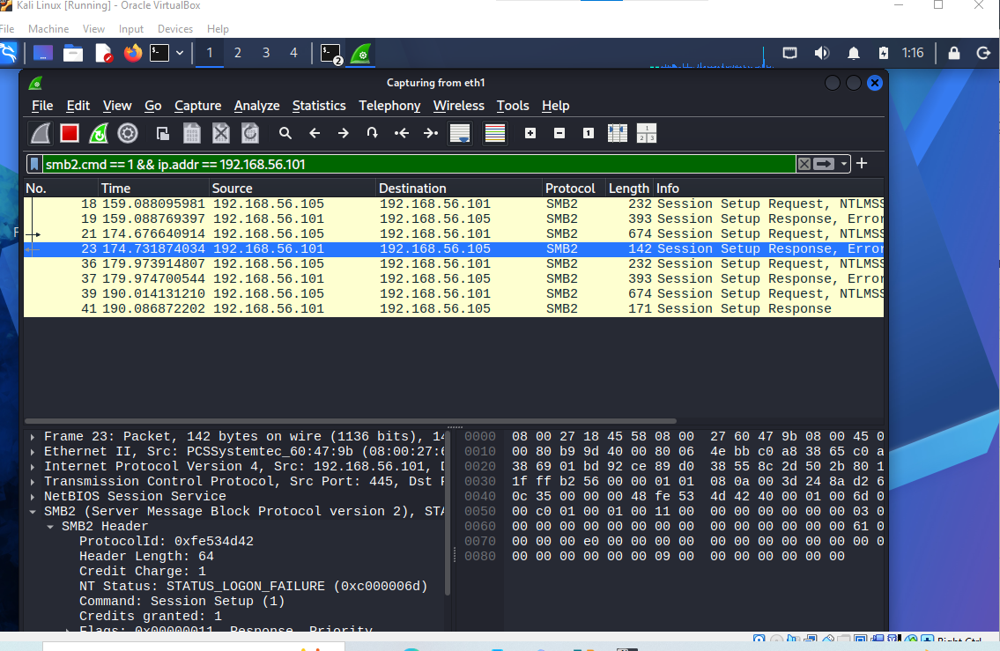
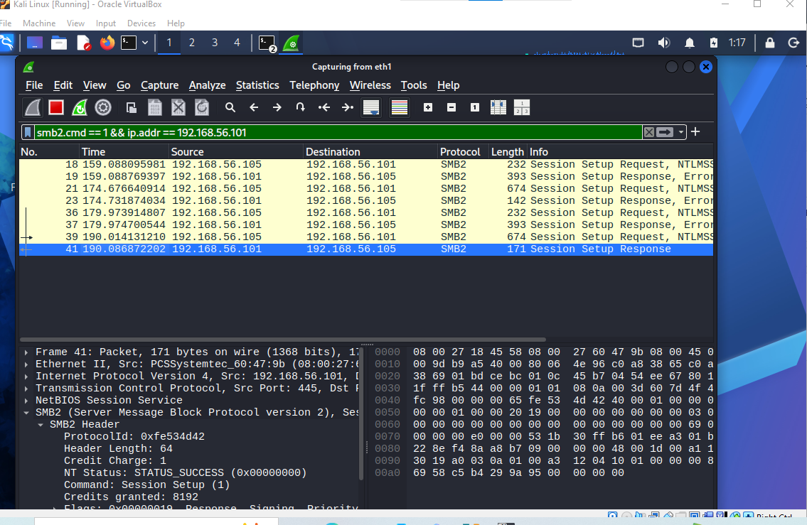

# IR-004 | SMB/NTLM Network Authentication Forensics

**Environment:** isolated VirtualBox lab · **Source:** Kali Linux `192.168.56.105` · **Target:** DC02 `192.168.56.101` · **Protocol:** TCP/445, SMB2, NTLMSSP · **Classification:** authorized simulation, not a production incident.

## Executive summary
Investigated a controlled SMB authentication sequence using Wireshark packet evidence. Identified the TCP three-way handshake, SMB session setup, an unsuccessful authentication response, and a subsequent successful session setup. Examined an NTLMSSP AUTH message identifying domain `LAB` and user `socuser`. The exercise demonstrates packet-level identity troubleshooting, evidence interpretation, and security-aware reporting.

**Observed outcome:** server response packet **23** reported `STATUS_LOGON_FAILURE (0xC000006D)`; server response packet **41** reported `STATUS_SUCCESS (0x00000000)`. The latter confirms successful SMB session setup, **not** administrator access, file access, lateral movement, or compromise.

## Scope and evidence standard
This report documents observations from screenshots 28–31 and the lab walkthrough. The raw `.pcapng` remains private because NTLM challenge-response and session-key-related fields can expose credential-derived material. No production system was targeted. Packet timestamps and exact Windows event correlation were not independently established from the raw capture.

## Investigation timeline

| Packet(s) | Direction | Evidence | Interpretation |
|---|---|---|---|
| 10 | Kali → DC02 | TCP SYN | Connection initiation |
| 11 | DC02 → Kali | TCP SYN, ACK | Server acknowledges SYN |
| 12 | Kali → DC02 | TCP ACK | Three-way handshake completes |
| 13–17 | Both | SMB negotiation | SMB protocol negotiation observed |
| 18–23 | Both | SMB2 Session Setup | Authentication exchange; packet 23 rejects logon |
| 36–41 | Both | SMB2 Session Setup | Subsequent authentication exchange; packet 41 succeeds |
| 39 | Kali → DC02 | `NTLMSSP_AUTH (3)` | NTLM authentication response, domain LAB / account socuser |

The sequence above is a packet-order narrative, not a verified wall-clock timeline.

## Findings and analysis

### F-01 — Network session established
TCP SYN, SYN-ACK, ACK in packets 10–12 demonstrate a completed transport handshake to SMB TCP/445. A successful TCP handshake alone does not establish SMB authentication.

### F-02 — Failed SMB authentication
Packet 23: SMB2 Session Setup response `STATUS_LOGON_FAILURE (0xC000006D)`. The server rejected the login. This status alone does not establish whether the cause was a wrong password, disabled account, or another authentication condition. Correlate with DC02 Windows Security Event 4625 and substatus to distinguish causes.

### F-03 — Successful SMB session setup
Packet 41: SMB2 Session Setup response `STATUS_SUCCESS (0x00000000)`. The server accepted the session setup. This is distinct from proof of accessing a share, reading data, or gaining privileged rights.

### F-04 — NTLM challenge-response observed
Packet 39 contains `NTLMSSP_AUTH (3)`, domain `LAB`, account `socuser`, workstation `KALI`, and an NTLM response field. The response is credential-derived, not a plaintext password. Presence of an NTLMSSP response is **not** evidence that the password was disclosed. Client-advertised SMB signing support does not prove signing was required or used for every message.

## Visual evidence and analyst interpretation

### Screenshot 28 — TCP three-way handshake



Packets 10–12 establish transport connectivity on TCP/445. This does not itself prove successful authentication.

### Screenshot 29 — Rejected SMB2 session setup



Packet 23 is a server response with `STATUS_LOGON_FAILURE`; in this controlled test the operator intentionally entered an incorrect password.

### Screenshot 30 — Accepted SMB2 session setup



Packet 41 reports `STATUS_SUCCESS`. The associated `smbclient` output listed `ADMIN# IR-004 | SMB/NTLM Network Authentication Forensics

**Environment:** isolated VirtualBox lab · **Source:** Kali Linux `192.168.56.105` · **Target:** DC02 `192.168.56.101` · **Protocol:** TCP/445, SMB2, NTLMSSP · **Classification:** authorized simulation, not a production incident.

## Executive summary
Investigated a controlled SMB authentication sequence using Wireshark packet evidence. Identified the TCP three-way handshake, SMB session setup, an unsuccessful authentication response, and a subsequent successful session setup. Examined an NTLMSSP AUTH message identifying domain `LAB` and user `socuser`. The exercise demonstrates packet-level identity troubleshooting, evidence interpretation, and security-aware reporting.

**Observed outcome:** server response packet **23** reported `STATUS_LOGON_FAILURE (0xC000006D)`; server response packet **41** reported `STATUS_SUCCESS (0x00000000)`. The latter confirms successful SMB session setup, **not** administrator access, file access, lateral movement, or compromise.

## Scope and evidence standard
This report documents observations from screenshots 28–31 and the lab walkthrough. The raw `.pcapng` remains private because NTLM challenge-response and session-key-related fields can expose credential-derived material. No production system was targeted. Packet timestamps and exact Windows event correlation were not independently established from the raw capture.

## Investigation timeline

| Packet(s) | Direction | Evidence | Interpretation |
|---|---|---|---|
| 10 | Kali → DC02 | TCP SYN | Connection initiation |
| 11 | DC02 → Kali | TCP SYN, ACK | Server acknowledges SYN |
| 12 | Kali → DC02 | TCP ACK | Three-way handshake completes |
| 13–17 | Both | SMB negotiation | SMB protocol negotiation observed |
| 18–23 | Both | SMB2 Session Setup | Authentication exchange; packet 23 rejects logon |
| 36–41 | Both | SMB2 Session Setup | Subsequent authentication exchange; packet 41 succeeds |
| 39 | Kali → DC02 | `NTLMSSP_AUTH (3)` | NTLM authentication response, domain LAB / account socuser |

The sequence above is a packet-order narrative, not a verified wall-clock timeline.

## Findings and analysis

### F-01 — Network session established
TCP SYN, SYN-ACK, ACK in packets 10–12 demonstrate a completed transport handshake to SMB TCP/445. A successful TCP handshake alone does not establish SMB authentication.

### F-02 — Failed SMB authentication
Packet 23: SMB2 Session Setup response `STATUS_LOGON_FAILURE (0xC000006D)`. The server rejected the login. This status alone does not establish whether the cause was a wrong password, disabled account, or another authentication condition. Correlate with DC02 Windows Security Event 4625 and substatus to distinguish causes.

### F-03 — Successful SMB session setup
Packet 41: SMB2 Session Setup response `STATUS_SUCCESS (0x00000000)`. The server accepted the session setup. This is distinct from proof of accessing a share, reading data, or gaining privileged rights.

### F-04 — NTLM challenge-response observed
Packet 39 contains `NTLMSSP_AUTH (3)`, domain `LAB`, account `socuser`, workstation `KALI`, and an NTLM response field. The response is credential-derived, not a plaintext password. Presence of an NTLMSSP response is **not** evidence that the password was disclosed. Client-advertised SMB signing support does not prove signing was required or used for every message.

, `C# IR-004 | SMB/NTLM Network Authentication Forensics

**Environment:** isolated VirtualBox lab · **Source:** Kali Linux `192.168.56.105` · **Target:** DC02 `192.168.56.101` · **Protocol:** TCP/445, SMB2, NTLMSSP · **Classification:** authorized simulation, not a production incident.

## Executive summary
Investigated a controlled SMB authentication sequence using Wireshark packet evidence. Identified the TCP three-way handshake, SMB session setup, an unsuccessful authentication response, and a subsequent successful session setup. Examined an NTLMSSP AUTH message identifying domain `LAB` and user `socuser`. The exercise demonstrates packet-level identity troubleshooting, evidence interpretation, and security-aware reporting.

**Observed outcome:** server response packet **23** reported `STATUS_LOGON_FAILURE (0xC000006D)`; server response packet **41** reported `STATUS_SUCCESS (0x00000000)`. The latter confirms successful SMB session setup, **not** administrator access, file access, lateral movement, or compromise.

## Scope and evidence standard
This report documents observations from screenshots 28–31 and the lab walkthrough. The raw `.pcapng` remains private because NTLM challenge-response and session-key-related fields can expose credential-derived material. No production system was targeted. Packet timestamps and exact Windows event correlation were not independently established from the raw capture.

## Investigation timeline

| Packet(s) | Direction | Evidence | Interpretation |
|---|---|---|---|
| 10 | Kali → DC02 | TCP SYN | Connection initiation |
| 11 | DC02 → Kali | TCP SYN, ACK | Server acknowledges SYN |
| 12 | Kali → DC02 | TCP ACK | Three-way handshake completes |
| 13–17 | Both | SMB negotiation | SMB protocol negotiation observed |
| 18–23 | Both | SMB2 Session Setup | Authentication exchange; packet 23 rejects logon |
| 36–41 | Both | SMB2 Session Setup | Subsequent authentication exchange; packet 41 succeeds |
| 39 | Kali → DC02 | `NTLMSSP_AUTH (3)` | NTLM authentication response, domain LAB / account socuser |

The sequence above is a packet-order narrative, not a verified wall-clock timeline.

## Findings and analysis

### F-01 — Network session established
TCP SYN, SYN-ACK, ACK in packets 10–12 demonstrate a completed transport handshake to SMB TCP/445. A successful TCP handshake alone does not establish SMB authentication.

### F-02 — Failed SMB authentication
Packet 23: SMB2 Session Setup response `STATUS_LOGON_FAILURE (0xC000006D)`. The server rejected the login. This status alone does not establish whether the cause was a wrong password, disabled account, or another authentication condition. Correlate with DC02 Windows Security Event 4625 and substatus to distinguish causes.

### F-03 — Successful SMB session setup
Packet 41: SMB2 Session Setup response `STATUS_SUCCESS (0x00000000)`. The server accepted the session setup. This is distinct from proof of accessing a share, reading data, or gaining privileged rights.

### F-04 — NTLM challenge-response observed
Packet 39 contains `NTLMSSP_AUTH (3)`, domain `LAB`, account `socuser`, workstation `KALI`, and an NTLM response field. The response is credential-derived, not a plaintext password. Presence of an NTLMSSP response is **not** evidence that the password was disclosed. Client-advertised SMB signing support does not prove signing was required or used for every message.

, `IPC# IR-004 | SMB/NTLM Network Authentication Forensics

**Environment:** isolated VirtualBox lab · **Source:** Kali Linux `192.168.56.105` · **Target:** DC02 `192.168.56.101` · **Protocol:** TCP/445, SMB2, NTLMSSP · **Classification:** authorized simulation, not a production incident.

## Executive summary
Investigated a controlled SMB authentication sequence using Wireshark packet evidence. Identified the TCP three-way handshake, SMB session setup, an unsuccessful authentication response, and a subsequent successful session setup. Examined an NTLMSSP AUTH message identifying domain `LAB` and user `socuser`. The exercise demonstrates packet-level identity troubleshooting, evidence interpretation, and security-aware reporting.

**Observed outcome:** server response packet **23** reported `STATUS_LOGON_FAILURE (0xC000006D)`; server response packet **41** reported `STATUS_SUCCESS (0x00000000)`. The latter confirms successful SMB session setup, **not** administrator access, file access, lateral movement, or compromise.

## Scope and evidence standard
This report documents observations from screenshots 28–31 and the lab walkthrough. The raw `.pcapng` remains private because NTLM challenge-response and session-key-related fields can expose credential-derived material. No production system was targeted. Packet timestamps and exact Windows event correlation were not independently established from the raw capture.

## Investigation timeline

| Packet(s) | Direction | Evidence | Interpretation |
|---|---|---|---|
| 10 | Kali → DC02 | TCP SYN | Connection initiation |
| 11 | DC02 → Kali | TCP SYN, ACK | Server acknowledges SYN |
| 12 | Kali → DC02 | TCP ACK | Three-way handshake completes |
| 13–17 | Both | SMB negotiation | SMB protocol negotiation observed |
| 18–23 | Both | SMB2 Session Setup | Authentication exchange; packet 23 rejects logon |
| 36–41 | Both | SMB2 Session Setup | Subsequent authentication exchange; packet 41 succeeds |
| 39 | Kali → DC02 | `NTLMSSP_AUTH (3)` | NTLM authentication response, domain LAB / account socuser |

The sequence above is a packet-order narrative, not a verified wall-clock timeline.

## Findings and analysis

### F-01 — Network session established
TCP SYN, SYN-ACK, ACK in packets 10–12 demonstrate a completed transport handshake to SMB TCP/445. A successful TCP handshake alone does not establish SMB authentication.

### F-02 — Failed SMB authentication
Packet 23: SMB2 Session Setup response `STATUS_LOGON_FAILURE (0xC000006D)`. The server rejected the login. This status alone does not establish whether the cause was a wrong password, disabled account, or another authentication condition. Correlate with DC02 Windows Security Event 4625 and substatus to distinguish causes.

### F-03 — Successful SMB session setup
Packet 41: SMB2 Session Setup response `STATUS_SUCCESS (0x00000000)`. The server accepted the session setup. This is distinct from proof of accessing a share, reading data, or gaining privileged rights.

### F-04 — NTLM challenge-response observed
Packet 39 contains `NTLMSSP_AUTH (3)`, domain `LAB`, account `socuser`, workstation `KALI`, and an NTLM response field. The response is credential-derived, not a plaintext password. Presence of an NTLMSSP response is **not** evidence that the password was disclosed. Client-advertised SMB signing support does not prove signing was required or used for every message.

, `NETLOGON`, and `SYSVOL`. **Listing share names is not proof of reading or writing files.**

### Screenshot 31 — NTLMSSP authentication

**Withheld from inline rendering pending sanitization.** Packet 39 identifies `NTLMSSP_AUTH`, domain LAB, account socuser and workstation KALI. Redact the NTLM response, session-key fields and hex pane before making this screenshot public. `STATUS_MORE_PROCESSING_REQUIRED` in the intermediate exchange is expected and is not a failed login.

## Evidence register

| Screenshot | Description | Reviewer focus |
|---|---|---|
| 28 | TCP three-way handshake | Packets 10, 11, 12 and flags |
| 29 | SMB2 authentication failure | Packet 23 and NT status `0xC000006D` |
| 30 | SMB2 authentication success | Packet 41 and NT status `0x00000000` |
| 31 | NTLMSSP authentication exchange | Packet 39, `NTLMSSP_AUTH (3)`, domain/account; **redact response bytes, session keys and hex pane** |

Screenshot 27 was an empty preliminary capture and was intentionally omitted. Do not publish unredacted NTLM response material or the original packet capture.

## Reproducible Wireshark filters
```wireshark
ip.addr == 192.168.56.101 && tcp.port == 445
smb2.cmd == 1 && ip.addr == 192.168.56.101
ntlmssp && ip.addr == 192.168.56.101
```
For a given connection, inspect its actual `tcp.stream` value rather than assuming it is zero. `tcp.flags.syn == 1` hides the final ACK packet of a normal three-way handshake.

## Detection engineering
**Windows source:** DC02 Security logs. Query Event ID **4625** (failed logon) and **4624** (successful logon), prioritize **Logon Type 3**, and pivot on source IP, account, timestamp, authentication package, status and substatus. A successful SMB session setup does not necessarily produce a one-to-one 4624 without timestamp/session correlation.

**Suggested analytic (pseudocode):**
```text
GROUP 4625 events by source_ip, target_account, host in 5-minute windows
FLAG repeated failures above environment-specific baseline
ESCALATE if followed by a correlated 4624 Type 3 from same source/account
EXCLUDE documented lab tests and approved service behavior
```
Tune thresholds with baseline traffic; one failed attempt is not brute force or password spraying.

**MITRE ATT&CK context:** T1110 (Brute Force) is a *possible detection hypothesis* for repeated credential guesses, **not a confirmed technique in this lab**. Network authentication and Windows log correlation are the demonstrated skills.

## Defensive priorities and risk assessment

**Identity hygiene:** Prior lab enumeration placed `socuser` in Domain Admins. Confirm whether that membership is necessary; use a standard account for routine testing and a separate privileged identity only for authorized administrative tasks.

**Network exposure:** Restrict SMB TCP/445 to approved segments and sources. Prior testing identified required SMB signing on DC02, a positive control worth maintaining. A reachable port alone is not a vulnerability.

**Authentication visibility:** Review NTLM usage and migration feasibility before restricting it. Where auditing is enabled, Windows 4776 can provide credential-validation context and 5140/5145 can help distinguish share access from mere enumeration. Do not claim those events were observed in IR-004 without evidence.

**ATT&CK accuracy:** T1021.002 (SMB/Windows Admin Shares) and T1110 (Brute Force) are useful investigative references, not confirmed adversary behaviors in this controlled case.

## Analyst workflow and follow-up
1. Preserve private PCAP and record capture provenance/timezone.
2. Identify TCP and SMB2 streams and authentication responses.
3. Correlate server-side 4625/4624 events with source IP, account and time.
4. Verify whether signing is required from configuration or protocol evidence; do not infer from client support.
5. Record uncertainty and recommend least privilege, account lockout policies, SMB hardening, and monitoring according to the environment.

## Interview review
**Q: What proves the login failed?** Packet 23 SMB2 `STATUS_LOGON_FAILURE`; a correlated 4625 could strengthen attribution.

**Q: What proves it succeeded?** Packet 41 SMB2 `STATUS_SUCCESS`, specifically session setup—not file access.

**Q: Why keep the PCAP private?** NTLM challenge-response and related security material can be sensitive even without plaintext passwords.

**Q: Why analyze both network and endpoint logs?** Network traces show protocol exchanges; Windows logs add identity, logon type, failure substatus and host context.

**Q: Does an NTLM response mean credentials were stolen?** No. It is part of the protocol; no compromise was demonstrated.

## Portfolio summary
**Conducted a controlled SMB/NTLM packet-level investigation across Kali Linux and Windows Server, distinguishing failed and successful SMB2 session setup using Wireshark, interpreting NTLMSSP authentication fields, and designing Windows Event 4625/4624 correlation guidance while preserving sensitive capture evidence.**

**Limitations:** Conclusions are grounded in screenshot-based review; raw PCAP, packet timestamps, event-log joins, and end-to-end access authorization were not independently verified.
