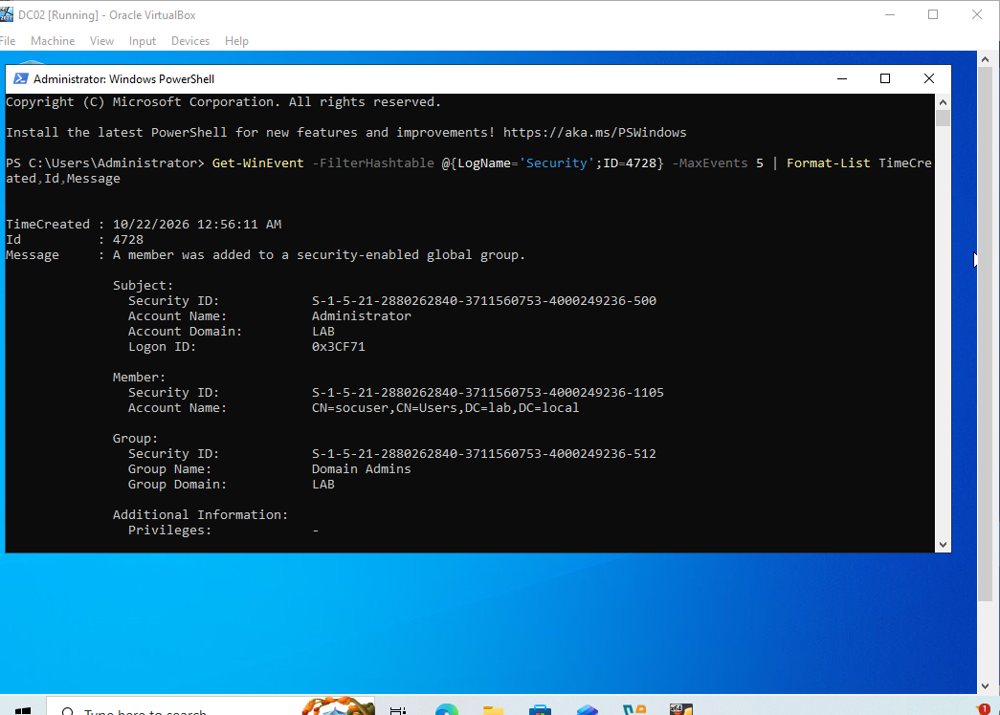
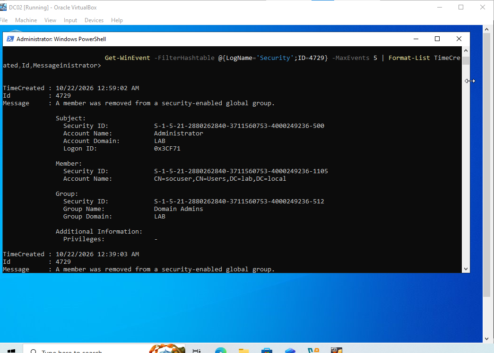
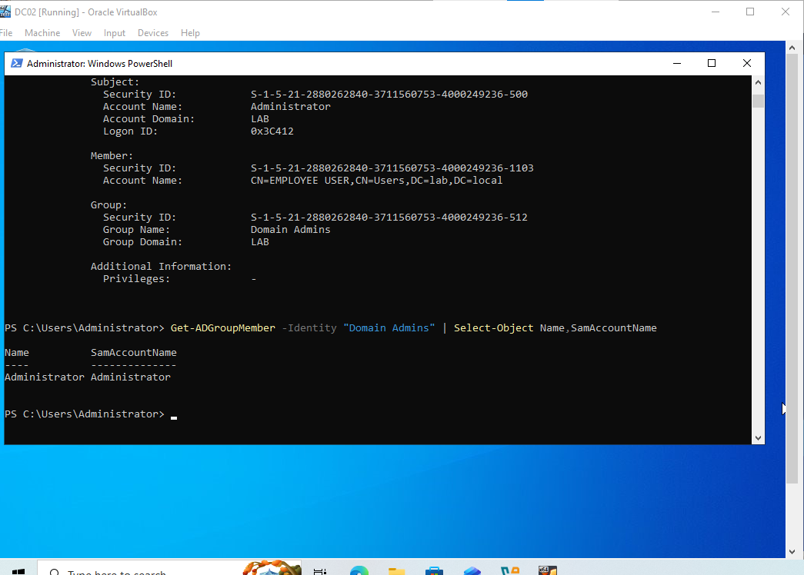

# IR-005 — Active Directory Privileged Group Membership Investigation

**Status:** Controlled simulation completed; screenshots 36–38 verified in the repository.  
**Environment:** DC02, Windows Server 2022, `lab.local` (isolated VirtualBox lab).  
**Tools:** Active Directory PowerShell, Windows Security Event Log, `Get-WinEvent`.  
**Scenario:** Authorized temporary addition of `socuser` to the `Domain Admins` security-enabled global group, followed by removal and verification.

## Executive summary

This exercise tests the ability to detect and investigate a sensitive Active Directory group membership change, identify the account performing the change, and verify remediation. The controlled lab administrator temporarily added `socuser` to `Domain Admins`, generating Windows Security **Event ID 4728**. The same account was then removed, generating **Event ID 4729**. A subsequent `Get-ADGroupMember` query displayed `Administrator` as the sole listed member.

This was an **authorized simulation**, not an observed attacker intrusion. The events prove group membership changes were logged; they do not independently establish credential theft, persistence, or malicious intent.

## Evidence-backed timeline

| Stage | Evidence | Observed result |
|---|---|---|
| Privilege grant | Event **4728**, **2026-10-22 00:56:11** (DC02 displayed local time) | `LAB\Administrator` added `socuser` to `LAB\Domain Admins` |
| Privilege removal | Event **4729**, **2026-10-22 00:59:02** (DC02 displayed local time) | `LAB\Administrator` removed `socuser` from `LAB\Domain Admins` |
| Verification | `Get-ADGroupMember -Identity "Domain Admins" | Select-Object Name,SamAccountName` | Output displayed only `Administrator`; `socuser` was absent |

**Time handling:** Timestamps above are transcribed from the Windows event screenshots; no timezone normalization or cross-host clock correlation was performed.

## Screenshot register

These are the actual uploaded evidence files, verified on the repository's default branch.

| # | Planned artifact | What it should show |
|---|---|---|
| 36 | [36-AD-DomainAdmins-Member-Added-4728.png](../screenshots/36-AD-DomainAdmins-Member-Added-4728.png) | Event 4728: `socuser` added to Domain Admins |
| 37 | [37-AD-DomainAdmins-Member-Removed-4729.png](../screenshots/37-AD-DomainAdmins-Member-Removed-4729.png) | Event 4729: `socuser` removed from Domain Admins |
| 38 | [38-AD-DomainAdmins-Remediation-Verified.png](../screenshots/38-AD-DomainAdmins-Remediation-Verified.png) | `Get-ADGroupMember` showing only `Administrator` |

Screenshots **32–35** belong to the separate [DC02 firewall validation case study](IR-005-DC02-Firewall-Hardening-Validation.md), not this AD group-membership investigation.

## Investigation method

### 1. Identify a privileged membership change




Windows Security **4728** records the addition of a member to a security-enabled **global** group. Relevant fields include the **Subject** (who made the change), **Member** (who was added), **Group** (which group changed), and timestamp.

Observed subject: `LAB\Administrator`. Observed member: `socuser`. Observed group: `LAB\Domain Admins`.

### 2. Review the corresponding removal




Windows Security **4729** records removal of a member from a security-enabled global group. The captured event identifies the same subject, member, and group. Event ordering supports the simulated grant-then-removal sequence.

### 3. Validate current state




```powershell
Get-ADGroupMember -Identity "Domain Admins" | Select-Object Name,SamAccountName
```

The final displayed result contained only `Administrator`. This verifies the queried group's direct membership at the time of the check; it is not a complete assessment of every possible privileged access path, nested membership, or previously issued access token.

## Detection engineering

**High-value alert candidate:** Windows Security Event 4728 where the target group is `Domain Admins`, `Enterprise Admins`, or another approved sensitive group. Enrich with subject identity, member identity, change window, approved change tickets, and follow-up Event 4729. A 4729 event is useful remediation evidence but should not automatically suppress investigation of the preceding grant.

Example Windows PowerShell triage (read-only):

```powershell
Get-WinEvent -FilterHashtable @{LogName='Security';ID=4728,4729} -MaxEvents 20 |
    Select-Object TimeCreated,Id,Message |
    Format-List
```

**False-positive considerations:** legitimate provisioning, temporary administrative elevation, and approved maintenance can produce identical event IDs. A malicious change requires contextual evidence beyond the event ID.

## Response and verification checklist

1. Confirm whether the change was authorized, using the subject identity and change records.
2. Inspect affected account privileges and relevant logons, prioritizing evidence of actual use of elevated access.
3. If unauthorized, revoke membership through approved incident response procedures and preserve original events.
4. Re-query membership; evaluate whether existing sessions or tokens require separate handling.
5. Document findings, gaps, and follow-up detection improvements.

## Limitations

- The captured change was performed deliberately by a lab administrator.
- No evidence demonstrates an external adversary or actual abuse of Domain Admin privileges.
- Screenshots 36–38 are present in this repository. The evidence demonstrates the documented membership change and current direct membership, not all potential privileged access.
- Event logs and membership checks demonstrate the specific tested workflow, not comprehensive AD security assurance.

## Interview-ready summary

> “I simulated a privileged Active Directory group membership change on Windows Server 2022, identified the addition using Security Event 4728, confirmed removal using 4729, and verified the final Domain Admins membership with PowerShell. I distinguished an authorized lab simulation from a real compromise and documented alerting logic, validation, and investigation limitations.”
