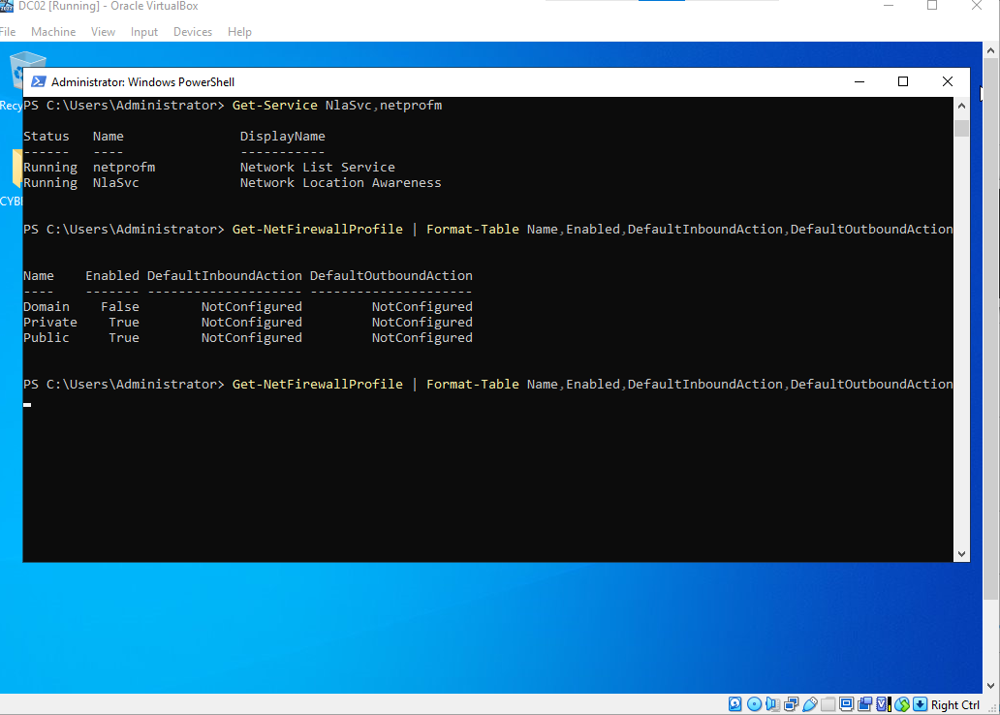
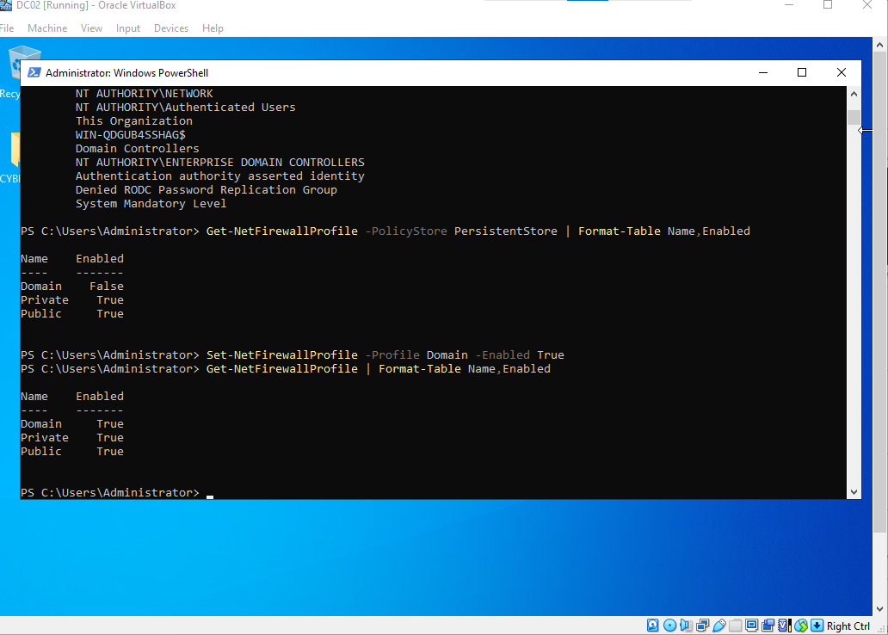
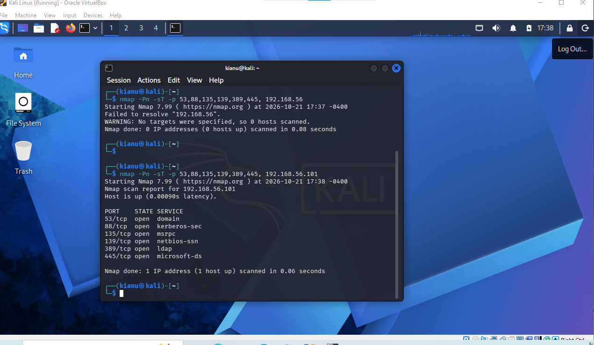
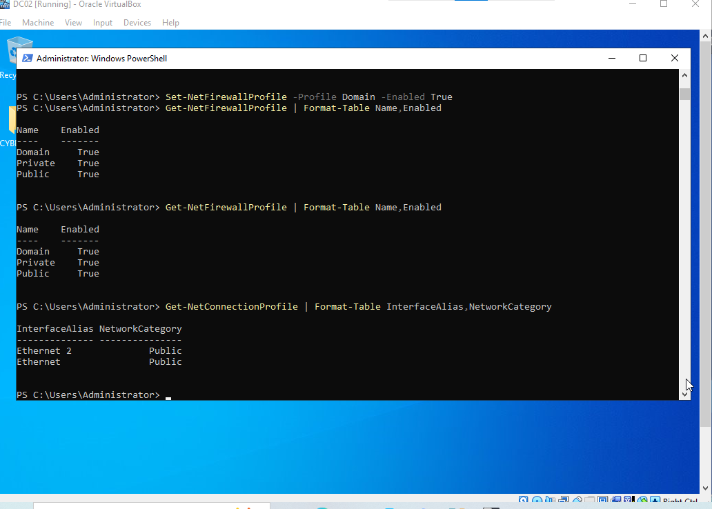

# DC02 Firewall Hardening and Kali Connectivity Validation

**Evidence:** Screenshots 32–35 (verified in the GitHub repository).  
**Environment:** Windows Server 2022 domain controller DC02 (`192.168.56.101`), Kali Linux (`192.168.56.105`), `lab.local`, VirtualBox.

## Purpose and scope

Document a controlled firewall configuration and network connectivity validation workflow between a Kali assessment workstation and the lab domain controller. This case study is separate from the Active Directory privileged group change investigation (screenshots 36–38).

## Evidence sequence

| # | Evidence | Interpretation and limitations |
|---|---|---|
| 32 | [DC02 firewall baseline](../screenshots/32-DC02-Firewall-Baseline.png) | Captured baseline configuration and network profile context prior to hardening |
| 33 | [DC02 firewall hardening](../screenshots/33-DC02-Firewall-Hardening.png) | Captured firewall configuration changes on DC02 |
| 34 | [Kali-to-DC02 connectivity validation](../screenshots/34-Kali-DC02-Connectivity-Validation.png) | Captured connectivity testing from Kali toward the DC02 lab host |
| 35 | [DC02 firewall verification](../screenshots/35-DC02-Firewall-Verfication.png) | Captured post-change firewall verification; filename preserves the uploaded spelling |

### 32 — Firewall baseline

The initial PowerShell checks showed enabled Domain, Private, and Public firewall profiles, with `DefaultInboundAction` displayed as `NotConfigured` in the queried output. The VM's adapters appeared as Public in the captured network profile check. This is configuration context, **not** evidence that Windows Firewall was disabled or that traffic was permitted.

### 33 — Firewall hardening

This artifact records the configuration stage. Any claim that a particular firewall rule blocked traffic should be tied to the actual rule name, direction, profile, protocol, port, and source address shown in the evidence. Merely enabling a firewall profile does not demonstrate that a specific connection was denied.

### 34 — Kali connectivity validation

Kali is the authorized assessment source (`192.168.56.105`); DC02 is the target (`192.168.56.101`). The network test helps evaluate the reachability of the domain controller after policy changes. A ping or port scan establishes the observed connectivity state only for the tested protocol and time.

### 35 — DC02 firewall verification

This is the final captured DC02-side verification artifact. Reviewers should compare it against screenshot 32 and the actual hardening commands in screenshot 33 before asserting a specific policy change or successful block.

## Analyst interpretation

- **Firewall enabled** is distinct from **inbound traffic blocked**.
- **Public network profile** on a virtual adapter is not automatically a defect; domain network identification, DNS, routing, and adapter topology may affect classification.
- DC02 has been observed with two IPv4 addresses (`192.168.56.101` on the host-only lab segment and `10.0.2.15` on a NAT-side adapter). DNS registration of both addresses may complicate name-based connectivity; the existence of a second address does not itself establish a firewall failure.
- Network reachability from Kali and DC02 policy output are complementary evidence, but neither independently proves that every intended rule is correctly scoped.

## Recommended validation and defensive follow-up

For a future retest, record the precise tested port, protocol, source, destination, and time, then compare against an exported Windows Firewall rule with its profile and remote-address scope. Preserve any service availability requirements for DNS, Kerberos, LDAP, and other domain-controller functions.

**Disposition:** Controlled firewall hardening and validation exercise. No unauthorized access or compromise is claimed.

## Interview-ready explanation

> “I documented a domain-controller firewall baseline, applied lab hardening, validated network reachability from Kali, and captured a final firewall check. I distinguished a network profile label from effective filtering, and documented the limits of interpreting scans without inspecting the corresponding firewall rule.”
