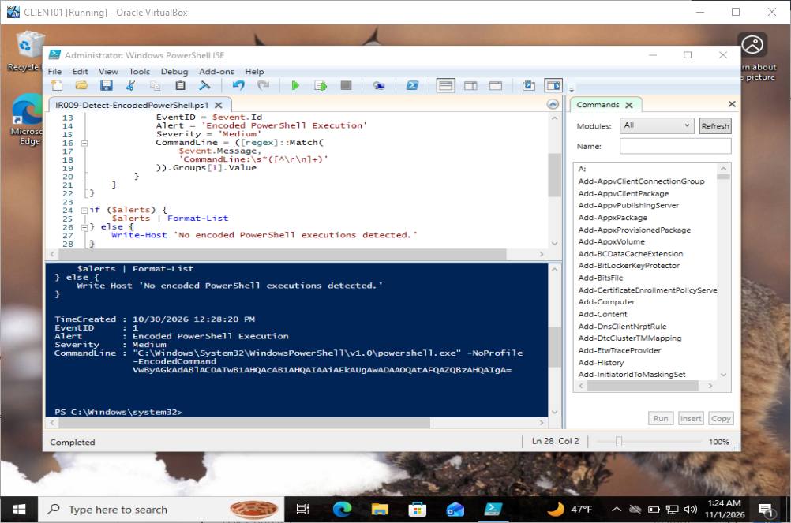
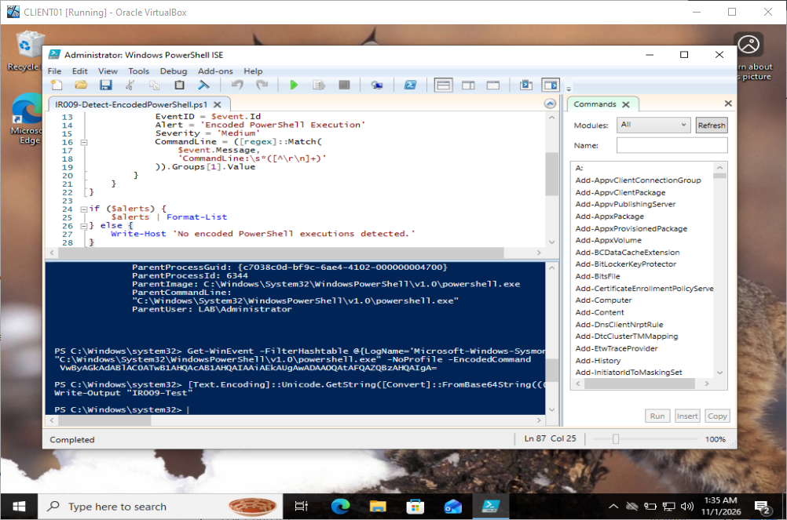

# IR-009 — Encoded PowerShell Execution: Endpoint Threat Hunt

## Executive summary
A controlled Windows endpoint investigation on CLIENT01 validated detection of encoded PowerShell execution using Sysmon process-creation telemetry. A custom PowerShell script identified an Event ID 1 process whose command line contained `-EncodedCommand`. Investigation established that the parent was PowerShell running under `LAB\Administrator`; decoding the captured payload as UTF-16LE yielded `Write-Output "IR009-Test"`. **Disposition: benign, controlled lab test.** Encoded execution alone is not proof of malware.

## Environment and telemetry
- Endpoint: CLIENT01, Windows 10, domain `lab.local`.
- Data source: `Microsoft-Windows-Sysmon/Operational`, Event ID 1 (Process Create).
- Detection script: `IR009-Detect-EncodedPowerShell.ps1`, saved in CLIENT01 Documents.
- The script searches recent available Sysmon process events, matches encoded PowerShell command-line activity, and emits structured fields including event time, event ID, alert title, severity, and command line.
- Alert severity `Medium` is a **lab rule classification**, not an independently verified risk score.

## Investigation timeline and findings
| Item | Observed result |
| --- | --- |
| Process creation timestamp | 2026-10-30 12:28:20 PM (endpoint-local display) |
| Detection | Encoded PowerShell Execution |
| Sysmon event | 1 |
| Child process | `powershell.exe` with `-EncodedCommand` |
| Parent image | `C:\Windows\System32\WindowsPowerShell\v1.0\powershell.exe` |
| Parent process ID | 6344 |
| Parent user | `LAB\Administrator` |
| Integrity | High |
| Decoded content | `Write-Output "IR009-Test"` |
| Final classification | Benign test activity |

### Detection
The investigator ran the reusable detection script and observed an alert containing the process-creation timestamp and captured command line. The command line included the encoded-execution switch. This demonstrated the rule was able to find the known test event.

### Parent-process correlation
The investigator queried Sysmon Event ID 1 within a narrow time window around the alert and reviewed the full event message. The parent process was PowerShell, parent PID 6344, running as `LAB\Administrator`. A parent of PowerShell is useful context but is not inherently malicious or benign.

### Static decoding
The investigator extracted the command line from the Sysmon event and Base64-decoded the argument using .NET Unicode (UTF-16LE) text decoding **without executing the decoded text**. Result:

```powershell
Write-Output "IR009-Test"
```

The decoded statement only writes a test string to standard output. It contains no instructions to download payloads, change files, or make network connections. This supports a benign classification for the captured test event; it does not establish that all encoded PowerShell activity is harmless.

## Detection logic and limitations
- Relevant telemetry: Sysmon process creation (Event ID 1), especially `Image`, `CommandLine`, `ParentImage`, `ParentProcessId`, `User`, and `IntegrityLevel`.
- Analytic concept: flag PowerShell executions containing encoded-command arguments, then enrich with parent process, user, and decoded content.
- The current lab detector is a **pattern-based hunt**, not an enterprise EDR or continuous alerting service.
- Encoding can be used legitimately, and attackers may vary syntax or launch methods. This detection may yield false positives and miss other obfuscation techniques.
- The investigation did not independently validate network or file telemetry for this event; conclusions are scoped to the decoded command and recorded process metadata.

## Evidence and artifacts
- Local detection script: `Documents/IR009-Detect-EncodedPowerShell.ps1` on CLIENT01.
- Verified screenshot evidence uploaded to the repository:
  - [55 — Encoded PowerShell detection](../screenshots/55-IR009-EncodedPowerShell-Detection.png)
  - [56 — Decoded PowerShell evidence](../screenshots/56-IR009-Decoded-PowerShell-Evidence.png)




- Screenshots observed during the lab showed the structured detection alert, the parent-process fields, and the decoded benign command.

## Analyst conclusion
**True positive for the detection condition; benign positive for security impact.** Sysmon captured an encoded PowerShell invocation, the custom script alerted correctly, and static decoding showed a harmless lab command. This case demonstrates endpoint log hunting, process-parent correlation, safe command decoding, and evidence-based triage.

## Further improvements
1. Support additional PowerShell encoded-command flag variants while controlling false positives.
2. Extract and report `ProcessGuid` and `ParentProcessGuid` for more reliable correlation than PID alone.
3. Add a CSV/JSON evidence export and a documented test suite with benign and suspicious simulations.
4. Correlate PowerShell script-block logging (Event ID 4104) where enabled, plus relevant Sysmon network/file events.

## Technical Defense & Analyst Discussion

### Investigation summary for technical discussion
> "I built a PowerShell-based detection on a Windows 10 lab endpoint using Sysmon Event ID 1 process-creation telemetry. It flagged an encoded PowerShell command, so I investigated the full command line, the parent PowerShell process, the user context, and the integrity level. I then decoded the Base64 payload as UTF-16LE without running it. The decoded command was a harmless test, so I classified the event as a true detection but benign activity. The exercise demonstrated how to investigate an alert instead of assuming every encoded command is malicious."

### Concepts to know
- **Sysmon Event ID 1:** process creation; provides process image, command line, user, parent-process metadata, and other context depending on configuration.
- **`-EncodedCommand`:** PowerShell accepts a Base64 representation of a UTF-16LE command. Encoding can be used by legitimate automation or by attackers attempting to obscure command text.
- **Detection versus verdict:** the analytic correctly identified the encoded-execution pattern; determining whether the activity is malicious requires additional context.
- **Parent-child process chain:** parent image, parent command line, process IDs, and preferably ProcessGuids help reconstruct execution. PIDs can be reused.
- **Safe analysis:** decode and inspect an encoded payload as text; do not execute unknown decoded content.
- **Severity:** the lab script labeled this event Medium. Severity is a triage starting point, not proof of compromise.
- **Observed outcome:** `Write-Output "IR009-Test"` was a controlled test command. The finding is not evidence of an actual intrusion.

### Technical review questions and evidence-based answers

**Q: Why investigate encoded PowerShell?**  
A: Encoding can hide the intent of a command from casual inspection and is a useful hunting signal, but it is not inherently malicious. I inspect the decoded content, execution context, and surrounding telemetry before making a determination.

**Q: Which log and event ID did you use?**  
A: The Sysmon Operational log, Event ID 1, for process creation. I used its command-line and parent-process fields to triage the activity.

**Q: How did you determine what the command actually did?**  
A: I extracted the Base64 argument and decoded it using .NET's Unicode/UTF-16LE decoder. I reviewed the resulting text without executing it.

**Q: What did you find?**  
A: A PowerShell process with `-EncodedCommand` and a PowerShell parent running as `LAB\Administrator`. The decoded payload only printed `IR009-Test`. I treated it as a benign test rather than claiming malware.

**Q: What is the difference between a true positive and a false positive here?**  
A: The rule truly detected the condition it was designed to find, so it was a true positive for encoded execution. It was benign from a security-impact standpoint. A useful detection can still produce alerts that do not require incident escalation.

**Q: What would you investigate next if the decoded command were suspicious?**  
A: Review the process tree and ProcessGuids, the user and logon session, PowerShell script-block logs if enabled, network connections, file modifications, persistence mechanisms, and any matching activity on other hosts. Preserve evidence before making changes.

**Q: How would you improve the detector?**  
A: Handle alternative encoded-command argument spellings, enrich with ProcessGuid and parent correlation, add structured CSV/JSON output, test against benign and suspicious cases, and correlate with PowerShell Event ID 4104 and Sysmon network/file telemetry.

### Resume-ready bullet
- Developed and validated a PowerShell endpoint-hunting detector using Sysmon Event ID 1; investigated encoded command-line execution, correlated parent-process and user context, decoded Base64 payloads safely, and documented evidence-based benign-versus-suspicious triage.

### Reporting integrity
Do not describe this as discovering real malware or a confirmed compromise. It was a **controlled detection-validation and threat-hunting lab**.
