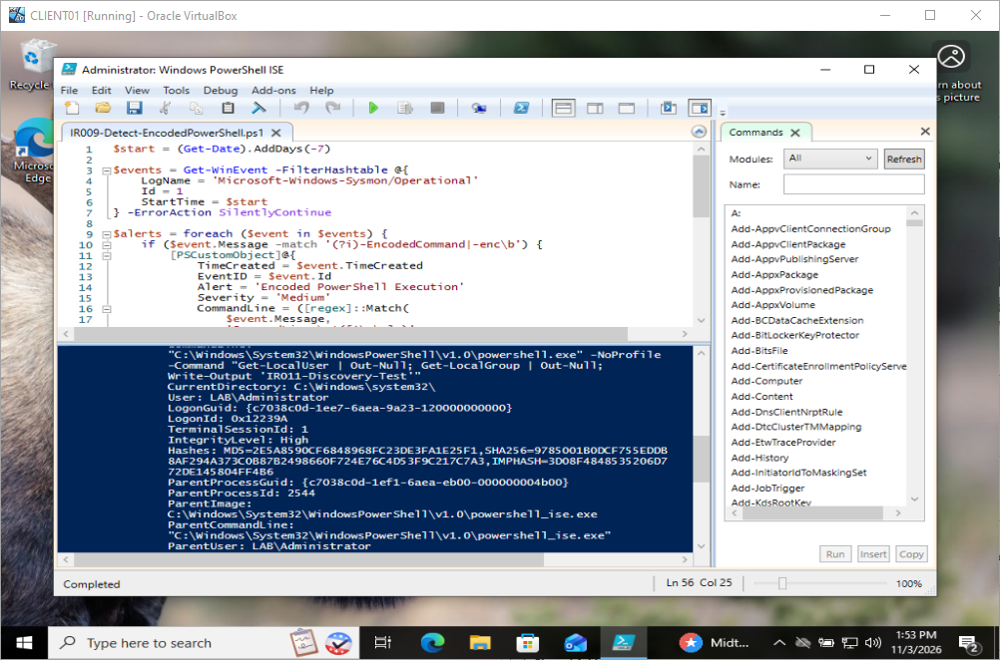
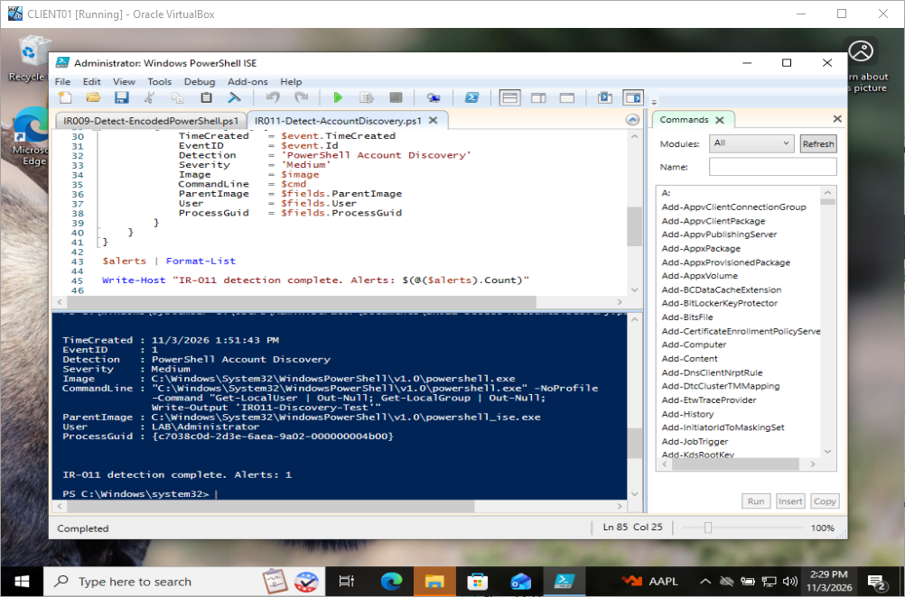

# IR-011 — PowerShell Account Discovery: Sysmon Detection and False-Positive Control

**Date:** November 3, 2026  
**Endpoint:** CLIENT01, Windows 10 (`lab.local`)  
**Scope:** Authorized isolated defensive lab  
**MITRE ATT&CK:** [T1087.001 — Local Account](https://attack.mitre.org/techniques/T1087/001/); [T1069.001 — Local Groups](https://attack.mitre.org/techniques/T1069/001/)  
**Disposition:** Benign simulation; custom detection triggered as expected; one benign control excluded.

## Executive summary
Implemented and tested a PowerShell detection script that parses **Sysmon Event ID 1 (Process Create)** records, identifies local account/group enumeration commands in PowerShell command lines, and outputs structured analyst alerts. A controlled `Get-LocalUser` / `Get-LocalGroup` simulation generated **one medium-severity alert**. A separate benign `Get-Date` / `Write-Output` control was executed; a subsequent detection run still returned **one alert**, indicating that this specific control did not generate an additional detection.

**No unauthorized discovery, attacker activity, or compromise is claimed.** The severity is an illustrative analyst triage label, not a calibrated risk score.

## Lab setup and telemetry
- Windows PowerShell ISE, run as `LAB\Administrator`
- Sysmon service running; Sysmon Operational channel confirmed to contain Event ID 1
- Detection implementation: [IR011-Detect-AccountDiscovery.ps1](../scripts/IR011-Detect-AccountDiscovery.ps1)
- Earlier IR-009 script retained separately; IR-011 uses its own account-discovery analytic

## Reproduction and observed results

### Positive test — local account and group enumeration
```powershell
powershell.exe -NoProfile -Command "Get-LocalUser | Out-Null; Get-LocalGroup | Out-Null; Write-Output 'IR011-Discovery-Test'"
```

Observed in Sysmon Event ID 1:
- Image: `C:\Windows\System32\WindowsPowerShell\v1.0\powershell.exe`
- ParentImage: `C:\Windows\System32\WindowsPowerShell\v1.0\powershell_ise.exe`
- User: `LAB\Administrator`
- Integrity: High
- Command line included `Get-LocalUser`, `Get-LocalGroup`, and the unique marker `IR011-Discovery-Test`
- Detection result: **1 alert**, named `PowerShell Account Discovery`, severity `Medium`
- Observed event time in alert: **2026-11-03 13:51:43** (host local time)

### Negative test — ordinary PowerShell activity
```powershell
powershell.exe -NoProfile -Command "Get-Date; Write-Output 'IR011-Benign-Control'"
```

The console returned the `IR011-Benign-Control` marker. Re-running the detection afterward produced **Alerts: 1**, matching the earlier single positive event. This is a **one-case negative-control check**, not a claim of zero false positives in production.

### Execution-policy troubleshooting
The script initially failed with a PowerShell execution-policy `UnauthorizedAccess` error. For this isolated lab, the process-scoped command below permitted execution without permanently changing machine policy:
```powershell
Set-ExecutionPolicy -Scope Process -ExecutionPolicy Bypass -Force
```
The detection script then executed and returned the structured alert.

## Detection logic and forensic value
The analytic queries Sysmon process creation events from the preceding 24 hours, parses named XML event fields, restricts results to PowerShell executables, and matches local account/group discovery tokens. Each alert preserves event time, command line, executable path, parent image, user, and Sysmon ProcessGuid.

**Analyst workflow:** inspect the exact command line; pivot on ProcessGuid and parent-child process lineage; validate the account's role, origin, session, and associated actions; compare against approved administrative scripts; and check for follow-on credential access, remote access, or unusual network connections. A discovery command alone does not prove malicious intent.

## Evidence inventory

| Screenshot | Description |
|---|---|
| `61-IR011-Sysmon-Process-Ancestry.png` | Sysmon Event 1 process creation, command line, parent process, user and integrity |
| `62-IR011-AccountDiscovery-Detection-Alert.png` | Custom analytic output with one medium-severity account-discovery alert |
| `63-IR011-Benign-Control-Validation.png` | Detection rerun showing one alert after executing benign control |

The user reports uploading these screenshots. Exact repository paths and filename extensions were not independently verified here, so broken image links are intentionally avoided.

## Original visual evidence

**61 — Sysmon Event 1 and process ancestry.** Confirms the process, user, parent and command-line context needed for a credible discovery investigation.



**62 — Custom detection alert.** Shows the single medium-severity alert produced by the account-discovery simulation.



**63 — Benign control validation.** The detector still reported one alert after `Get-Date` / `Write-Output`, indicating no additional alert for that specific control.


## Analyst decisions and five-minute refresher

| Choice | Why it mattered |
|---|---|
| Sysmon Event 1 | Captures process creation and command-line context |
| Inspect parent image and ProcessGuid | Supports process-lineage pivots rather than judging a command in isolation |
| Controlled discovery commands | Provides a known positive case for validating the analytic |
| Ordinary PowerShell control | Checks whether the detector triggers on unrelated PowerShell activity |
| Process-scoped execution-policy bypass | Allowed a local lab test without permanently changing machine policy |

**30-second interview summary:** I generated controlled PowerShell account/group discovery on a domain client, verified its Sysmon process creation event, wrote a PowerShell detector that produced one alert, and ran a benign control that produced no additional alert. I distinguished the detected behavior from malicious intent.

**Recall prompts:** What does Sysmon Event 1 capture? Why investigate the parent process? Why doesn't a single negative control prove a low false-positive rate?

<details><summary>Interview defense — What would you change in production?</summary>

Correlate the command line with user role, parent-child lineage and related activity; support alternate discovery tools and PowerShell script block logging where available; centralize event retention; test diverse benign cases; and avoid treating a fixed Medium label as a calibrated risk score.

</details>

## Limitations and production hardening
- Only **one positive and one negative** test were observed; no measured detection sensitivity, precision, or false-positive rate is claimed.
- Command-line string matching can miss alternate discovery mechanisms, renamed executables, indirect execution, and obfuscation.
- The `net user` / `net localgroup` expression is scoped to PowerShell command lines; direct `net.exe` execution is not covered.
- A 24-hour lookback and local event retention limit visibility; log collection should be centralized for operational use.
- Severity is fixed at Medium, not risk-scored.
- Production improvements: normalize Sysmon fields, cover native discovery tools and PowerShell script-block logging where enabled, add exclusions for approved automation, unit-test diverse benign/malicious cases, export structured JSON, and map alert triage to an incident playbook.

## Conclusion
IR-011 demonstrates custom detection development, Sysmon process-ancestry analysis, controlled positive/negative validation, execution-policy troubleshooting, and evidence-driven incident reporting. The activity was benign and deliberately generated in the lab.
