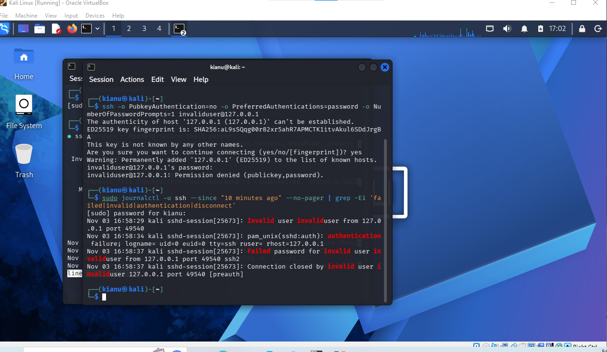
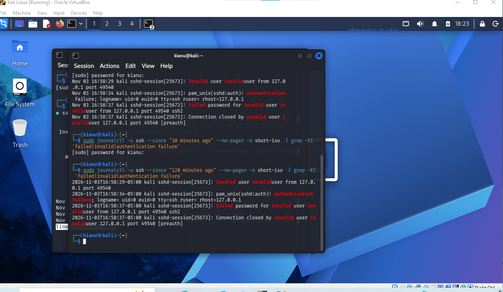
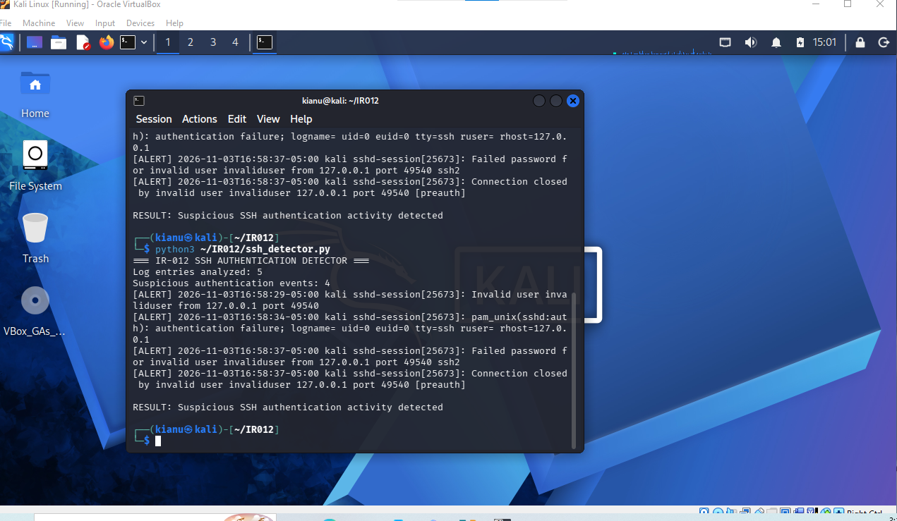
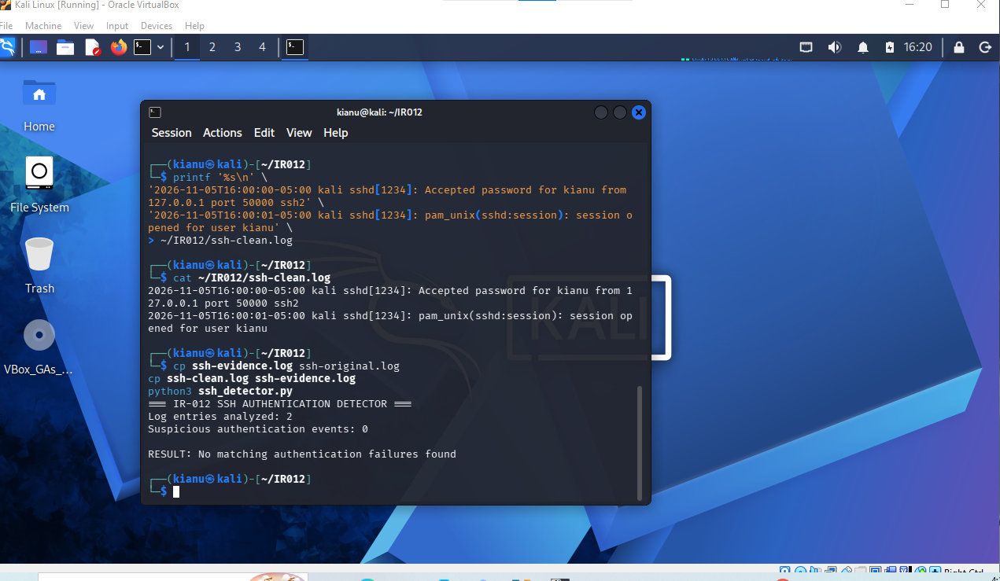

# IR-012 — SSH Authentication Failure Detection and Clean-Log Validation

**Date:** November 5, 2026  
**Environment:** Authorized Kali Linux lab, VirtualBox  
**Status:** Positive and negative test cases completed

## Objective
Build and validate a lightweight Python detector for SSH authentication-failure messages, using controlled log evidence. Distinguish matching log lines from unique login attempts and test for false alerts on a benign sample.

## Method
1. Collected a five-line SSH authentication evidence sample from a controlled local test (source `127.0.0.1`, invalid account `invaliduser`).
2. Wrote `ssh_detector.py` to read `ssh-evidence.log` beside the script, scan each line case-insensitively for `Invalid user`, `Failed password`, or `authentication failure`, and print matching lines.
3. Ran the detector on the original evidence.
4. Created a separate two-line benign sample containing an accepted SSH login and a session-open event. Temporarily substituted it for the input log and reran the detector.
5. Restored the original evidence file after testing.

## Observed results

| Test | Log lines | Matching lines | Result |
| --- | ---: | ---: | --- |
| Controlled failed-authentication sample | 5 | 4 | Suspicious SSH authentication activity detected |
| Benign login/session sample | 2 | 0 | No matching authentication failures found |

**Interpretation:** Four matches do **not** mean four distinct failed login attempts. A connection-closure line also contained the phrase `invalid user` and matched the broad regex. The benign test demonstrates zero matches for the two supplied normal lines, not a measured production false-positive rate.

## Reproduce
Place the detector and an SSH sample named `ssh-evidence.log` in the same directory, then run:

```bash
python3 ssh_detector.py
```

The script does not automatically ingest system journals or accept an arbitrary input path. To run against another sample, replace the local `ssh-evidence.log` file (after backing up the original).

## Evidence
- [64 — Failed SSH authentication evidence](../screenshots/64-IR012-SSH-Failed-Authentication-Evidence.png)
- [65 — SSH authentication timeline](../screenshots/65-IR012-SSH-Authentication-Timeline.png)
- [66 — Detector positive test](../screenshots/66-IR012-SSH-Authentication-Detection.png)
- [67 — Clean-log negative test](../screenshots/67-IR012-Clean-Log-Validation.png)
- [Python detector](../scripts/ssh_detector.py)

### Visual evidence and analyst interpretation

**Screenshot 64 — Controlled SSH authentication evidence.** This records the source material inspected by the detector; the loopback address indicates a local test, not an external attack.



**Screenshot 65 — Authentication timeline.** Read the log entries in sequence and distinguish authentication messages from connection/session messages before counting attempts.



**Screenshot 66 — Positive detection.** The Python script matched four of five log lines. Because multiple messages can refer to one attempt, four matched lines are not necessarily four failed logins.



**Screenshot 67 — Negative control.** Two benign entries produced zero matches. This verifies the behavior on the tested sample, not a production-wide false-positive rate.



## Why the investigation steps mattered

| Decision | Reason | What the result can establish |
|---|---|---|
| Preserve a controlled SSH sample | Provides repeatable input for a detection test | The detector was evaluated on known data |
| Match several failure-related phrases | Covers different SSH authentication log wording | Four lines contained one of the target patterns |
| Inspect each matched line | Prevents mistaking matching messages for unique attempts | A connection-close message also matched `invalid user` |
| Test accepted-login messages | Checks that the detector is not triggered by all SSH activity | No matches in the two-line benign control |
| Restore the original sample | Keeps the positive test reproducible | The initial evidence remains the test reference |

## Technical Summary & Key Takeaways

**Executive technical recap:** I used controlled Kali SSH logs to build a Python regex-based failure detector, verified that it flagged relevant authentication messages, then tested a clean sample to check for obvious false alerts. The detector identified matching log lines, not unique failed attempts. I documented that limitation rather than claiming brute force or compromise.

**Command to remember:** `python3 ssh_detector.py` runs the local parser against the expected adjacent `ssh-evidence.log` file. The command alone does not enable continuous monitoring or query the system journal.

**Three self-check questions:**
1. Why might a single SSH connection produce multiple matching log entries?
2. Why is a two-line negative test useful but insufficient to estimate false-positive rates?
3. What fields would you use to aggregate failures into unique sessions and time windows?

<details><summary>Suggested answers</summary>

1. Authentication, invalid-account, and connection-close messages may all describe the same connection.
2. It checks behavior on a known clean input but does not represent diverse production log formats.
3. Timestamp, source address, account, SSH daemon process ID, and where available connection/session identifiers.

</details>

## Engineering Considerations

<details><summary>How would you reduce false positives?</summary>

Parse event types and structured fields rather than broad substring matches, correlate messages by session, exclude expected test activity, and test against larger benign datasets. Retain raw lines for auditability.

</details>

<details><summary>How would you evolve this into a SOC alert?</summary>

Collect logs centrally, normalize SSH event fields, aggregate by account/source over a defined time window, set thresholds, enrich with asset context, and validate against both simulated attacks and benign activity. Those improvements are proposals, not features of the current script.

</details>

## Limitations and next improvements
- Regex matches individual lines, not unique sessions; deduplicate by process ID, source, account, and time window.
- No rate threshold, aggregation, severity classification, structured JSON output, or automated tests yet.
- Only a tiny controlled sample and two benign lines were validated; broader real-world SSH log formats may behave differently.
- The localhost test is a simulation, **not** evidence of an external intrusion or compromised host.
- Raw log evidence is retained locally; the repository documents screenshots and source code.

## Skills demonstrated
Python log parsing, regex-based detection, controlled test design, positive/negative validation, evidence preservation, and explicit detection limitations.
