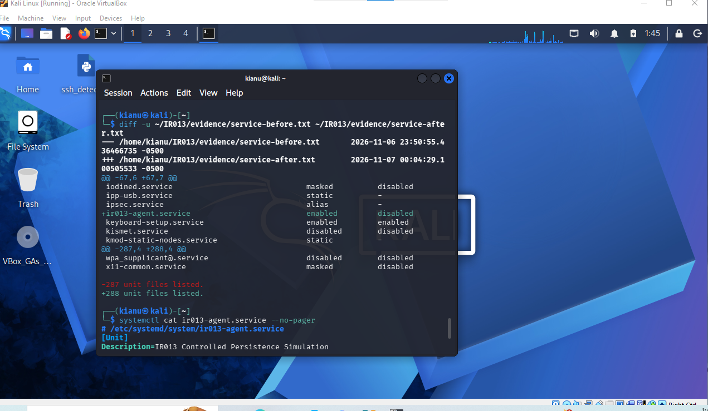
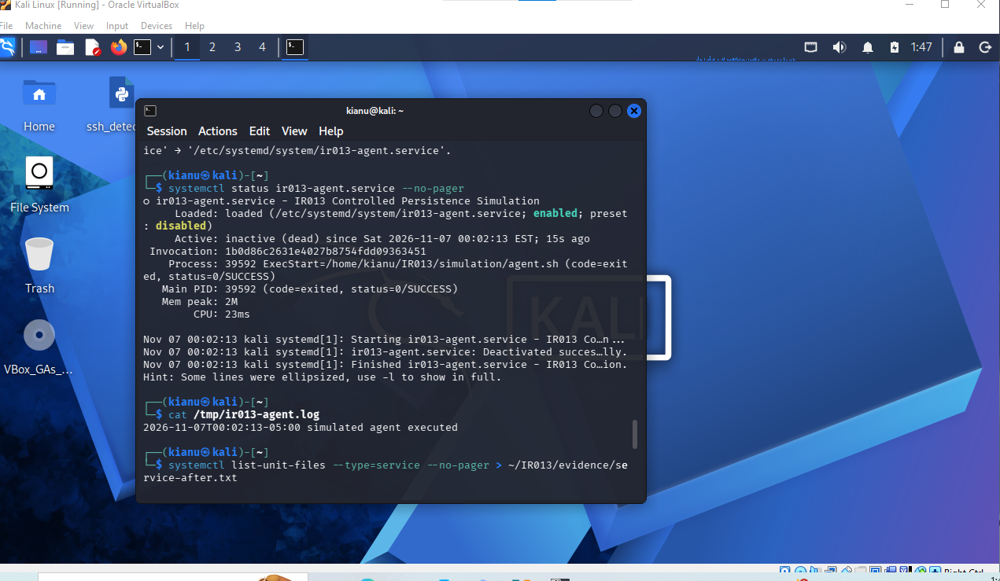
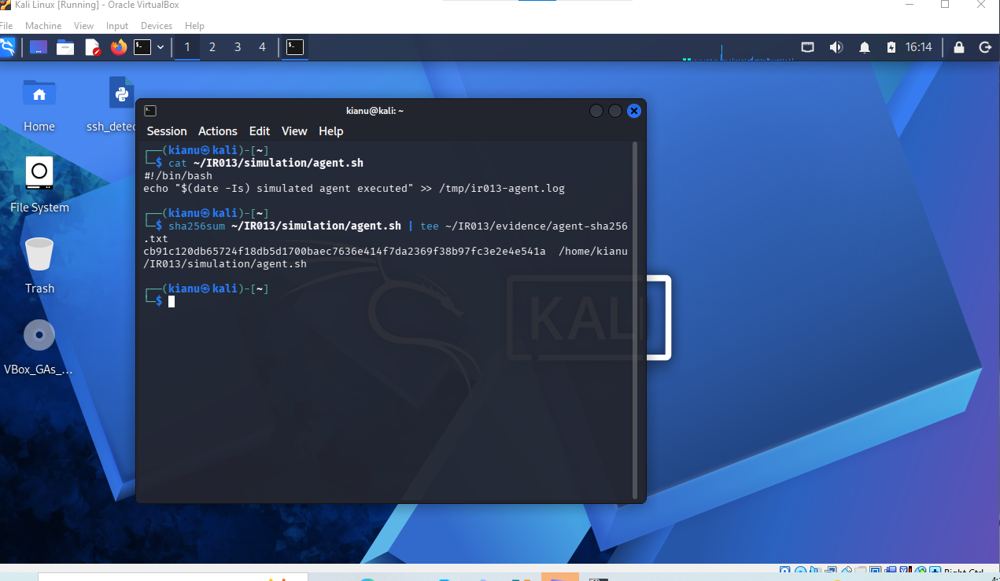
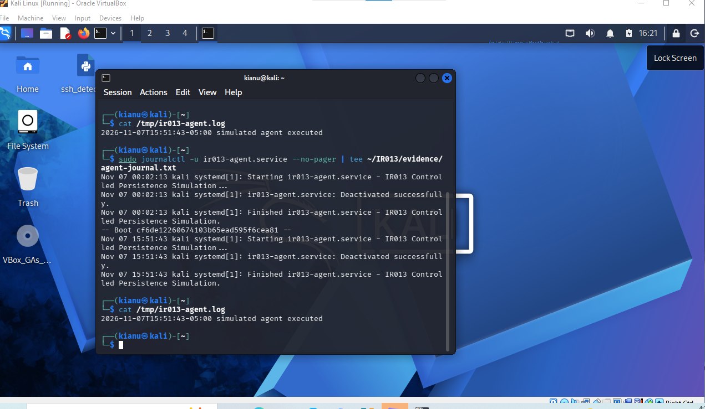
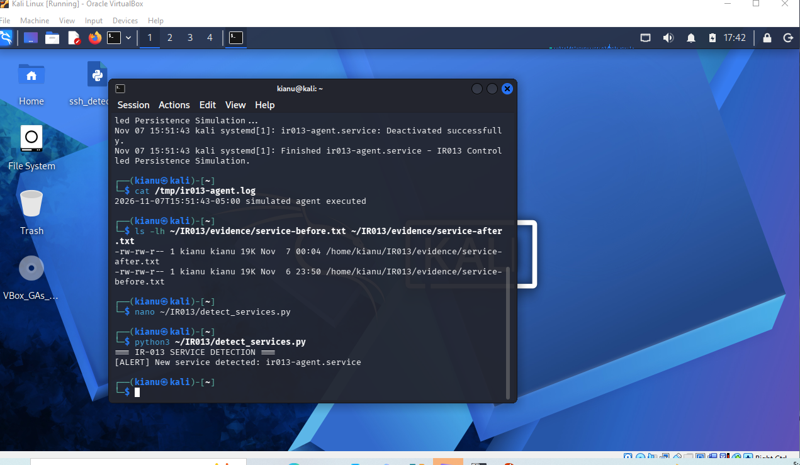
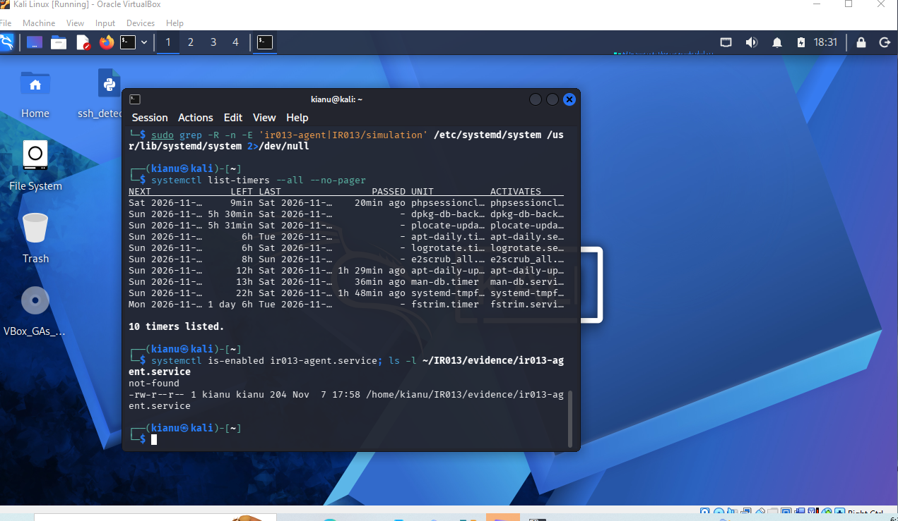

# IR-013 — Linux Systemd Persistence Detection and Incident Response

**Environment:** Isolated, authorized Kali Linux VirtualBox lab  
**Technique:** MITRE ATT&CK T1543.002 — Create or Modify System Process: Systemd Service  
**Classification:** Benign adversary-technique simulation; no real compromise asserted  
**Status:** Detection, investigation and containment completed

## Executive summary

This exercise simulated persistence using a harmless Bash script and a systemd unit named `ir013-agent.service`. The investigation compared service inventories before and after installation, inspected service configuration and execution evidence, recorded a script SHA-256 hash, and tested a Python detector that flags newly introduced systemd service units. The service was subsequently disabled and removed, followed by verification checks.

The screenshots below are **original uploaded lab evidence**, embedded inline so readers can inspect the observed results while reading the report.

## 1. Establish a baseline and identify the new service

Saved systemd unit inventories before and after the simulation were compared. The inventory increased from 287 to 288 entries, with `ir013-agent.service` identified as the added service. A new service is a lead for investigation, not proof of malicious intent.



## 2. Investigate the persistence mechanism

The test service was installed under `/etc/systemd/system/` and enabled to model boot-persistent execution. Its `ExecStart` referenced a harmless local Bash script, `~/IR013/simulation/agent.sh`, which wrote a timestamp to `/tmp/ir013-agent.log`. This demonstrates the mechanism without deploying malware.



## 3. Record file integrity evidence

The investigation captured a SHA-256 hash for the simulated agent and reviewed file metadata. A hash is useful for tracking a specific file's content and comparing copies; it does not, on its own, determine whether a file is malicious.



## 4. Reconstruct the execution timeline

Systemd journal evidence and the script's timestamped output supported a timeline of simulated execution. Journal records provide context for service starts and stops, but interpretation still requires configuration and process evidence.



## 5. Detection engineering

A Python comparison of the saved before-and-after service inventories produced:

```text
[ALERT] New service detected: ir013-agent.service
```

The detector performs **snapshot comparison**, not continuous monitoring, and would require enrichment and allowlisting in a production environment. The original detection-alert screenshot is embedded below, showing the detector's output during the controlled test.



## 6. Containment and verification

The simulated service was disabled and stopped with `systemctl disable --now`, its unit file was removed, and systemd configuration was reloaded. Follow-up checks showed `systemctl is-enabled ir013-agent.service` returning `not-found`, no matching persistence unit paths, and no unexpected listeners attributable to this simulation. The benign script was intentionally retained as lab material.



## Findings and limitations

- **Observed:** A new systemd service appeared in the inventory, executed the benign simulation, and triggered the snapshot-based Python alert.
- **Observed:** The simulated persistence unit was disabled and removed; follow-up checks did not find the installed unit.
- **Not established:** A real attacker, malicious binary, production compromise, or continuous detection capability.
- **Improvement opportunities:** Automate periodic inventory capture, record unit metadata, correlate journal events, baseline approved services, and test alerting on suspicious service changes.

## Evidence and reproducibility

The screenshots are stored in the repository's [shared screenshot archive](../screenshots/). The locally prepared Python detector, before/after inventories, and longer incident report should be uploaded separately for complete reproducibility. This report summarizes the verified exercise and does not substitute reconstructed source code for the original files.
