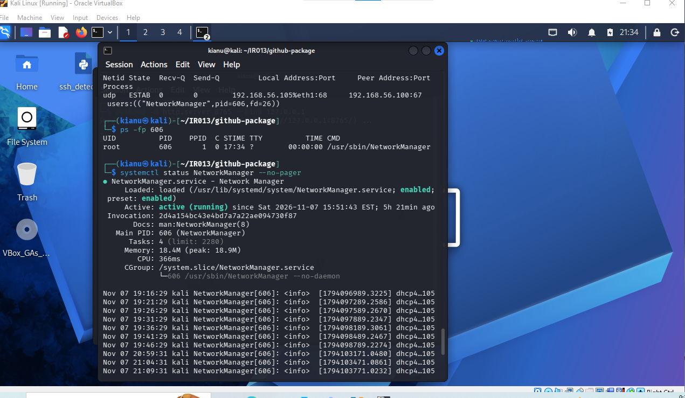
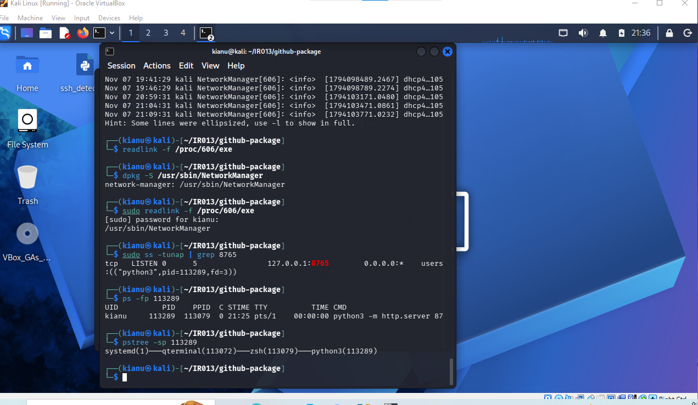
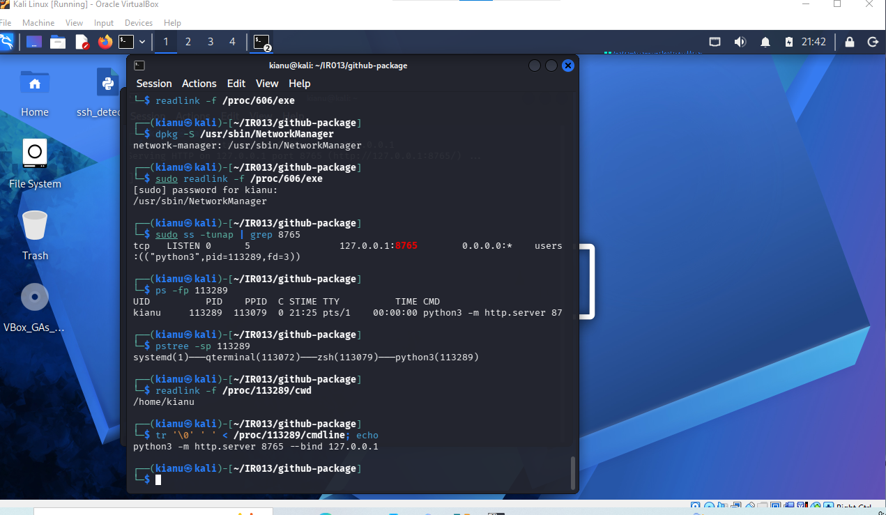
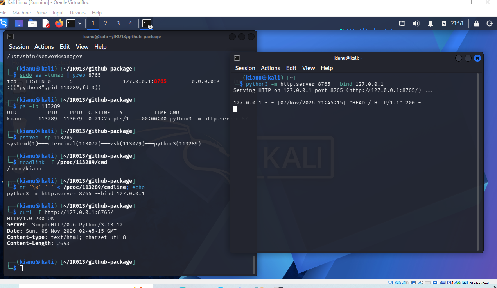
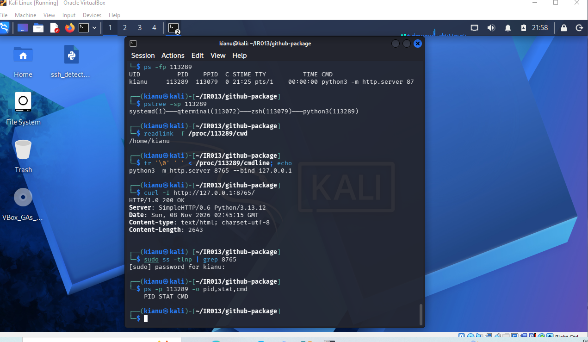
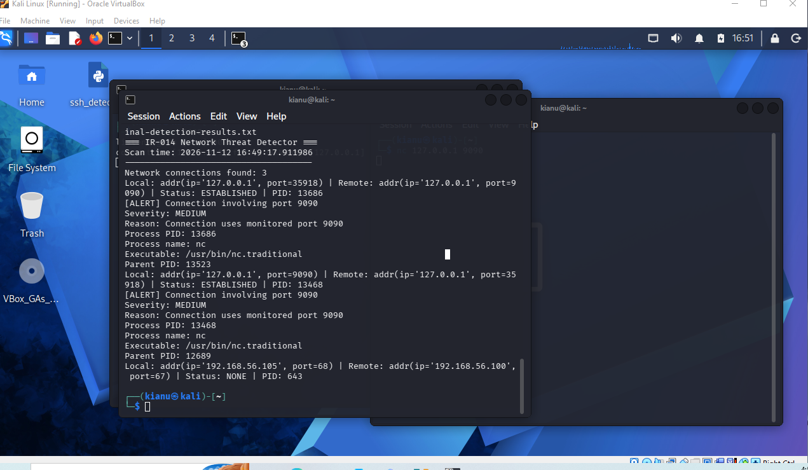

# IR-014 — Python Network Connection Detection and Containment Verification

**Date:** 2026-11-12  
**Environment:** Authorized Kali Linux home lab (VirtualBox)  
**Classification:** Simulated detection-engineering exercise; no confirmed malicious compromise

## Objective
Build and validate a Python network-connection detector that identifies connections involving a lab-monitored TCP port, attributes activity to processes, assigns a triage label, and verifies alert behavior after the test connection ends.

## Tools
- Python 3 and psutil 7.1.0
- Netcat (`nc.traditional`) for controlled loopback traffic
- Kali Linux terminal and standard Linux process/network facilities

## Procedure and verified observations
1. Created `~/IR014/scripts/network_detector.py` using `psutil.net_connections(kind="inet")`. The detector prints scan time, connection count, local/remote endpoints, TCP state, and PID.
2. Started a Netcat listener on `127.0.0.1:9090` and connected a second local Netcat process. The initial scanner found **three network connection records**.
3. An initial local-port-only rule flagged the listener but missed the client. Revised the rule to match port 9090 on **either the local or remote endpoint**. This produced **two alerts**, representing the two local process endpoints of one TCP conversation—not two attacks.
4. Added process attribution using `psutil.Process(pid)`: process name `nc`, executable `/usr/bin/nc.traditional`, and parent PID. Added a lab-defined `MEDIUM` triage label with the reason `Connection uses monitored port 9090`. This label alone does not establish maliciousness.
5. Preserved active-detection output using `tee` to `~/IR014/evidence/final-detection-results.txt`.
6. Stopped the Netcat test processes. A subsequent scan showed **two records**, including one port-9090 `TIME_WAIT` record with `PID: None`, which still triggered the port-only rule. This was a recently closed TCP connection, not proof of an active process.
7. After the `TIME_WAIT` record expired, a new scan showed **one remaining record and zero port-9090 alerts**. The remaining record was DHCP traffic (`192.168.56.105:68` to `192.168.56.100:67`). Preserved this post-test result in `~/IR014/evidence/post-containment-results.txt`.

## Detection logic and limitations
- Matches port 9090 on either endpoint; this is a **lab-specific indicator**, not a universal malware signature.
- A connection record is not necessarily a distinct remote session or attack.
- `TIME_WAIT` can produce a stale alert after a process exits; an improvement would classify TCP state separately and prioritize `ESTABLISHED` and `LISTEN` activity.
- `PID: None` may reflect a connection state without an owning process or limited attribution; it is not evidence of stealth malware.
- The script provides a **point-in-time snapshot**, not continuous monitoring, packet capture, or historical logging.
- No comprehensive persistence search, malware analysis, data-exfiltration assessment, or full-host compromise clearance was established in IR-014.

## Outcome
The detector correctly identified both endpoints of the controlled Netcat connection, enriched alerts with process metadata, and stopped alerting after the simulated activity and TCP cleanup completed. The exercise demonstrates detection rule iteration, process attribution, false-positive awareness, evidence preservation, and post-activity validation.

## Embedded visual evidence — chronological investigation

The six screenshots below are verified files in the repository's `screenshots/` directory. They are placed beside the corresponding investigative phase; captions describe their role without treating the screenshots as proof of an actual intrusion.

### 1. Network baseline — Screenshot 69

*Baseline: document the observed network state before evaluating the controlled test traffic. A baseline makes later differences easier to interpret.*

### 2. Listener and process ancestry — Screenshot 70

*Listener attribution: connect the observed listening socket to its owning process and parent-process context. Process ancestry helps distinguish an authorized test from unexplained activity.*

### 3. Process execution context — Screenshot 71

*Execution context: inspect the process identity and execution details associated with the lab traffic. A familiar binary name alone does not establish that activity is benign.*

### 4. HTTP request and log correlation — Screenshot 72

*Correlation evidence: relate the captured request/log observations to the investigation timeline. This is contextual evidence; the port-9090 Netcat detector findings should not be misrepresented as proof that an HTTP request was malicious.*

### 5. Containment verification — Screenshot 73

*Post-activity verification: check whether the test activity has ended and distinguish residual TCP state from an actively running connection. In this lab, a transient TIME_WAIT record preceded the later zero-alert scan.*

### 6. Python network detector — Screenshot 74

*Detector validation: the custom Python/psutil scan identified port-9090 activity, associated Netcat processes with the observations, and applied the lab-defined MEDIUM triage label. The alert is not evidence of a confirmed compromise.*

## Evidence inventory

- [Screenshot 69 — Network Baseline](../screenshots/IR014_69_Network_Baseline.png)
- [Screenshot 70 — Listener Process Ancestry](../screenshots/IR014_70_Listener_Process_Ancestry.png)
- [Screenshot 71 — Process Execution Context](../screenshots/IR014_71_Process_Execution_Context.png)
- [Screenshot 72 — HTTP Request Log Correlation](../screenshots/IR014_72_HTTP_Request_Log_Correlation.png)
- [Screenshot 73 — Containment Verification](../screenshots/IR014_73_Containment_Verification.png)
- [Screenshot 74 — Python Network Detection](../screenshots/IR014_74_Python_Network_Detection.png)
- Local text evidence: `final-detection-results.txt` and `post-containment-results.txt` (not confirmed uploaded to GitHub).
- [Python detector reference implementation](../scripts/IR014_network_detector.py) — authored for the portfolio based on verified IR-014 behavior; **not** claimed to be the exact original Kali source. Original local path: `~/IR014/scripts/network_detector.py`.

## Reproducible detection script

The repository includes [a complete Python 3 reference implementation](../scripts/IR014_network_detector.py) using `psutil.net_connections(kind="inet")`, local/remote port matching, process metadata, and explicit `TIME_WAIT` caveats. Run it in the authorized Kali lab with `sudo python3 scripts/IR014_network_detector.py` after installing `psutil`. Its code was authored for this portfolio after the exercise, so its exact output formatting has **not** been verified against the original lab script. The original local script remains the source of truth for historical execution.

## Analyst decision
Close the **controlled lab test** as successful. Do not interpret a disappearing alert as proof of host safety in a real incident. A real SOC case would also investigate process ancestry, user activity, persistence, destination reputation, data transfer, and reappearance before incident closure.
