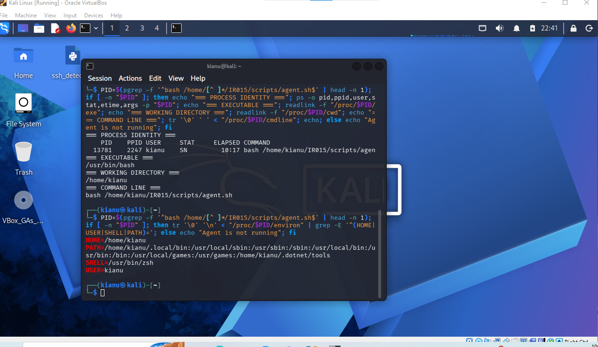
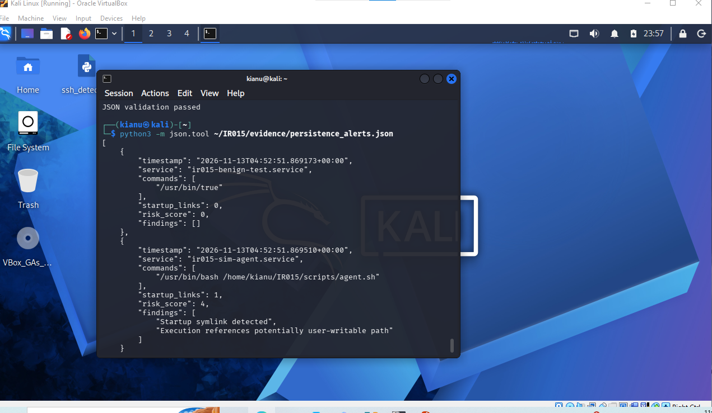
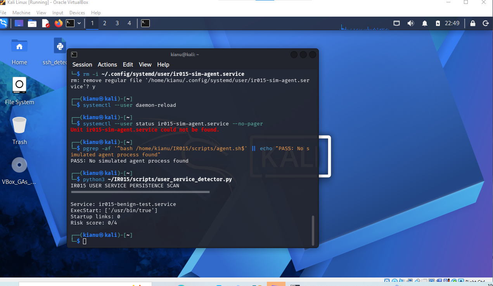
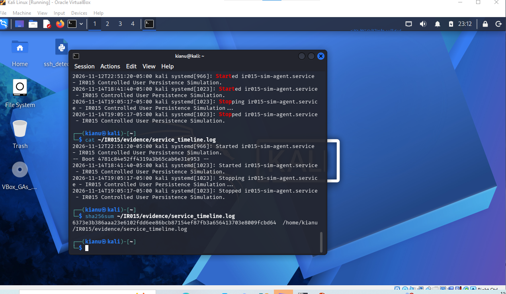

# IR-015: Linux User-Level Systemd Persistence Investigation

## Executive Summary
This controlled cybersecurity lab investigated a simulated Linux user-level persistence mechanism using a systemd service. A benign Bash agent was configured to run through a user service. The investigation covered process attribution, service configuration analysis, detection engineering, alert validation, evidence preservation, containment, eradication, and recovery verification.

## Environment
- Platform: Kali Linux virtual machine
- Persistence mechanism: User-level systemd service
- Simulated service: ir015-sim-agent.service
- Benign comparison: ir015-benign-test.service
- Tools: systemctl, journalctl, ps, pgrep, pstree, Python 3, SHA-256

## Detection Engineering
A Python detector examined user-level service configurations, startup links, and ExecStart commands. The simulated service scored 4/4 while enabled. The benign test service scored 0/4. After disabling the simulated service, its score decreased to 2/4 because the configuration still referenced a script under the user's home directory. These scores were laboratory heuristics, not proof of malware.

## Incident Timeline
All timestamps below use UTC-05:00.

| Date and time | Recorded event |
| --- | --- |
| 2026-11-12 22:51:20 | Simulated service started |
| 2026-11-14 18:41:40 | Simulated service started in a later boot session |
| 2026-11-14 19:05:17 | Service stopping and stopped events recorded |

## Containment and Eradication
The simulated service was disabled and stopped using `systemctl --user disable --now`. Subsequent checks found no matching agent process and no startup links. After preserving a copy of the service configuration, the active unit file was removed and systemd was reloaded. Final checks showed the unit could not be found and the detector listed only the benign comparison service.

## Evidence Preservation
- `evidence/agent.log`
- `evidence/persistence_alerts.json`
- `evidence/service_timeline.log`
- `evidence/preserved/ir015-sim-agent.service`
- `evidence/evidence_hashes.sha256`

SHA-256 verification returned OK for the preserved service configuration and service timeline. The historical JSON alert validation also passed.

## Recovery Verification
The original simulated service was no longer found by systemd or the Python persistence detector. The benign service remained with a score of 0/4. These checks establish removal of the tested persistence mechanism, not a comprehensive guarantee that the entire operating system is threat-free.

## Lessons Learned
- Enabled startup configuration and currently running process state are different.
- A suspicious execution path is an investigation clue, not proof of malicious activity.
- Containment, eradication, and recovery require separate verification.
- Historical detection evidence should be preserved after remediation.
- Hash manifests support integrity verification of collected evidence.

## Scope
This was an authorized, controlled simulation. No real malware or unauthorized compromise was involved.

## Visual Evidence and Analyst Interpretation

The following screenshots were captured during the controlled IR-015 investigation. Select any image to open its full-size version in GitHub. The captions describe the evidence category; the findings and limitations are documented in the report above.

### Evidence 75 — Process ancestry

*Investigative view of the simulated agent's process ancestry. [Open full-size screenshot](../screenshots/IR015_75_Agent_Process_Ancestry.png).*

### Evidence 76 — Execution context

*Process execution context collected during triage. [Open full-size screenshot](../screenshots/IR015_76_Process_Execution_Context.png).*

### Evidence 77 — User-level persistence

*Systemd user-service configuration and persistence verification. [Open full-size screenshot](../screenshots/IR015_77_User_Systemd_Persistence.png).*

### Evidence 78 — Service log correlation

*Service activity correlated with recorded systemd events. [Open full-size screenshot](../screenshots/IR015_78_Service_Log_Correlation.png).*

### Evidence 79 — Python persistence detection

*Detector findings for the simulated persistence mechanism. [Open full-size screenshot](../screenshots/IR015_79_Python_Persistence_Detection.png).*

### Evidence 80 — Structured JSON security alerts

*Exported detection alerts, including benign and simulated-service comparison. [Open full-size screenshot](../screenshots/IR015_80_JSON_Security_Alerts.png).*

### Evidence 81 — Post-containment verification

*Verification after disabling and stopping the simulated service. [Open full-size screenshot](../screenshots/IR015_81_Post_Containment_Verification.png).*

### Evidence 82 — Forensic evidence and SHA-256

*Preserved service configuration and integrity-check evidence. [Open full-size screenshot](../screenshots/IR015_82_Forensic_Evidence_SHA256_Verification.png).*

### Evidence 83 — Eradication verification

*Verification that the simulated persistence service was removed. [Open full-size screenshot](../screenshots/IR015_83_Final_Eradication_Verification.png).*

### Evidence 84 — Recovery and detection validation

*Recovery checks and validation of preserved historical alerts. [Open full-size screenshot](../screenshots/IR015_84_Recovery_And_Detection_Validation.png).*

### Evidence 85 — Incident timeline integrity

*Service timeline and SHA-256 integrity evidence. [Open full-size screenshot](../screenshots/IR015_85_Incident_Timeline_SHA256.png).*
