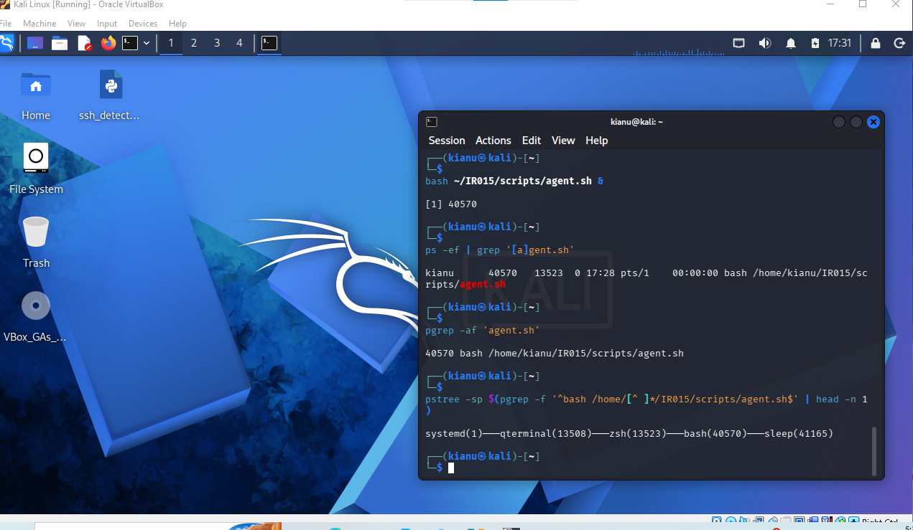
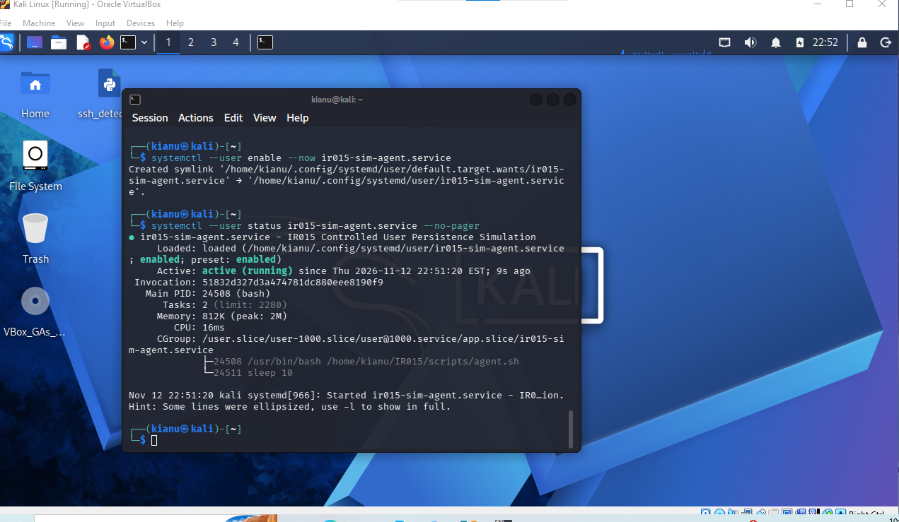
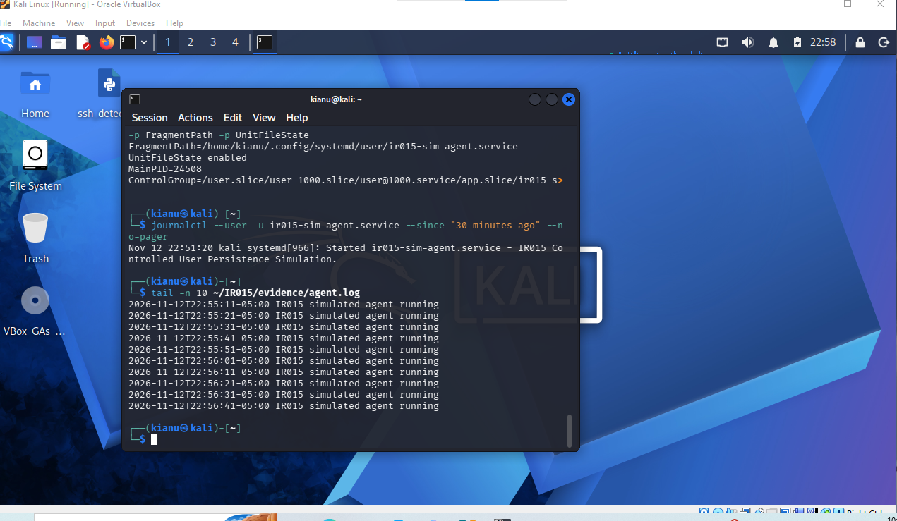
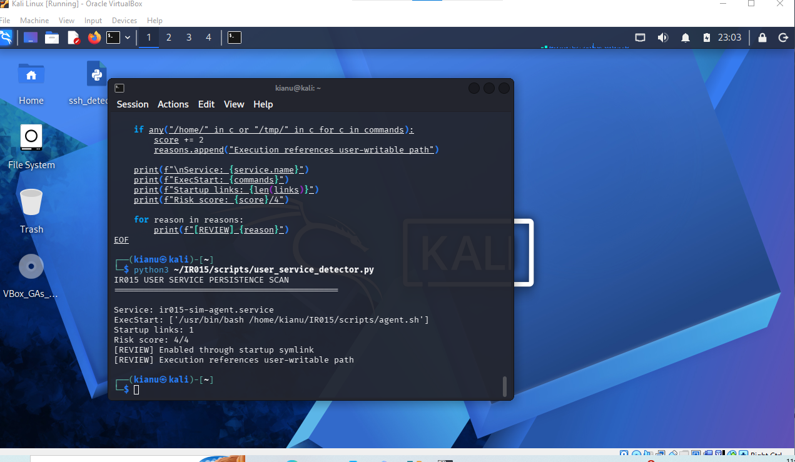
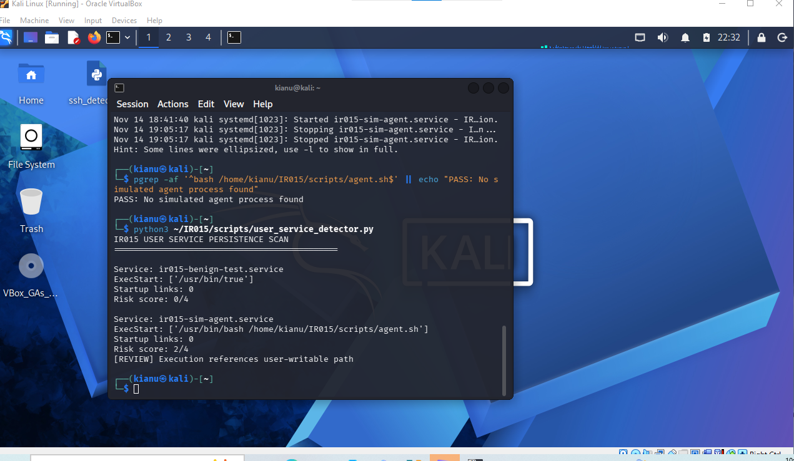
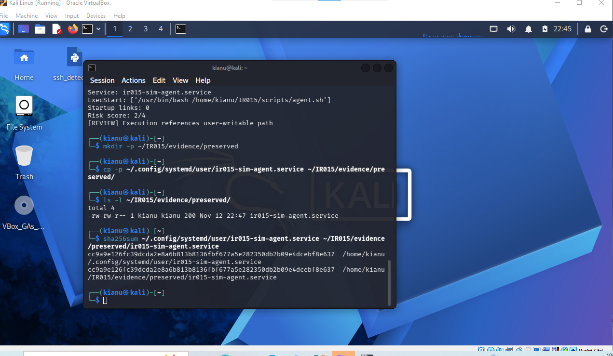
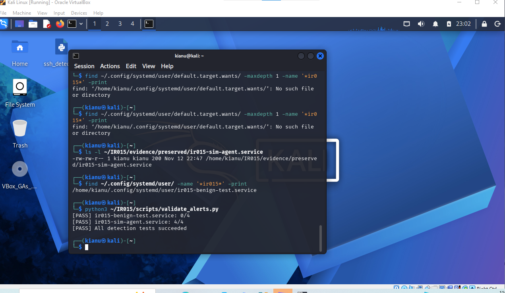

# IR-015: Linux User-Level Systemd Persistence Investigation

## Project Overview — What This Investigation Demonstrates

**The security problem:** On Linux, a user-level **systemd service** can automatically launch a program when a user's service manager starts. Attackers can abuse this legitimate feature for **persistence**—a way to run their code again after a session or system restart.

**What I built:** In an authorized Kali Linux virtual machine, I created a harmless Bash agent that wrote timestamps to a local log. I configured it as a user-level systemd service, investigated its process and service evidence, and developed Python checks to flag enabled startup links and execution paths in user-writable locations.

**What I found:** The simulated service triggered both detection rules (**4/4**); a benign comparison service triggered neither (**0/4**). Disabling the simulation removed the startup-link indicator, leaving **2/4** until the unit was removed. The score is a **lab-specific heuristic**, not a malware probability or industry-standard severity rating.

**What I did next:** I preserved the unit configuration and service timeline, verified SHA-256 evidence fingerprints, stopped and disabled the service, removed its active unit file, and confirmed that this specific persistence mechanism was no longer registered.

**Skills demonstrated:** Linux incident response, systemd service analysis, process attribution, journal log analysis, Python detection engineering, structured JSON alerts, evidence preservation, SHA-256 integrity validation, containment, eradication, and recovery verification.

**Result:** The tested persistence mechanism was removed and its historical evidence retained. This was a **controlled simulation**, not an actual attack or a claim that the entire host was forensically cleared.

**Reader's guide:** [Investigation findings](#detection-engineering) · [Timeline](#incident-timeline) · [Response](#containment-and-eradication) · [Visual evidence](#visual-evidence-and-analyst-interpretation) · [Technical summary](#technical-summary--key-takeaways)

## Executive Summary
This controlled cybersecurity lab investigated a simulated Linux user-level persistence mechanism using a systemd service. A benign Bash agent was configured to run through a user service. The investigation covered process attribution, service configuration analysis, detection engineering, alert validation, evidence preservation, containment, eradication, and recovery verification.

## Environment
- Platform: Kali Linux virtual machine
- Persistence mechanism: User-level systemd service
- Simulated service: ir015-sim-agent.service
- Benign comparison: ir015-benign-test.service
- Tools: systemctl, journalctl, ps, pgrep, pstree, Python 3, SHA-256

## Detection Engineering
A Python detector examined user-level service configurations, startup links, and ExecStart commands. The simulated service scored 4/4 while enabled. The benign test service scored 0/4. After disabling the simulated service, its score decreased to 2/4 because the configuration still referenced a script under the user's home directory. These scores were laboratory heuristics, not proof of malware.

## Incident Timeline
All timestamps below use UTC-05:00.

| Date and time | Recorded event |
| --- | --- |
| 2026-11-12 22:51:20 | Simulated service started |
| 2026-11-14 18:41:40 | Simulated service started in a later boot session |
| 2026-11-14 19:05:17 | Service stopping and stopped events recorded |

## Containment and Eradication
The simulated service was disabled and stopped using `systemctl --user disable --now`. Subsequent checks found no matching agent process and no startup links. After preserving a copy of the service configuration, the active unit file was removed and systemd was reloaded. Final checks showed the unit could not be found and the detector listed only the benign comparison service.

## Evidence Preservation
- `evidence/agent.log`
- `evidence/persistence_alerts.json`
- `evidence/service_timeline.log`
- `evidence/preserved/ir015-sim-agent.service`
- `evidence/evidence_hashes.sha256`

SHA-256 verification returned OK for the preserved service configuration and service timeline. The historical JSON alert validation also passed.

## Recovery Verification
The original simulated service was no longer found by systemd or the Python persistence detector. The benign service remained with a score of 0/4. These checks establish removal of the tested persistence mechanism, not a comprehensive guarantee that the entire operating system is threat-free.

## Lessons Learned
- Enabled startup configuration and currently running process state are different.
- A suspicious execution path is an investigation clue, not proof of malicious activity.
- Containment, eradication, and recovery require separate verification.
- Historical detection evidence should be preserved after remediation.
- Hash manifests support integrity verification of collected evidence.

## Scope
This was an authorized, controlled simulation. No real malware or unauthorized compromise was involved.

## Visual Evidence and Analyst Interpretation

The following screenshots were captured during the controlled IR-015 investigation. Select any image to open its full-size version in GitHub. The captions describe the evidence category; the findings and limitations are documented in the report above.

### Evidence 75 — Process ancestry

**What it is:** A process-family view showing how the agent was launched. **Why it matters:** Parent/child relationships help an analyst trace a process back to its launcher; the process name alone does not establish malicious intent.

*Investigative view of the simulated agent's process ancestry. [Open full-size screenshot](../screenshots/IR015_75_Agent_Process_Ancestry.png).*

### Evidence 76 — Execution context

**What it is:** Process execution details collected during triage. **Why it matters:** Command lines and execution context help distinguish the configured service from the process that actually ran.

*Process execution context collected during triage. [Open full-size screenshot](../screenshots/IR015_76_Process_Execution_Context.png).*

### Evidence 77 — User-level persistence

**What it is:** The user-level systemd service and its startup configuration. **Why it matters:** An enabled user service can relaunch a program in later user sessions; this is the persistence mechanism being tested.

*Systemd user-service configuration and persistence verification. [Open full-size screenshot](../screenshots/IR015_77_User_Systemd_Persistence.png).*

### Evidence 78 — Service log correlation

**What it is:** Systemd journal and service-activity evidence. **Why it matters:** Log records support the timeline of starts and stops, separately from the unit configuration.

*Service activity correlated with recorded systemd events. [Open full-size screenshot](../screenshots/IR015_78_Service_Log_Correlation.png).*

### Evidence 79 — Python persistence detection

**What it is:** Output from the Python persistence detector. **Why it matters:** It records which defined indicators were found, rather than treating an unfamiliar service name as proof of malware.

*Detector findings for the simulated persistence mechanism. [Open full-size screenshot](../screenshots/IR015_79_Python_Persistence_Detection.png).*

### Evidence 80 — Structured JSON security alerts

**What it is:** Structured JavaScript Object Notation (JSON) alerts from the controlled test. **Why it matters:** The simulated service scored 4/4 and the benign comparison 0/4, showing the test rules distinguished these two cases at collection time.

*Exported detection alerts, including benign and simulated-service comparison. [Open full-size screenshot](../screenshots/IR015_80_JSON_Security_Alerts.png).*

### Evidence 81 — Post-containment verification

**What it is:** Post-containment process and service checks. **Why it matters:** Stopping and disabling the service removed the active process and startup-link indicator, but the unit configuration still warranted investigation.

*Verification after disabling and stopping the simulated service. [Open full-size screenshot](../screenshots/IR015_81_Post_Containment_Verification.png).*

### Evidence 82 — Forensic evidence and SHA-256

**What it is:** A preserved service configuration and SHA-256 integrity verification. **Why it matters:** Keeping a copy before deletion allows later review; matching hashes support file integrity, not proof that a file is harmless.

*Preserved service configuration and integrity-check evidence. [Open full-size screenshot](../screenshots/IR015_82_Forensic_Evidence_SHA256_Verification.png).*

### Evidence 83 — Eradication verification

**What it is:** Checks after removing the active systemd unit and reloading the service manager. **Why it matters:** A not-found result and absence from the detector support eradication of this particular tested service registration.

*Verification that the simulated persistence service was removed. [Open full-size screenshot](../screenshots/IR015_83_Final_Eradication_Verification.png).*

### Evidence 84 — Recovery and detection validation

**What it is:** Recovery checks and validation of the earlier JSON alert evidence. **Why it matters:** Historical alerts remain available after cleanup; passing validation does not mean the suspicious service is still present.

*Recovery checks and validation of preserved historical alerts. [Open full-size screenshot](../screenshots/IR015_84_Recovery_And_Detection_Validation.png).*

### Evidence 85 — Incident timeline integrity

**What it is:** The timestamped systemd incident timeline and integrity check. **Why it matters:** These records help reconstruct when the simulated service started and stopped, with hashes to detect later changes to the preserved files.

*Service timeline and SHA-256 integrity evidence. [Open full-size screenshot](../screenshots/IR015_85_Incident_Timeline_SHA256.png).*

---

## Technical Summary & Key Takeaways

**The story in 30 seconds:** I simulated Linux user-service persistence with a harmless timestamp-writing Bash agent. I traced its execution, inspected its systemd configuration and journal events, wrote a Python detector that distinguished the simulated service from a benign comparison, preserved and hashed evidence, disabled and removed the service, and verified the specific persistence mechanism was gone.

| Term or command | Plain-English meaning | Why it mattered |
| --- | --- | --- |
| Persistence | A way for a program to run again automatically | The behavior under investigation |
| systemd user service | A Linux service managed in a user's session | Mechanism used by the simulated agent |
| `ExecStart` | Command a service is configured to run | Identified the agent's script path |
| `pgrep -af` | Search running process command lines | Checked whether the agent was still running |
| `journalctl --user -u` | Read recorded events for a user service | Reconstructed starts and stops |
| Python detector | Script applying defined checks to services | Produced explainable risk indicators |
| JSON alert | Structured record that other tools can parse | Preserved historical detection output |
| `systemctl --user disable --now` | Remove enablement and stop the service now | Containment |
| `systemctl --user daemon-reload` | Reload unit configuration | Reflected eradication changes |
| `sha256sum -c` | Compare file fingerprints with a manifest | Verified preserved evidence integrity |

### Engineering Decisions and Limitations

- **Why use a benign agent?** It reproduced the persistence behavior without deploying malware or contacting an external system.
- **Why compare against a benign service?** A comparison helps test whether the detection rules flag everything indiscriminately.
- **Why did the score change from 4/4 to 2/4?** Disabling removed the startup-link indicator, while the user-writable execution-path indicator remained in the unit file.
- **Why preserve evidence before deletion?** Removing a service changes the system and can destroy the configuration needed to explain the finding.
- **What does this not prove?** It does not establish an actual compromise, full-host cleanliness, continuous monitoring, or a validated production detection rate. Legitimate services may also run from user-writable locations.
- **Reproducibility:** The original scripts and raw evidence were created locally during the lab. They should not be described as published source artifacts until their exact files have been uploaded and verified in this repository.
