# IR-016: Windows Endpoint Execution and File Identity Investigation

## Project Overview — What This Investigation Demonstrates

**The security problem:** PowerShell can launch renamed executables. A suspicious filename or encoded command is an investigation lead, not proof of compromise.

**What I built:** In an authorized CLIENT01 Windows lab, I investigated controlled PowerShell execution and a harmless copy of Notepad using Sysmon and native PowerShell queries.

**What I found:** Sysmon confirmed file creation and two process launches. SHA-256 comparison matched the original Notepad file, and Windows reported a valid Microsoft signature.

**What I did next:** Correlated historical events, reviewed network and termination telemetry, classified the controlled activity, and exported the timeline locally.

**Skills demonstrated:** Endpoint triage, process ancestry, log correlation, file identity verification, evidence preservation and incident classification.

**Result:** Benign authorized simulation; no actual compromise established.

**Reader's guide:** [Timeline](#incident-timeline) · [Visual evidence](#visual-evidence-and-analyst-interpretation) · [Technical summary](#technical-summary--key-takeaways)

## Executive Summary

The investigation separated process execution, script content, file creation, file identity and behavior. The controlled encoded PowerShell launch was observed in Sysmon, but the matching Event 4104 script block was not recovered. The subsequent renamed Notepad exercise established creation and execution independently.

## Environment

- Windows CLIENT01 lab VM
- Sysmon Operational log and Windows PowerShell Operational log
- Native PowerShell, SHA-256 and Authenticode
- Test file: `C:\IR016\IR016-Test.exe`

## Investigation Findings

| Evidence | Finding |
| --- | --- |
| Sysmon 1 | Test executable launched; parent PowerShell; lab administrator account |
| Sysmon 11 | File creation recorded at matching path |
| SHA-256 | Test and original Notepad hashes matched |
| Authenticode | Windows reported Valid; Microsoft signer |
| Embedded metadata | Original filename NOTEPAD.EXE |
| Sysmon 3 / 5 | No matching network or termination records recovered |
| PowerShell 4104 | No matching simulation script block recovered |

The latest launch had PID 4408. A visible Notepad window did not appear; process creation does not establish successful application initialization. Matching paths alone do not prove unchanged contents across time.

## Incident Timeline

Times as displayed on the lab endpoint; offset not independently verified.

| Date and time | Event | Record ID |
| --- | --- | --- |
| 2026-11-15 22:55:29 | Sysmon 11 — file creation | 111070 |
| 2026-11-15 22:57:03 | Sysmon 1 — first execution | 111071 |
| 2026-11-17 15:21:04 | Sysmon 1 — second execution | 111953 |

## Evidence Preservation

The timeline was exported locally as `C:\IR016\Incident-Timeline.csv`. The raw CSV has not been verified as published; review sensitive fields before sharing. Screenshots document the investigation.

## Incident Classification

Benign, authorized simulation. File identity, observed behavior and known lab authorization jointly support this disposition. A valid signature alone does not establish safe behavior. Missing events do not establish absence of activity. No containment or eradication action is claimed.

## Visual Evidence and Analyst Interpretation

### Evidence 1 — Sysmon baseline

[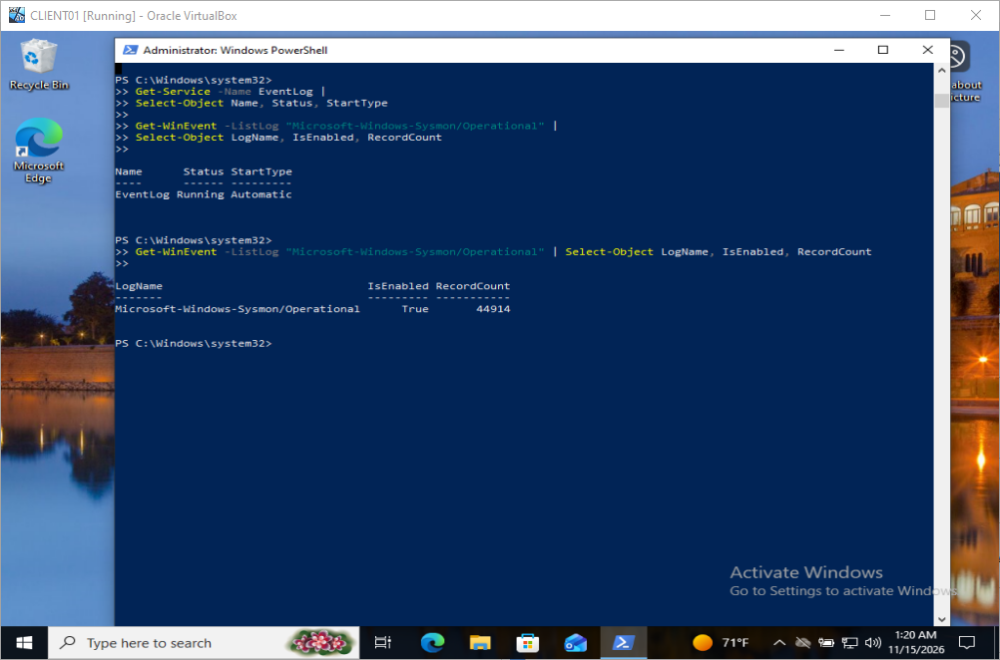](../screenshots/IR016-1-Windows-Sysmon-Baseline.png)

**Why it matters:** Establish available endpoint telemetry.

### Evidence 2 — Process ancestry

[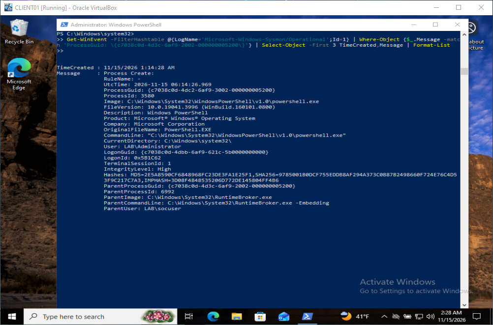](../screenshots/IR016-2-PowerShell-Parent-Process-Investigation.png)

**Why it matters:** Trace the launcher and execution context.

### Evidence 3 — Script-block logging

[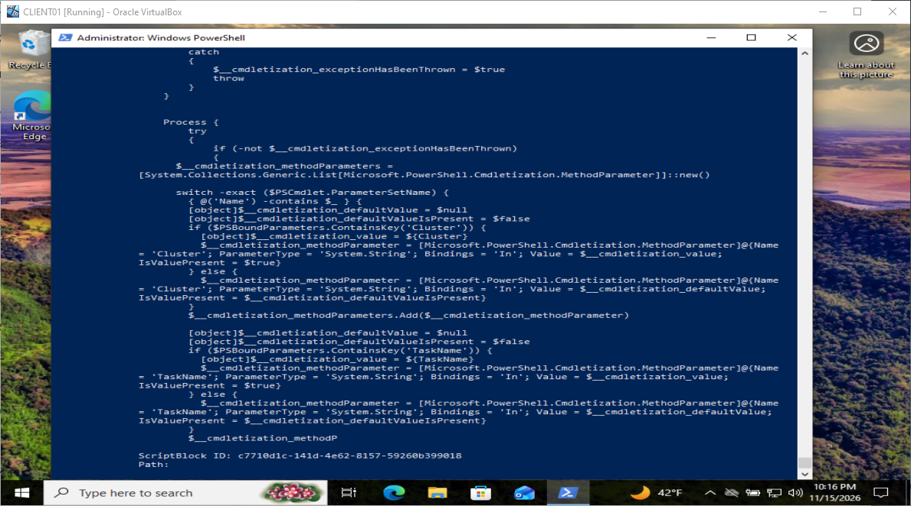](../screenshots/IR016-3-PowerShell-ScriptBlock-Logging.png)

**Why it matters:** Review historical PowerShell telemetry; not proof the specific simulation was captured.

### Evidence 4 — Detection triage

[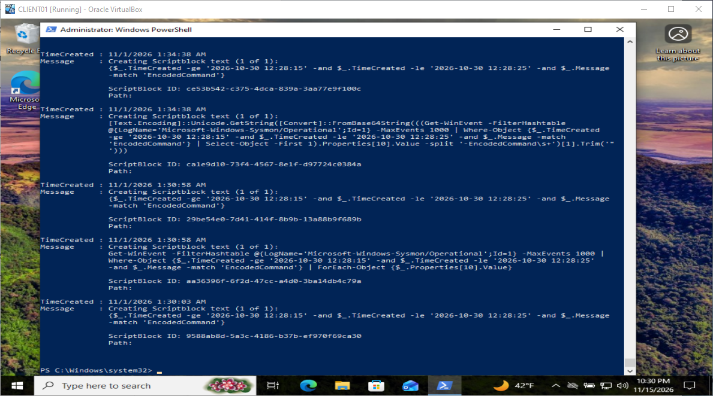](../screenshots/IR016-4-PowerShell-Detection-Triage.png)

**Why it matters:** Review suspicious execution indicators in context.

### Evidence 5 — Encoded PowerShell

[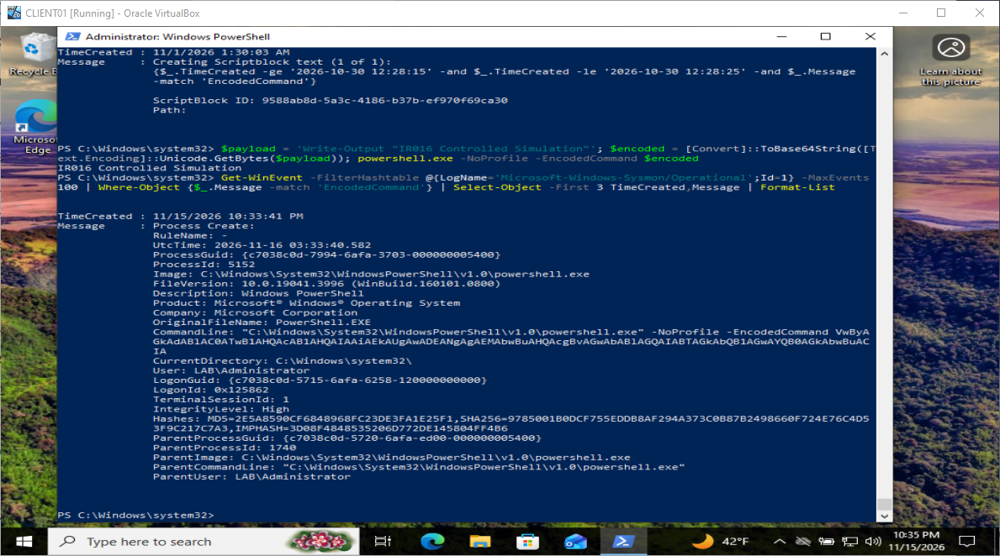](../screenshots/IR016-5-Encoded-PowerShell-Sysmon-Detection.png)

**Why it matters:** Process creation evidence for the controlled simulation.

### Evidence 6 — File execution

[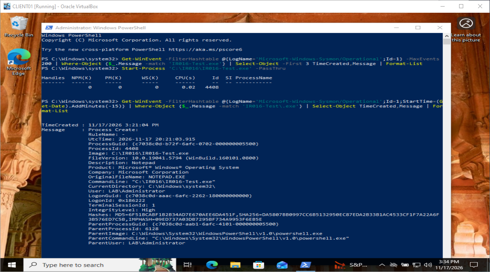](../screenshots/IR016-FIle-Execution-Detection.png)

**Why it matters:** Event 1 confirms the renamed test executable started.

### Evidence 7 — File creation

[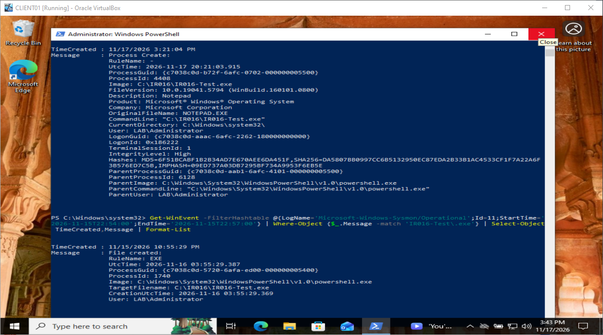](../screenshots/IR016-7-File-Creation-Correlation.png)

**Why it matters:** Event 11 records creation at the matching path.

### Evidence 8 — Hash comparison

[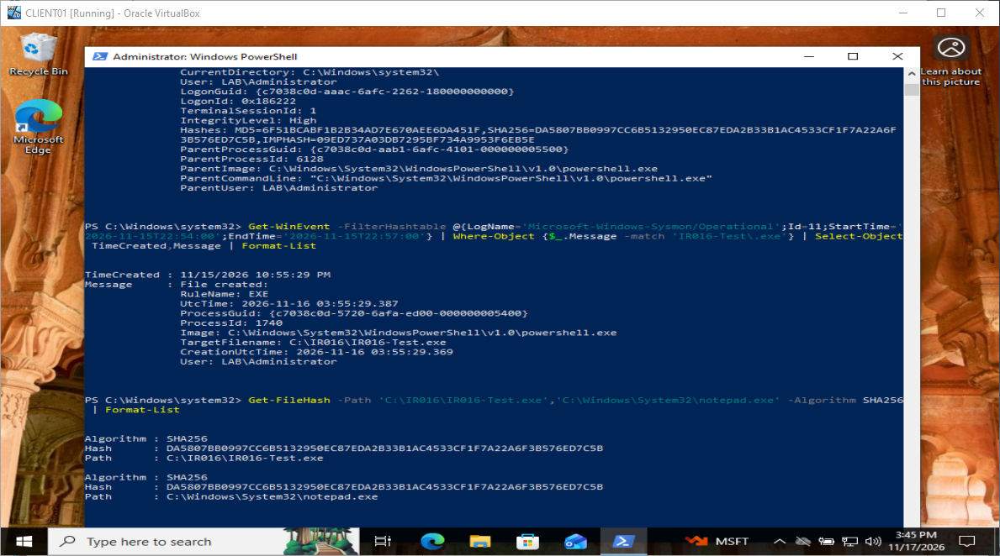](../screenshots/IR016-8-SHA256-Hash-Comparison.png)

**Why it matters:** Matching SHA-256 supports identical file contents at collection.

### Evidence 9 — Signature verification

[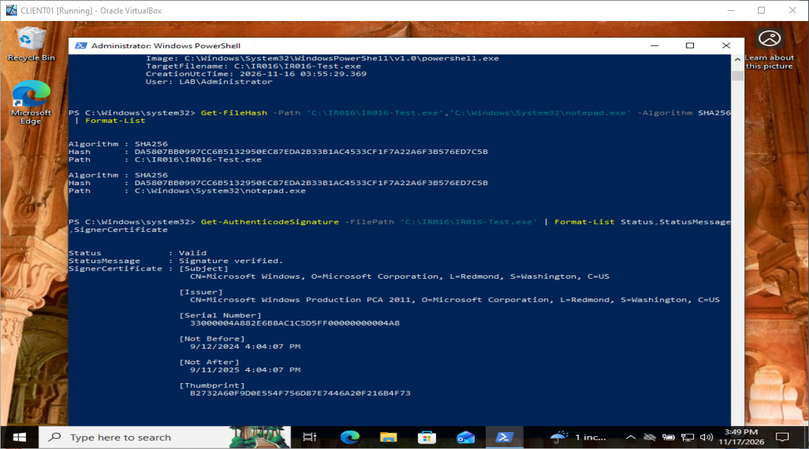](../screenshots/IR016-9-Digital-Signature-Verification.png)

**Why it matters:** Windows reported a valid Microsoft signature; this is not authorization.

### Evidence 10 — Incident timeline

[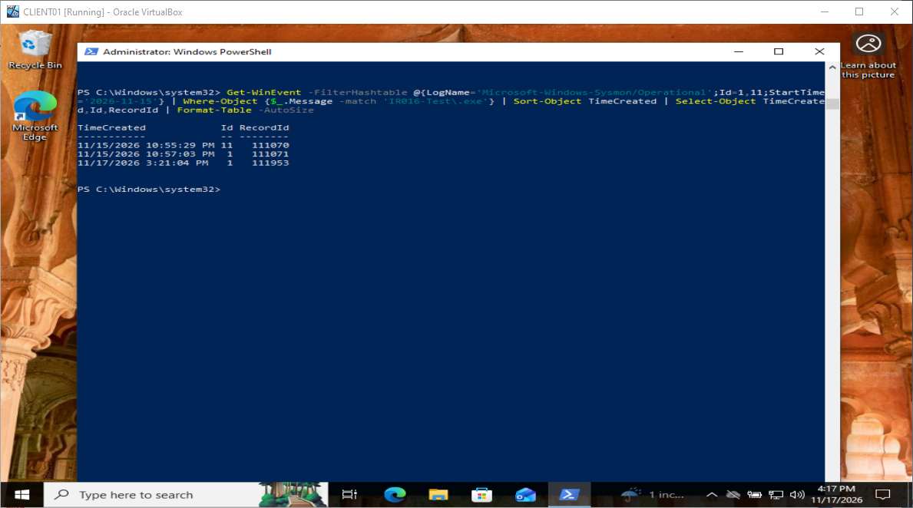](../screenshots/IR016-10-Incident-Timeline.png)

**Why it matters:** Chronological correlation of file creation and execution.

### Evidence 11 — Evidence export

[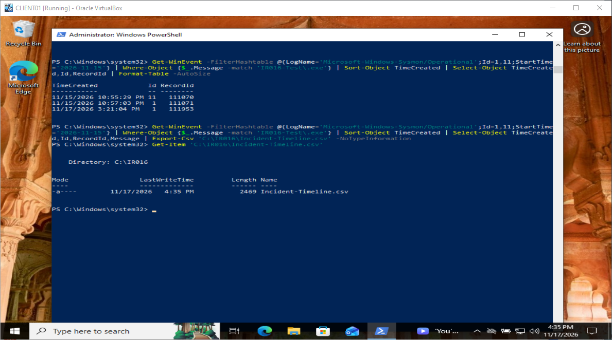](../screenshots/IR016-11-Evidence-Export.png)

**Why it matters:** Local CSV preservation and verification.

## Technical Summary & Key Takeaways

| Tool or event | Plain-English meaning |
| --- | --- |
| Sysmon 1 | Process creation |
| Sysmon 3 | Network connection, when configured |
| Sysmon 5 | Process termination |
| Sysmon 11 | File creation |
| PowerShell 4104 | Script-block content, when captured |
| Get-FileHash | File fingerprint |
| Get-AuthenticodeSignature | Signature status and signer |
| Export-Csv | Structured evidence export |

**Investigation workflow:** Identify execution, trace parent and user, inspect available script content, verify identity and integrity, examine behavior, establish authorization, then classify or escalate.

**Limitations:** This is a controlled lab, not a production detection-rate test. No missing telemetry was inferred to be proof of absence. The report summarizes the recorded lab findings; commands were not rerun during publication.
