# IR-017: Windows Malware Detection, Remediation and PowerShell Threat Hunting

## Project Overview — What This Investigation Demonstrates

**Security problem:** An antivirus alert or encoded command is a triage lead, not proof of a successful intrusion or complete containment.

**What I investigated:** Two separate authorized exercises on CLIENT01: Microsoft Defender detection of the harmless EICAR antivirus test file, and retrospective analysis of a benign encoded PowerShell process from IR-016.

**Result:** Defender reported successful quarantine of EICAR. The decoded PowerShell command was benign; a related temporary file creation was correlated by ProcessGuid. No matching network, termination or child-process records were recovered in the targeted searches. Evidence timelines were exported, re-imported and hashed across sessions.

**Skills demonstrated:** Endpoint triage, EDR/antivirus event interpretation, process and file correlation, static command decoding, ATT&CK research, evidence integrity, incident disposition and escalation judgment.

[Timeline](#incident-timeline) · [Reproducibility](#reproducibility) · [Visual evidence](#visual-evidence-and-analyst-interpretation) · [Detection and response](#detection-and-response)

## Executive Summary and Scope

Windows CLIENT01 in VirtualBox; native PowerShell, Microsoft Defender Operational and Sysmon Operational logs. No live malware was deployed. EICAR is a standardized harmless antivirus test artifact; Emotet was researched as a threat-intelligence example, not executed or identified on the endpoint. The two timelines are not a causal attack chain.

| Source | Event | Interpretation |
| --- | --- | --- |
| Defender Operational | 1116 | Threat detected |
| Defender Operational | 1117 | Protection action; inspect outcome |
| Sysmon Operational | 1 | Process creation |
| Sysmon Operational | 3 | Network connection when captured |
| Sysmon Operational | 5 | Process termination when captured |
| Sysmon Operational | 11 | File creation |
| PowerShell Operational | 4104 | Script block content when captured; not required for static decoding of a recorded command line |

## Incident Timeline

Endpoint displayed local times; selected Sysmon UTC fields corroborate a five-hour difference for the November 15 events. No cross-host clock validation performed.

| Local time | Source / ID | Record ID | Finding |
| --- | --- | --- | --- |
| Nov 15 2026 22:33:41 | Sysmon 1 | 111050 | PowerShell PID 5152, parent PowerShell PID 1740, LAB\\Administrator, high integrity, encoded command |
| Nov 15 2026 22:34:15 | Sysmon 11 | 111051 | Same ProcessGuid creates temporary __PSScriptPolicyTest file |
| Nov 17 2026 17:02:37 | Defender 1116 | 4776 | EICAR detection |
| Nov 17 2026 17:02:41 | Defender 1117 | 4777 | Quarantine action; successful outcome reported |

## Defender Investigation

The remediation record identifies Virus:DOS/EICAR_Test_File, threat ID 2147519003, vendor severity Severe, internet origin, downloads and attachments source, and affected location `C:\IR017\eicar.com`. Action: Quarantine; action status: no additional actions required; error code: 0x00000000. Detection-to-action interval was approximately four seconds based on displayed event times, not a measured enterprise response SLA. Process name was Unknown; execution is not established. The user reported two subsequent verification checks returned False. Exact test predicates are not reproduced from the available transcript; the Defender action record is the primary remediation evidence.

## PowerShell Investigation

The process GUID was `{c7038c0d-7994-6afa-3703-000000005400}`. Static decoding of the recorded Base64 UTF-16LE command returned:

```powershell
Write-Output "IR016 Controlled Simulation"
```

This is decoded text, not a command executed during this retrospective analysis. The same GUID appears in Event 11 approximately 34 seconds after the process creation record, under Administrator's local Temp directory with a __PSScriptPolicyTest filename. This naming is consistent with PowerShell policy testing; the file contents were not recovered or verified. The later directory search returned no matching file. No deletion event or exact deletion time was established. Targeted network, termination and child-process searches returned no matching records; general Event 3 and 5 samples demonstrate those event types exist but not that historical coverage was complete.

## Reproducibility

The following commands were observed during the lab (paths and read-only checks preserved):

```powershell
Get-ChildItem C:\IR017
Get-ChildItem C:\IR017\*.csv | Get-FileHash -Algorithm SHA256 | Format-List
Get-FileHash 'C:\IR017\PowerShell-Incident-Timeline.csv' -Algorithm SHA256
Import-Csv 'C:\IR017\Defender-Incident-Timeline.csv' | Where-Object {$_.Id -eq 1117} | Format-List
```

The following is a reference reconstruction of the investigation logic, not a verbatim transcript or independently rerun test. It uses structured XML event fields rather than localized Message substring matching:

```powershell
$log = 'Microsoft-Windows-Sysmon/Operational'
$guid = '{c7038c0d-7994-6afa-3703-000000005400}'
Get-WinEvent -FilterHashtable @{LogName=$log; Id=1,3,5,11; StartTime=[datetime]'2026-11-15'; EndTime=[datetime]'2026-11-19'} |
    Where-Object {
        $fields = ([xml]$_.ToXml()).Event.EventData.Data
        @($fields | Where-Object { $_.Name -in @('ProcessGuid','ParentProcessGuid') -and $_.'#text' -eq $guid }).Count -gt 0
    } | Sort-Object TimeCreated | Select-Object TimeCreated, Id, RecordId, Message
```

Static decoding reference (never invoke decoded content):

```powershell
$event = Get-WinEvent -LogName 'Microsoft-Windows-Sysmon/Operational' -FilterXPath "*[System[EventRecordID=111050]]"
if ($event.Message -match '-EncodedCommand\s+([A-Za-z0-9+/=]+)') {
    [System.Text.Encoding]::Unicode.GetString([Convert]::FromBase64String($Matches[1]))
}
```

The original lab queries and export steps are shown in the evidence images. Record IDs, GUIDs and timestamps are specific to this endpoint and are not portable detection constants.

## Evidence Preservation

| Local artifact | Size (bytes) | Records |
| --- | ---: | ---: |
| C:\IR017\Defender-Incident-Timeline.csv | 1929 | 2 |
| C:\IR017\PowerShell-Incident-Timeline.csv | 1705 | 2 |

SHA-256 was calculated on the exports and visually compared across subsequent sessions; both displayed digests matched. Re-import confirmed the four record IDs listed above. The repository contains screenshots, not independently acquired or verified CSV bytes or original EVTX files. Hash comparison supports unchanged bytes between observations, not authenticity of the source logs or complete chain of custody. In production, preserve original logs, collector identity, acquisition time, timezone, hashes and access history in restricted storage.

## Detection and Response

| Analytic candidate | Benign explanations | Escalation triggers |
| --- | --- | --- |
| Defender 1116 | Authorized EICAR test | Unknown authorization, repeated detections, failed or absent action |
| PowerShell process with encoded command flag | Administrative automation, controlled tests | Unexpected parent/user, suspicious decoded content, corroborating persistence or network behavior |
| PowerShell file creation in Temp | Policy-test files, temporary admin scripts | Unexpected executable/script contents, subsequent execution or persistence |

These are proposed triage criteria, not a deployed detection rule or quantified detection-rate evaluation. In production, establish scope, verify remediation, correlate file hashes/path and process GUID with endpoint and network telemetry, preserve evidence and escalate credible ongoing compromise for authorized containment. A successful quarantine alone does not prove endpoint-wide clearance.

ATT&CK reference: [T1059.001 PowerShell](https://attack.mitre.org/techniques/T1059/001/) describes a relevant interpreter behavior; encoding resembles [T1027](https://attack.mitre.org/techniques/T1027/) at a conceptual level, but malicious obfuscation intent is not established. [Emotet S0367](https://attack.mitre.org/software/S0367/) is research context only.

**Disposition:** Authorized benign exercises. EICAR detection and reported successful quarantine validated; encoded PowerShell content benign. No actual compromise established. No enterprise-wide containment, eradication or recovery claimed.

## Visual Evidence and Analyst Interpretation

### Evidence 1 — IR017 1 Defender Security Baseline.png

[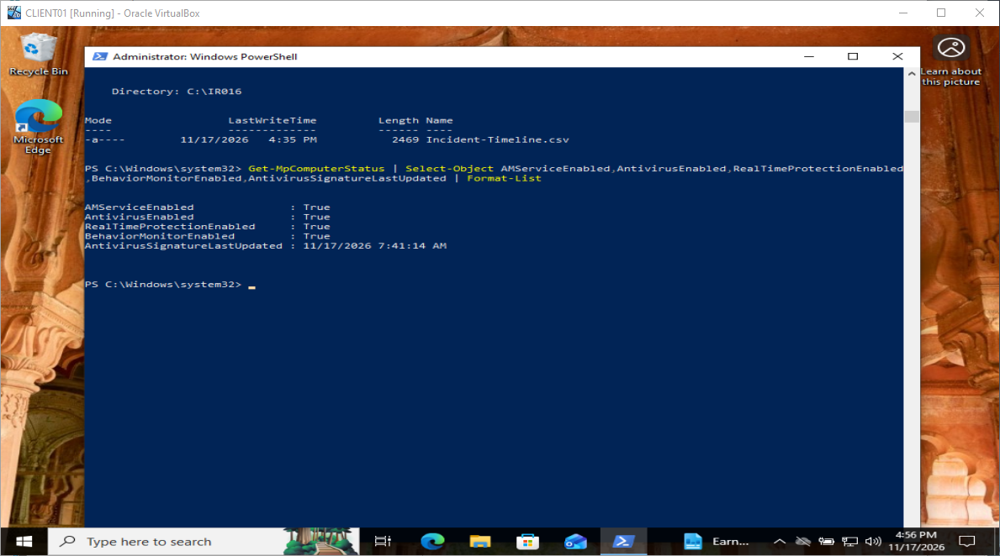](../screenshots/IR017-1-Defender-Security-Baseline.png)

**Analyst interpretation:** Defender baseline; establishes the control being evaluated, not proof of complete coverage.

### Evidence 2 — IR017 2 Malware Detection Alert.png

[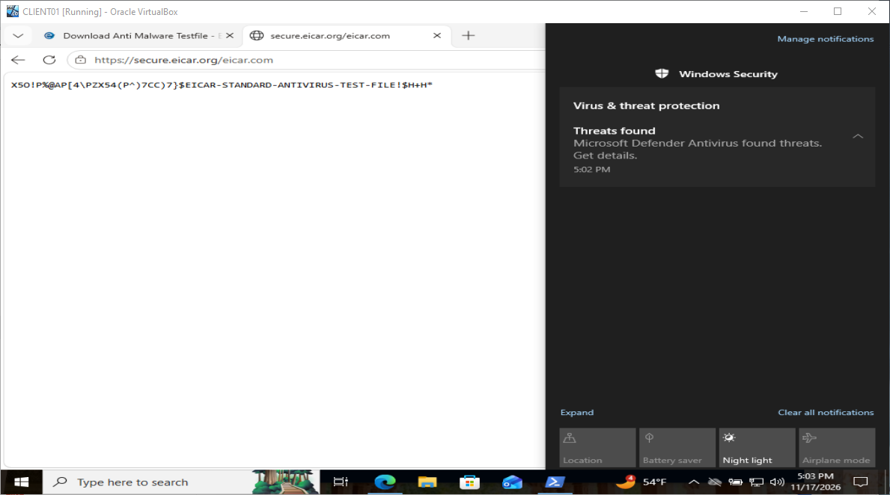](../screenshots/IR017-2-Malware-Detection-Alert.png)

**Analyst interpretation:** Detection alert; initial triage lead, not proof of execution.

### Evidence 3 — IR017 3 Defender Threat Detection Details.png

[](../screenshots/IR017-3-Defender-Threat-Detection-Details.png)

**Analyst interpretation:** Threat details; correlate detection name and affected path with the remediation record.

### Evidence 4 — IR017 4 Defender Threat Classification.png

[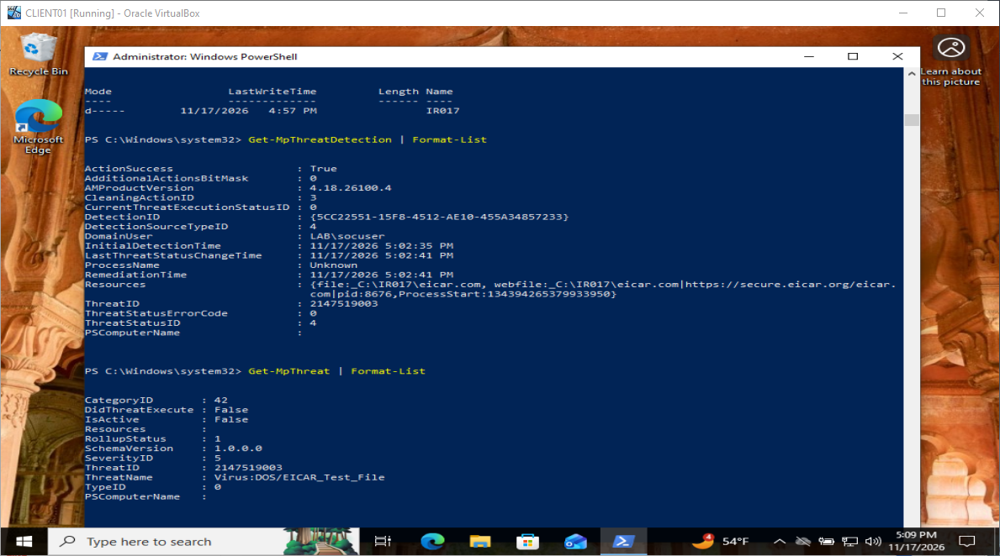](../screenshots/IR017-4-Defender-Threat-Classification.png)

**Analyst interpretation:** Threat classification; vendor severity is distinct from actual impact in a controlled test.

### Evidence 5 — IR017 5 Defender Detection Remediation Correlation.png

[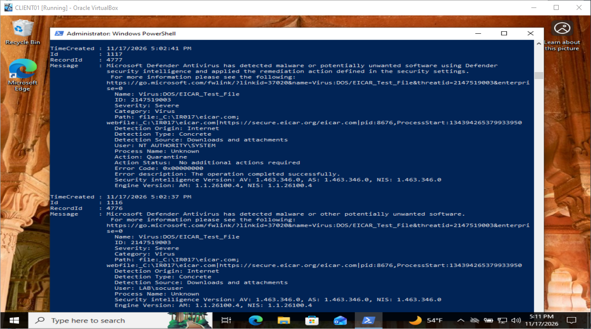](../screenshots/IR017-5-Defender-Detection-Remediation-Correlation.png)

**Analyst interpretation:** Detection and remediation correlation; compare event IDs 1116 and 1117 and their timestamps.

### Evidence 6 — IR017 6 Sysmon Telemetry Gap.png

[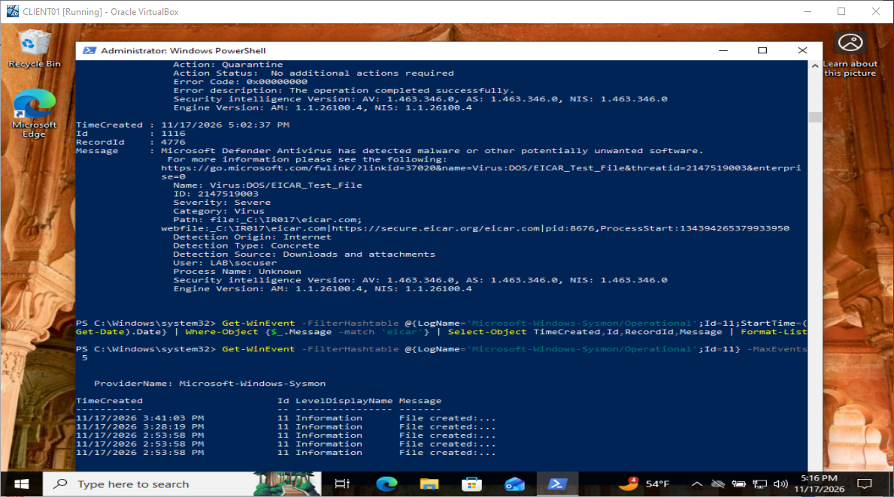](../screenshots/IR017-6-Sysmon-Telemetry-Gap.png)

**Analyst interpretation:** Telemetry gap; missing matching Sysmon records cannot establish absence of activity.

### Evidence 7 — IR017 7 Process Identity Correlation.png

[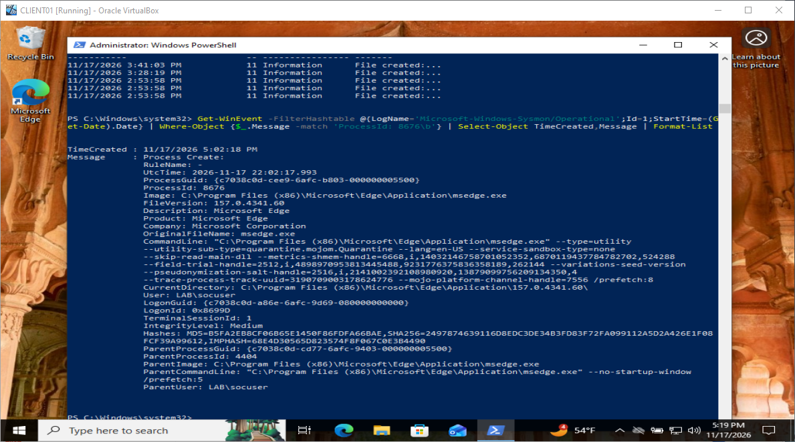](../screenshots/IR017-7-Process-Identity-Correlation.png)

**Analyst interpretation:** Process identity correlation; use process identity and time rather than assuming a PID uniquely identifies historical activity.

### Evidence 8 — IR017 8 Remediation Verification.png

[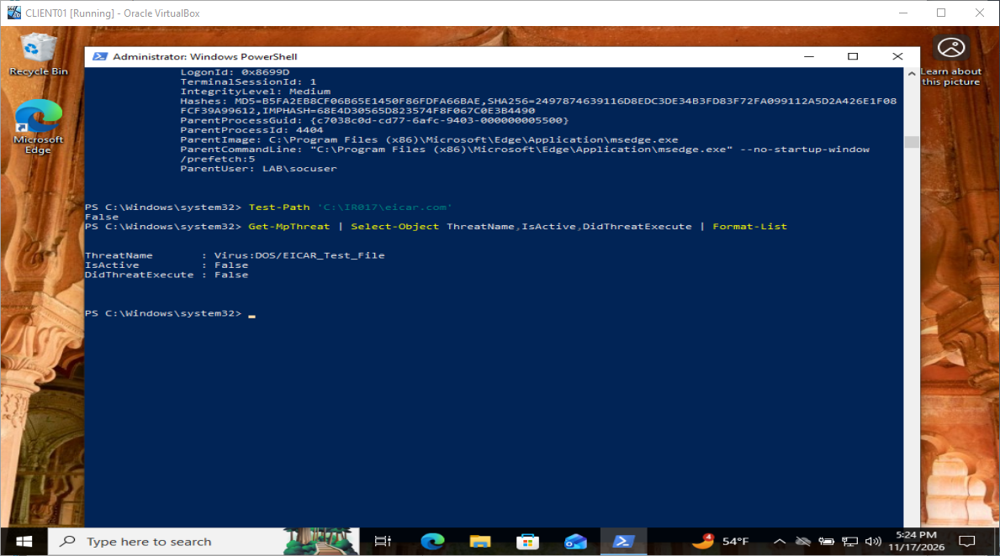](../screenshots/IR017-8-Remediation-Verification.png)

**Analyst interpretation:** Remediation verification; distinguish antivirus action from endpoint-wide clearance.

### Evidence 9 — IR017 9 Defender Evidence Export.png

[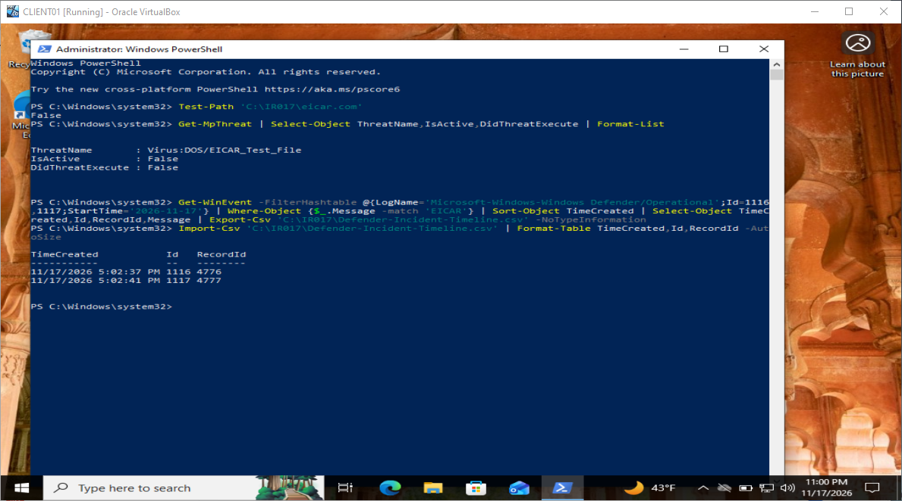](../screenshots/IR017-9-Defender-Evidence-Export.png)

**Analyst interpretation:** Defender evidence export; local derived timeline, not a full original EVTX acquisition.

### Evidence 10 — IR017 10 Evidence Integrity SHA256.png

[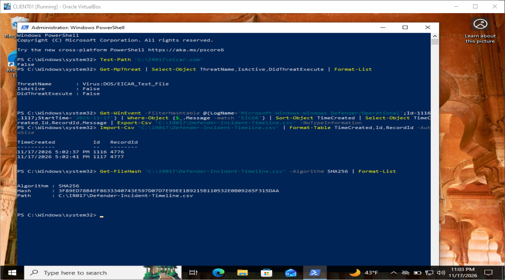](../screenshots/IR017-10-Evidence-Integrity-SHA256.png)

**Analyst interpretation:** Initial SHA-256 evidence baseline for the Defender export.

### Evidence 11 — IR017 11 Emotet MITRE Technique Mapping.png

[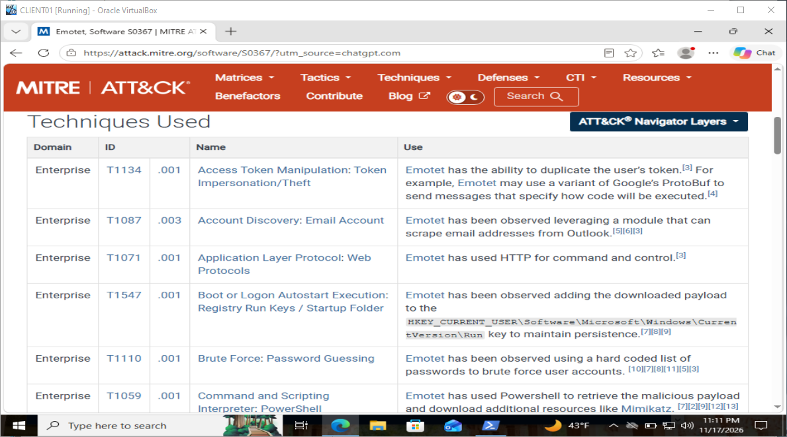](../screenshots/IR017-11-Emolet-MITRE-Technique-Mapping.png)

**Analyst interpretation:** Emotet research reference; behavioral context only, not an observed Emotet infection. Filename retains original upload spelling.

### Evidence 12 — IR017 12 Encoded PowerShell Threat Hunting.png

[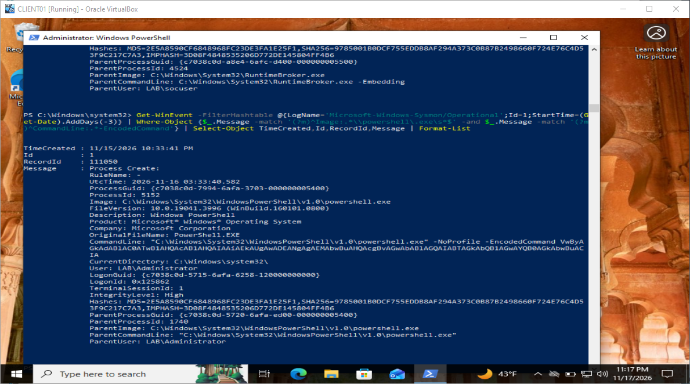](../screenshots/IR017-12-Encoded-PowerShell-Threat-Hunting.png)

**Analyst interpretation:** Encoded PowerShell process creation, record 111050, PID 5152.

### Evidence 13 — IR017 13 Decoded PowerShell Command.png

[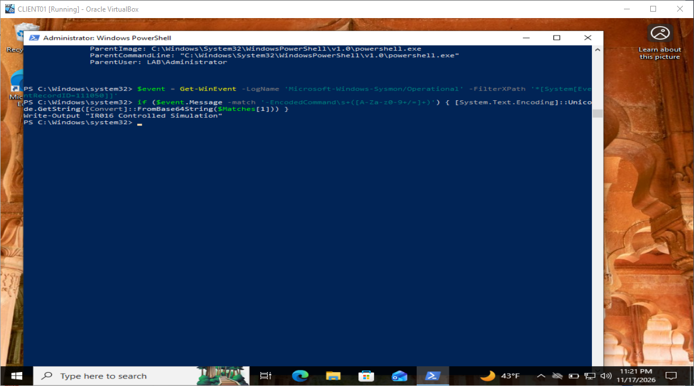](../screenshots/IR017-13-Decoded-PowerShell-Command.png)

**Analyst interpretation:** Decoded content is Write-Output "IR016 Controlled Simulation"; not a malicious payload.

### Evidence 14 — IR017 14 Network Telemetry Validation.png

[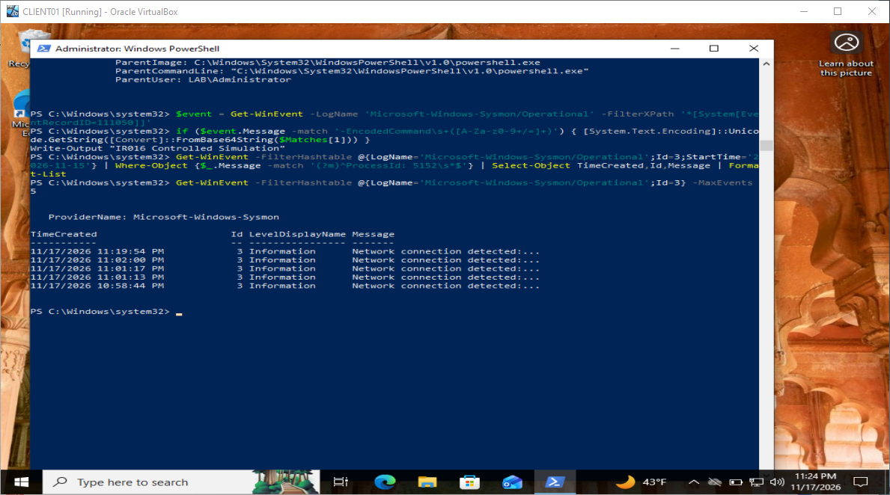](../screenshots/IR017-14-Network-Telemetry-Validation.png)

**Analyst interpretation:** Event 3 records exist generally; no matching network event recovered in the targeted search.

### Evidence 15 — IR017 15 Process Termination Telemetry Validation.png

[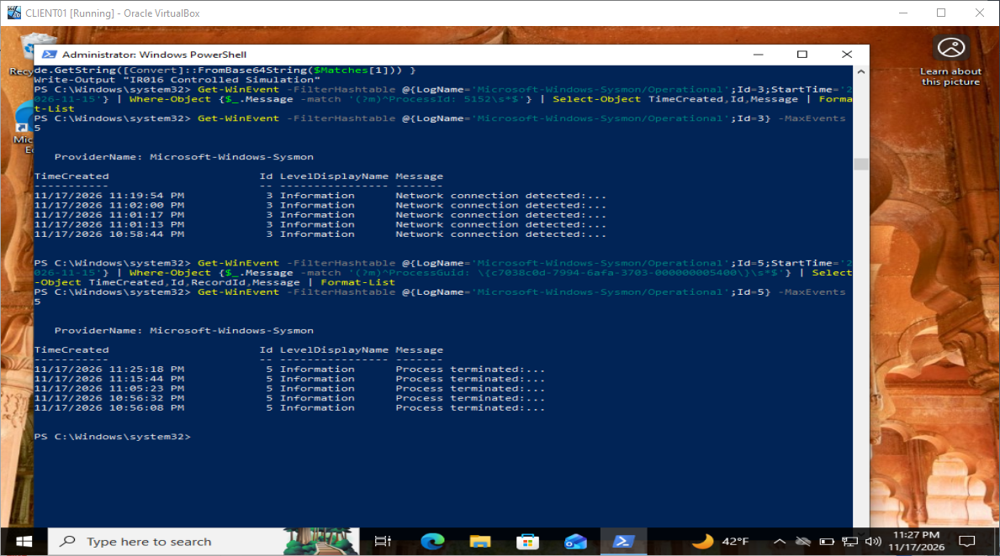](../screenshots/IR017-15-Process-Termination-Telemetry-Validation.png)

**Analyst interpretation:** Event 5 records exist generally; no matching termination event recovered for the target GUID.

### Evidence 16 — IR017 16 PowerShell File Creation Correlation.png

[](../screenshots/IR017-16-PowerShell-File-Creation-Correlation.png)

**Analyst interpretation:** Event 11 record 111051 links a temporary PowerShell policy-test file to the same GUID.

### Evidence 17 — IR017 17 PowerShell Incident Timeline.png

[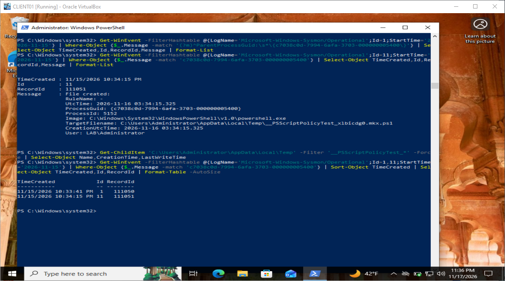](../screenshots/IR017-17-PowerShell-Incident-Timeline.png)

**Analyst interpretation:** Two-event PowerShell timeline; independent of Defender test.

### Evidence 18 — IR017 18 PowerShell Evidence Integrity.png

[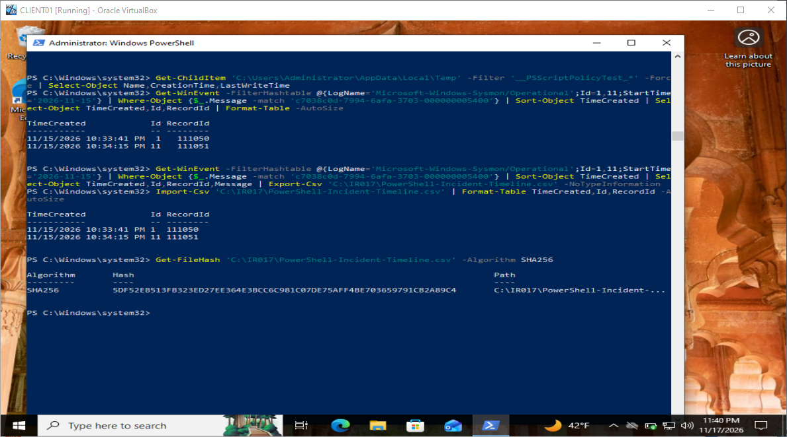](../screenshots/IR017-18-PowerShell-Evidence-Integrity.png)

**Analyst interpretation:** PowerShell CSV export, re-import and SHA-256 calculation.

### Evidence 19 — IR017 19 Post Reboot Evidence Integrity.png

[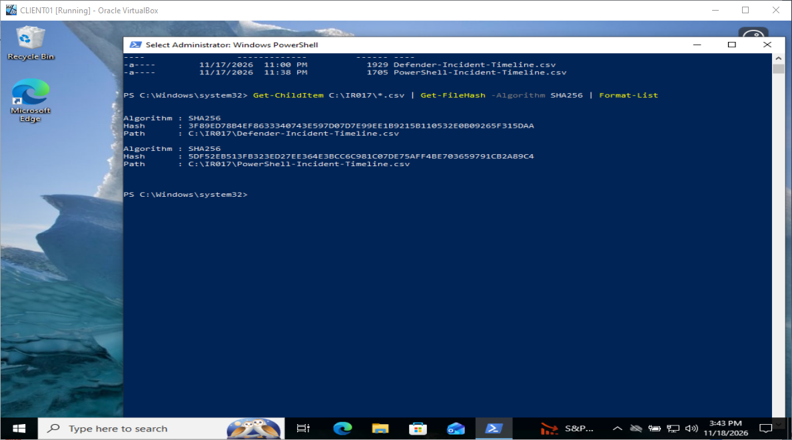](../screenshots/IR017-19-Post-Reboot-Evidence-Integrity.png)

**Analyst interpretation:** Both CSVs present and hashed in the subsequent session.

### Evidence 20 — IR017 20 Final Evidence Validation.png

[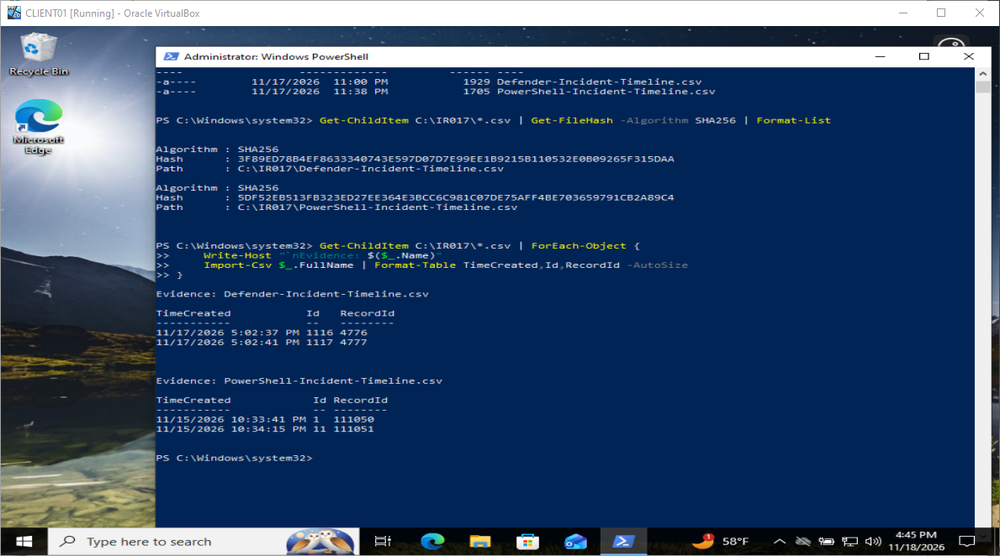](../screenshots/IR017-20-Final-Evidence-Validation.png)

**Analyst interpretation:** Both exported timelines re-imported; two records each.

### Evidence 21 — IR017 21 Defender Remediation Confirmation.png

[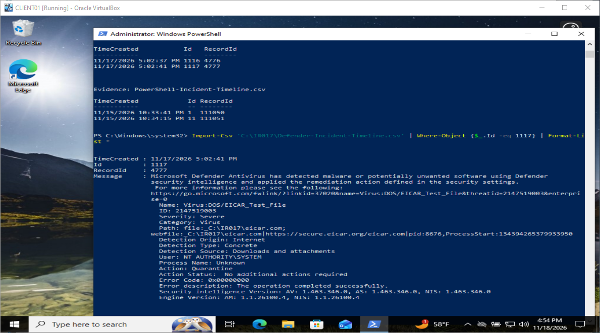](../screenshots/IR017-21-Defender-Remediation-Confirmation.png)

**Analyst interpretation:** Defender 1117 reports Quarantine, no additional actions required, error code 0x00000000.

### Evidence 22 — IR017 22 Post Remediation Verification.png

[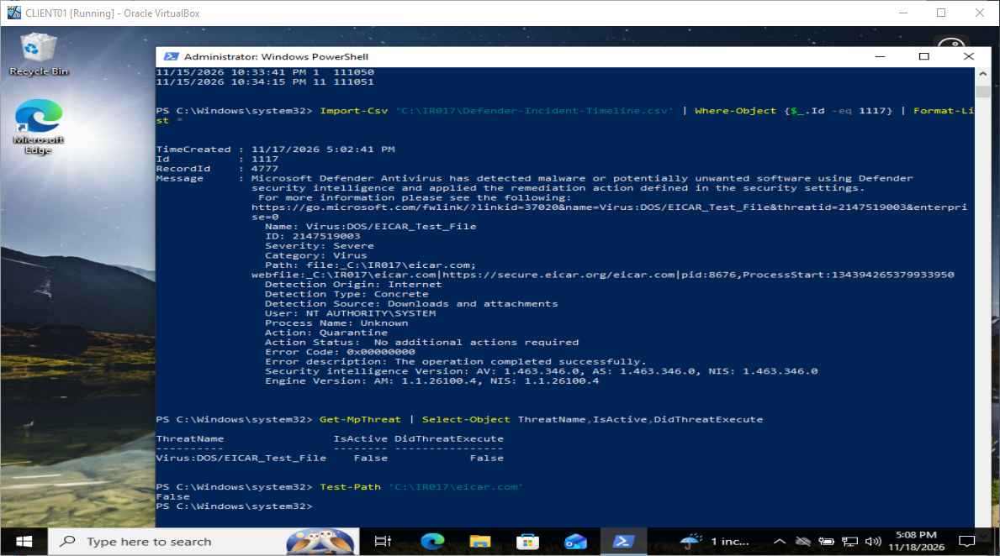](../screenshots/IR017-22-Post-Remediation-Verification.png)

**Analyst interpretation:** User reported both post-remediation checks returned False; exact predicates not independently transcribed here.

### Evidence 23 — IR017 23 Final Evidence Integrity Verification.png

[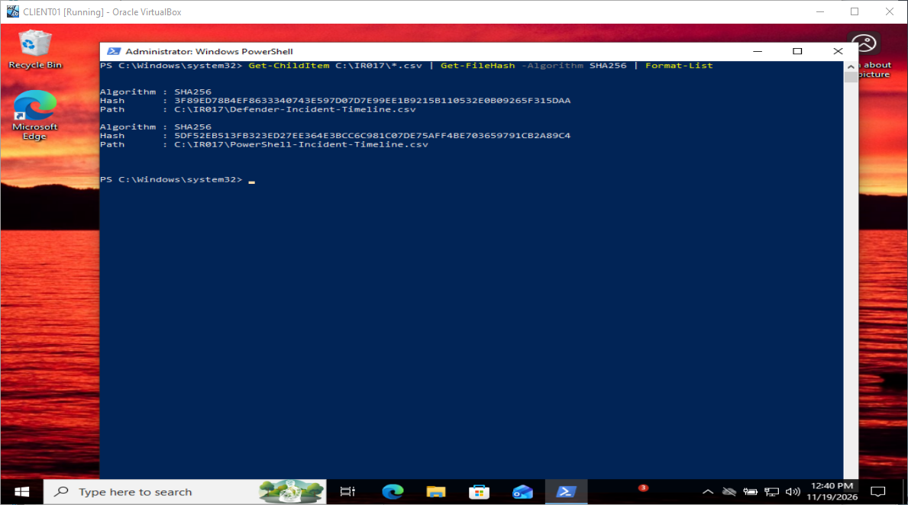](../screenshots/IR017-23-Final-Evidence-Integrity-Verification.png)

**Analyst interpretation:** Final hashes visually match prior-session values; supports unchanged exports.

## Limitations and Next Steps

Historical telemetry can be incomplete due to retention, event filters, time scope, or configuration changes. General event availability does not prove full capture for the specific process. Validate event coverage using controlled positive and negative tests before operational deployment; verify logging configuration and retention. No live Emotet, command-and-control, persistence, or ransomware was executed. The report documents the observed lab evidence and distinguishes recommended production actions from completed actions.
